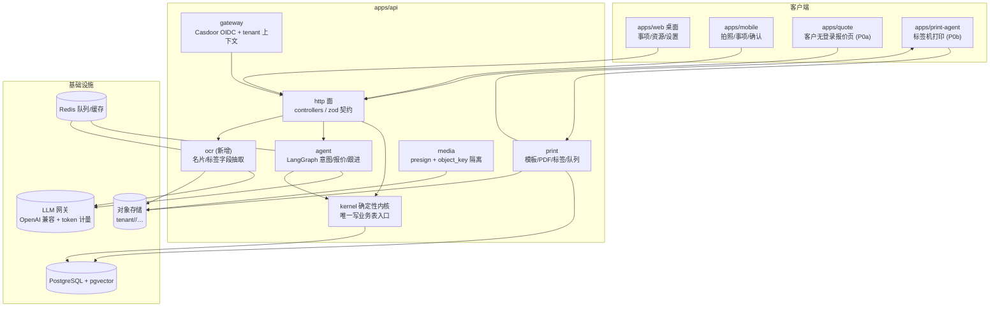
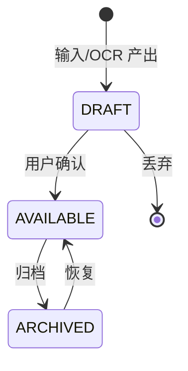
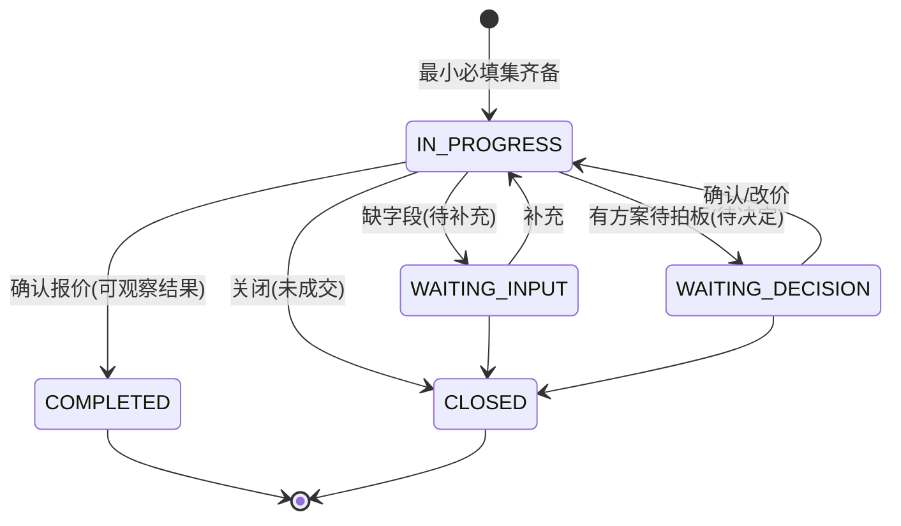
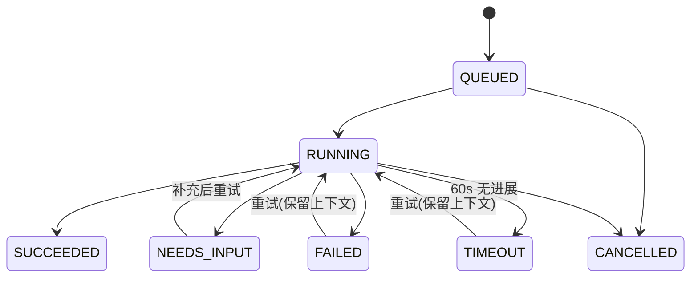
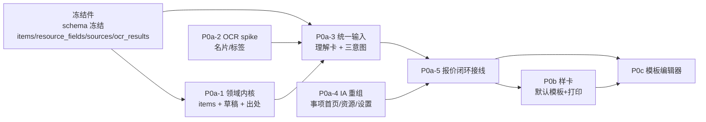

# AI 原生业务工作台 · 架构评估与设计

> 版本：v0.2 ｜ 日期：2026-11-20 ｜ 作者：鲁班（首席架构师）
> 评估对象：`docs/ai-native-workbench-requirements.html` v0.2 + `docs/ai-native-workbench-design-supplement.md` v0.2
> v0.2 变更：按创始人/产品设计已确认的 D1（取消报价审批）、D3（模板后置）、D4（事项/资源/设置）、D7（客户报价链接入 P0a）修订定稿；D9（存量迁移）保留选项。
> 用途：回答「P0a 能不能开工、还差什么」，给出可被工程直接拆成任务的架构设计。
> 边界：本轮只评估与设计，不实现业务代码。D1（取消报价审批）、D3（模板后置）、D4（事项/资源/设置）、D7（客户报价链接入 P0a）已由创始人/产品设计确认（2026-11-20），本文按此定稿；D9（存量迁移）仍未定，保留选项。

---

## 0. 结论先行

D1/D3/D4/D7 已确认，**P0a 可以开工，只剩两件「冻结件」**：

1. **冻结 schema**——`items`、`resource_fields`、`sources`、`ocr_results` 四张表 + `intents` 扩展 + capability 枚举 + `quoteShareEvents` 接受意向事件，在 `packages/schema` 落地。这是唯一必须串行的环节，冻结后其余切片可并行。
2. **OCR（名片/面料标签）spike**——最高的技术风险，不是「接个模型就行」。中文名片与面料标签的字段抽取准确率直接决定「零初始化报价成功率 ≥ 80%」能不能达标，必须先做一次性 spike（20 张真实名片 + 20 张面料标签）。

好消息是：**现有代码比设计稿以为的成熟得多**。报价内核、意图通道、打印流水线、分享链接、多租户隔离、审计幂等这些「P0 的新能力」其实大部分已经存在，P0a 的真实新工作量集中在「事项聚合根 + 资源草稿态 + 字段出处 + OCR + 信息架构重组 + 客户报价链接公开面」这六块，而不是从零搭报价。

---

## 1. 与现有代码的关系：复用 / 改造 / 新增 / 不动

先给一张精确到模块的地图，回答补充文档 §13.4 第 8 项，也回答本 issue 第 5 问。结论：**几乎没有东西要下线，大部分是「改造现有 + 新增一薄层」**。

| 现有模块 | 目录 | 结论 | 动作 |
| --- | --- | --- | --- |
| 报价内核 | `apps/api/src/kernel/quotes.service.ts`、`quote-pricing.service.ts`、`pricing.service.ts`、`pricing-scope.ts`、`price-rules.ts` | **复用** | 已含 baselineSnapshot、pendingDiff、provenance、审批角色、定价继承与管控夹取。P0a 的「依据/改价/diff/确认」直接复用，只加「确认即关闭审批」的策略开关 |
| 意图通道 | `apps/api/src/kernel/intents.service.ts`、`intent-state.ts`、`http/intents.controllers.ts`、`intent-executor.service.ts` | **改造** | 已含 clientRequestId 幂等、QUEUED→RUNNING→SUCCEEDED/NEEDS_INPUT/FAILED 状态机、60s 超时。需从「只面向报价」泛化为「统一输入」：支持多附件、理解卡、名片/建样/报价三类意图分派 |
| 报价智能体 | `apps/api/src/agent/quoting-graph.ts`、`quoting-state.ts` | **复用+改造** | LangGraph + PostgreSQL checkpointer，失败/重试/恢复已就绪。需接 OCR 产物作为槽位输入 |
| 客户/样品内核 | `kernel/customers.service.ts`、`samples.service.ts`、`customer-aggregates.ts` | **改造** | 现有客户/样品「直接 ACTIVE」，无草稿态、无字段出处。需加 draft 状态 + 字段级 provenance |
| 打印流水线 | `apps/api/src/print/*`、`apps/print-agent/*`、`packages/db/src/schema/print.ts` | **复用** | 已含 printTemplates/printTemplateVersions（变量白名单）、documentSnapshots（1:1 快照）、printJobs（幂等键）、printJobEvents、qr.ts、pdf.ts、labels.ts、template-engine。P0b/P0c 是「给它喂样卡模板」，不是重写 |
| 分享链接 | `apps/api/src/kernel/shares.service.ts`、`shares/`、`apps/quote/*`、`packages/db/src/schema/shares.ts` | **复用+改造** | 已含 tokenHash、expiresAt、revokedAt、事件回传。D7 已确认入 P0a，直接复用并补公开页水印、可选手机尾号验证、接受意向事件、租户级关闭开关 |
| 多租户 | `kernel/tenancy.service.ts`、`gateway/*`、`tenants`/`memberships` 表 | **复用** | 已含 SHARED_RLS / SCHEMA / DATABASE 三级隔离、actor/role/dataScope。P0 沿用 RLS |
| 媒体隔离 | `apps/api/src/media/media.service.ts` | **复用** | object_key 已按 `tenant/<id>/<scope>/<uuid>` 前缀隔离 + 服务端签发 presign。原件、样卡 PDF 直接沿用 |
| 审计 | `kernel/audit.ts`、`audit-log.service.ts` | **复用** | 已含 append-only 审计 + actor |
| 桌面 Web 三窗口 | `apps/web/app/(desktop)/today|approvals|panorama|settings|logs` | **改造** | 不删除，新增 `items`（事项）入口作为首页；today 合并为事项视图（最近/待我处理），approvals 不再展示（D1 取消审批），panorama 改为资源 |
| 移动端 | `apps/mobile/*` | **改造** | 已有相机按 mode、客户排序、样品图墙、报价单屏。P0a 加「名片/面料/标签」三模式 + 事项页 |
| 客户报价页 | `apps/quote/*` | **复用+改造** | 复用 `/s/[token]` 公开页（SSR、无登录）与 `quote_shares` tokenHash/expiresAt/revokedAt；D7 已确认入 P0a，补客户名水印、可选手机尾号验证、接受意向记录、租户级关闭开关 |

**没有要下线的模块**。旧三窗口与新 IA 是「同一套数据、两种导航视角」；唯一例外是 approvals 在 D1 取消审批后不再展示，但代码保留（通过路由映射 + 功能开关关闭），不是删除。

---

## 2. 上下文图与模块边界



**模块边界规则**（沿用现有铁律）：

- `kernel` 是唯一可写业务表的地方；HTTP、Agent、OCR 都通过 kernel 落库。
- `agent` 只调 `tools/`（Zod 校验的工具接口），不直接写表。
- `OCR` 是新增的无状态服务，只做「图 → 结构化字段」，不写业务库、不做去重决策；去重与确认交给 kernel。
- `print` 只读业务表（通过 documentSnapshots 白名单视图），渲染产物落对象存储。

---

## 3. 领域模型与状态机

### 3.1 对象职责与聚合边界

| 对象 | 面向谁 | 生命周期 | 是否聚合根 | 关键不变量 |
| --- | --- | --- | --- | --- |
| 输入记录 Inbound | 系统 | 短（一次提交） | 是（任务的前置） | 原件不可变；可关联多任务；幂等键 `tenant+clientRequestId` |
| 资源 Resource（客户/样品/联系人） | 用户 | 长（跨事项共享） | **独立聚合根** | 草稿可缺非关键字段；合并/覆盖留痕；归档不参与新建议 |
| 业务事项 Item | 用户 | 中（从发起到一个业务结果） | **聚合根** | 最小必填集（客户+样品+数量）齐备才创建；完成必有可观察业务结果 |
| 任务 Task | AI | 短（可重试） | 否（挂在事项/输入下） | 可补充/纠偏/取消/重试；重试不重复建资源/单据 |
| 单据 Document（报价/订单/发货/应收） | 财务/法务 | 长（定稿即锁定） | 否（挂在事项下） | 字段确定、权限明确、确认与变更有审计 |
| 原件 Source | 核对者 | 不可变 | 否（值对象） | object_key 不可变；字段出处指向它 |
| 模板 Template | 用户 | 长（版本化） | 是 | 已用版本不静默改写，只能新增版本 |
| 打印任务 PrintJob | 系统 | 短（可幂等重试） | 是 | 幂等键唯一；失败保留样卡 |

**核心判断：事项（Item）是聚合根，但它不「拥有」资源。** 客户、样品是独立聚合根，被事项通过 ID 引用。理由有三：

1. 资源是「资产不是配置」，生命周期独立于任何单一事项（一个客户可以被多个事项引用）。
2. 把资源塞进事项聚合，会导致「合并客户」变成跨事项的分布式事务；独立后合并只在资源聚合内部发生。
3. 与现有代码一致：`customers`/`samples` 已经是独立表 + 独立 service，`quotes` 通过 `customer_id`/`sample_id` 外键引用。新增事项不会破坏这一结构。

**事项与单据的关系**：事项「产出」单据（报价），单据是事项的可观察业务结果。P0a 里一个事项对应一到多份报价（改价→新版本→确认）。单据独立于事项存续，事项关闭后单据仍可读、可复打。

### 3.2 状态机

**资源（客户/样品）**



- 草稿态允许缺非关键字段；必填字段缺则停在「待补充」。
- 「可用」是参与报价/建议的前提；草稿不参与去重建议、不参与历史价取数。

**业务事项（Item）**



- 只有 `客户 + 样品 + 数量` 齐备才创建事项；创建前「先查再建」。
- `WAITING_INPUT`（缺信息）与 `WAITING_DECISION`（有方案要拍板）是两个不同的状态，视觉与文案分开（对应补充文档 §7.3）。

**任务（Task，含 OCR/LLM）**

沿用现有 `intents` 状态机并泛化：



**单据（报价）**

D1 已确认取消报价审批，P0 状态机只保留 `DRAFT → CONFIRMED`（确认即定稿）。`requiredApprovalRole` 字段保留在表里但 P0 不触发；不实现 `PENDING_APPROVAL` 分支、审批队列与审批卡。确认仍是权限动作（`quote.confirm` capability），并记录确认人审计。

---

## 4. 核心数据表（新增与改动）

> 只列「新增」和「有实质改动」的表；完全复用的表（quotes/quoteItems/print*/shares/pricing/audit 等）不重复。

### 4.1 新增：`items`（业务事项，聚合根）

```ts
items = pgTable("items", {
  id: uuid PK,
  tenantId: uuid notNull,
  status: itemStatusEnum,            // IN_PROGRESS | WAITING_INPUT | WAITING_DECISION | COMPLETED | CLOSED
  customerId: uuid ref customers,    // 引用，不拥有
  sampleId: uuid ref samples,
  quantityMilli: bigint,             // 千分之一单位，沿用现有精度约定
  unit: unitEnum,
  currentStage: varchar,             // 展示用「正在核对价格」
  nextAction: varchar,               // 展示用「确认最终价格」
  sourceIntentId: uuid ref intents,  // 从哪次输入长出来
  createdBy / createdAt / updatedAt,
}, (t) => [
  index(tenant, status, updatedAt),
  index(tenant, customerId),
  index(tenant, sampleId),
]);
```

**先查再建**：创建前在 kernel 内查「同 tenant 下同 customer+sample+quantity、且非终态」的事项，命中则提示「接续到已有事项」。这不是唯一约束（同一客户+样品+数量可以有先后多个事项），是「疑似重复」软提示。

### 4.2 新增：`resource_drafts` 或扩展 `customers`/`samples`

**建议方案：不动 `customers`/`samples` 主表结构，新增一张字段出处与草稿元数据表。** 理由：现有主表已被大量 service/迁移引用，加列是低风险，但「字段级 provenance + 待确认状态」是一张稀疏矩阵，塞主表会膨胀。

```ts
resource_fields = pgTable("resource_fields", {
  id: uuid PK,
  tenantId: uuid notNull,
  resourceType: enum('customer','contact','sample'),
  resourceId: uuid notNull,          // 逻辑外键
  fieldName: varchar,                // 'name'|'composition'|'weight'|...
  value: jsonb,                      // 候选值
  status: enum('CONFIRMED','PENDING','EDITED','CONFLICT'),
  sourceId: uuid,                    // 指向 source 原件
  sourceKind: enum('bizcard','label','history','manual','llm'),
  updatedBy / updatedAt,
}, (t) => [
  uniqueIndex(tenant, resourceType, resourceId, fieldName),
  index(tenant, resourceType, status),
]);
```

资源主表再加一列 `status`（`DRAFT | AVAILABLE | ARCHIVED`）。样品现有 `sampleStatusEnum` 是 `ACTIVE|ARCHIVED`，客户没有状态列——需要统一补 `DRAFT` 态。

### 4.3 新增：`sources`（原件，值对象）

```ts
sources = pgTable("sources", {
  id: uuid PK,
  tenantId: uuid notNull,
  kind: enum('IMAGE','PDF','TEXT'),
  objectKey: varchar,                // 图片/PDF 走 media，文本存原文
  textContent: text,                 // 文本原话
  mimeType / byteSize,
  createdAt,                          // 不可变
});
```

### 4.4 新增：`ocr_results`（OCR 缓存与重试）

```ts
ocr_results = pgTable("ocr_results", {
  id: uuid PK,
  tenantId: uuid notNull,
  sourceId: uuid ref sources,
  engine: varchar,                   // 模型/版本，便于回放
  raw: jsonb,                        // 原始识别结果
  fields: jsonb,                     // 抽取出的结构化字段
  status: enum('PENDING','SUCCEEDED','FAILED'),
  failureCode: varchar,              // 不是自由文本
  attempts / createdAt / updatedAt,
}, (t) => [index(tenant, status), index(sourceId)]);
```

### 4.5 改造：`intents` → 统一输入

`intents` 表已具备幂等键、状态机、context、result。改造点：

- `source` 枚举从 `today|command-bar|customer-360` 扩展 `mobile-camera|upload`（或保留 + 新增）。
- 新增 `attachments: uuid[]`（指向 sources），支持「多图分组假设」。
- `result` 从只存 `IntentDraft`（报价）泛化为 `UnifiedUnderstanding`（区分「这是报价/建样/建档」）。
- 新增「理解卡」快照字段：`understanding`（模型对输入的解读，供用户确认/纠正）。

---

## 5. 核心 API 契约

沿用现有「Zod 在 `packages/schema` 是唯一契约来源」的约定。以下列关键端点（HTTP 面），契约在 schema 层冻结。

### 5.1 统一输入

```
POST /inbound            # 提交统一输入（文本/图片/PDF，多附件，带 clientRequestId）
  → 202 { inboundId, understanding: { kind, summary, slots, pendingQuestions } }
GET  /inbound/:id        # 轮询理解与任务进度（现有 intent 轮询的泛化）
POST /inbound/:id/start  # 用户在「理解卡」上确认 → 触发建档/建样/报价任务
POST /inbound/:id/revise # 纠正理解（改槽位），再出发
```

### 5.2 资源草稿

```
POST /customers/draft   # 从名片 OCR 建客户草稿（幂等键 = sourceId）
POST /samples/draft     # 从面料/标签 OCR 建样品草稿
GET  /customers/:id/fields   # 字段出处矩阵（value + status + source）
PATCH /customers/:id/fields  # 逐字段确认/修改/解决冲突
POST /customers/:id/confirm  # 草稿 → 可用
POST /customers/:id/merge    # 合并（影响预览 + 确认 + 撤销窗口）
```

### 5.3 事项

```
GET  /items?status=&cursor=     # 最近事项 / 待我处理 / 已完成
GET  /items/:id                 # 事项详情（画布 + 工作面聚合读）
POST /items                     # 先查再建（内部查重，命中返回已有事项）
POST /items/:id/complete        # 完成（必须有可观察业务结果，kernel 校验）
```

### 5.4 报价

```
POST /items/:id/quotes          # 在事项内发起报价（走现有 quote agent）
GET  /quotes/:id/basis          # 依据抽屉（历史成交/成本/毛利/来源单据）
POST /quotes/:id/revise         # 改价（diff，保留 baselineSnapshot）
POST /quotes/:id/confirm        # 确认（幂等键；D1 已取消审批，确认即 CONFIRMED，记录确认人审计）
GET  /quotes/:id/copy-text      # 复制文本（编号/客户/样品/数量/单价/合计/有效期）
```

### 5.5 模板与打印（P0b/P0c）

```
GET  /print/templates           # 模板列表（含默认样卡模板）
POST /print/templates           # P0c：复制默认模板为草稿
POST /print/templates/:id/versions   # 发布新版本（变量白名单校验）
POST /print/preview             # 真实数据 1:1 预览（返回渲染产物）
POST /print/jobs                # 发起打印（幂等键 = 单据+模板版本+份数+操作人）
GET  /print/jobs/:id            # 打印状态 / 补打入口
```

### 5.6 客户报价链接（P0a，D7 已确认）

```
POST /quotes/:id/shares          # 生成客户链接（有效期/是否允许接受意向/是否尾号验证）
  → { token(仅返回一次), url, expiresAt }
GET  /s/:token                   # 公开页（无登录，apps/quote 渲染，SSR）
POST /s/:token/accept            # 接受意向（幂等，记录事件，不建订单）
POST /s/:token/message           # 留言
POST /quotes/:id/shares/:sid/revoke  # 撤回（业务员）
GET  /quotes/:id/shares          # 链接状态与客户动作（查看/接受/留言）
```

- token 高熵随机，服务端只存哈希（沿用 `quote_shares.tokenHash`）；链接不可枚举，不把价格/客户名写进 URL。
- 过期/撤回立即失效，显示统一说明不泄露报价内容；支持按租户关闭，关闭后已生成链接立即失效。
- 接受意向写入 `quoteShareEvents`（新增 `ACCEPTED` 事件），业务员可见「已表达接受意向，尚未下单」，不自动创建订单。

---

## 6. 多租户、权限、审计、幂等

### 6.1 多租户

**沿用现有 RLS 方案，不引入新隔离层。** 现有 `isolationMode`（SHARED_RLS/SCHEMA/DATABASE）已经覆盖「单人大租户」到「需要物理隔离」的全谱。P0 试点全部走 `SHARED_RLS`；发现单租户数据量或合规要求再升 SCHEMA/DATABASE，不需要改业务代码（隔离模式是租户属性）。

文件隔离沿用 object_key 前缀 `tenant/<tenantId>/<scope>/<uuid>` + 服务端签发 presign，客户端拿不到桶与写权限。打印 PDF 与 OCR 原件都走这套，天然按租户隔离。

### 6.2 权限

沿用现有 `memberRole + dataScope + actor.type` 模型，新增三个 capability（对应 §13.2 Q11）：

| capability | 含义 | 默认角色 |
| --- | --- | --- |
| `quote.confirm` | 可确认最终价格 | 老板/主管；销售需授权 |
| `resource.merge` | 可合并客户/样品 | 老板；合并是不可逆动作 |
| `print.execute` | 可发起打印/补打 | 全员（打印本身低风险） |

D1 已确认取消报价审批：`quote.confirm` 是角色授权动作，确认即定稿并记录确认人审计。`requiredApprovalRole` 字段保留但 P0 不触发；未来若需要监督，做确认后提醒或报表，不恢复阻塞式审批。这样「确认权限」与「审计」都保留，只是去掉了「必须上级批准」这一步。

### 6.3 审计

沿用现有 append-only `auditLog`。以下动作强制留痕：确认报价、合并/覆盖资源、打印、权限变更、草稿→可用。确认事件记录 `actor.type + actor.id + 时间 + 变更前后`。

### 6.4 幂等

沿用现有 `clientRequestId` 模式（intents 已示范）扩展到三类动作：

- **提交输入**：`intents.tenant + clientRequestId` 唯一索引（已有）。
- **确认报价**：`confirm` 带幂等键，kernel 校验「已 CONFIRMED 则直接返回现有结果，不重复写」。
- **打印任务**：`printJobs.tenant + idempotencyKey` 唯一索引（已有），补打不会重复建样。

**确认事件是否用「事件表 + 当前状态投影」？** 现有代码用「乐观锁 version + audit append-only + baselineSnapshot」已经达到同样效果，且更简单。结论：**不引入新的 event-sourcing 框架**，沿用现有「状态列是投影 + 审计是事件」的模式；需要「事件重放」的只有打印回执（`printJobEvents` 已具备）。这符合 KISS 与「一人可维护」原则。

---

## 7. 异步任务、OCR、LLM、打印的失败与补偿

### 7.1 编排与队列

- **意图/报价**：LangGraph.js + PostgreSQL checkpointer（已有），天然支持跨进程恢复、重试、超时。不做独立的 BullMQ 队列——现状用 LangGraph 状态机 + `intents` 表已足够，加队列是过度设计。
- **OCR**：新增无状态服务，经 Redis 做「背压 + 去重」，结果落 `ocr_results`；失败可重试、可降级到「逐字段人工录入」（这是 OCR 不确定性的兜底，见 §8 风险）。
- **打印**：现有 `printJobs` 队列 + `printJobEvents` 回执，幂等键已防重复。

### 7.2 失败与补偿矩阵

| 环节 | 失败表现 | 保留什么 | 补偿 |
| --- | --- | --- | --- |
| 意图理解 | 模型超时/报错 | 原话、附件、已识别槽位 | 从 checkpoint 重试，不重新描述背景 |
| OCR | 识别不清/图片模糊 | 原件、已识字段、未识字段列表 | 逐字段人工修正；不虚构完成 |
| 报价草稿 | 定价缺失/币种不一致 | 客户、样品、数量、已算行 | NEEDS_INPUT 停在待补充，补后继续 |
| 确认 | 并发/重复点击 | 幂等键 | 返回已有结果，不重复写 |
| 打印 | 打印机离线/缺纸 | 样卡与样品、失败原因 | 幂等重试；不重复建样 |

**统一原则**（对应补充文档 §6.7）：所有失败保留输入、原件、已确认字段与用户补充；重试从等待点继续；「模型成功」不等于「业务完成」——完成只能由业务结果（确认报价、打印成功）判定。

---

## 8. 关键技术风险（按严重度排序）

1. **OCR 名片/面料标签准确率（高风险，P0a 成败关键）**。中文名片公司/职务/电话抽取、面料标签的成分/克重/门幅/批号抽取，真实准确率波动大。**开工前必须先做一个一次性 spike**：拿 20 张真实名片 + 20 张面料标签测，达不到「关键字段 ≥ 90% 且失败可逐字段修正」就调整验收口径。**兜底方案已内置**：OCR 失败走「逐字段人工录入」，不影响闭环成立，但影响「零初始化成功率」指标。
2. **字段出处（provenance）改造的历史包袱（中风险）**。给 `customers`/`samples` 加草稿态 + 字段出处矩阵，是一次 schema 迁移 + UI 重做，涉及现有客户/样品列表、图墙、报价引用。要一次性冻结 `resource_fields` 契约，避免各端各自发明。
3. **事项聚合根与旧「聊天式报价」的并行期（中风险）**。旧 intents→quote 流与新 items 流会并存一段。必须明确「新输入默认进事项流」，旧报价只读，否则出现两套报价入口。
4. **信息架构重组的体验回退（低风险，但影响口碑）**。把 today/approvals/panorama 换成 items/资源/设置，存量用户有迁移成本。用「别名路由 + 灰度开关」平滑过渡（见 §9）。
5. **模板 1:1 与浏览器打印边距（低风险，P0b）**。浏览器打印边距不可控，热敏标签机尤其如此。P0b 明确「PDF/A4 + 80×50mm 标签 + 打印前实际扫码验证」，不承诺浏览器直打热敏，把直连放打印代理（P1）。
6. **客户报价链接的公开面安全（中风险，P0a 新增）**。无登录公开页是新的信任边界：token 泄露、链接被转发给非客户、接受意向被滥用、隐私泄露。P0a 用「高熵 token 只存哈希 + 有效期 + 撤回 + 客户名水印 + 可选尾号验证 + 频率限制 + 租户级关闭开关」兑底，但需要把「链接被转发给非客户」这一现实风险写进验收，接受意向只能作为线索，不能作为下单依据。

---

## 9. 存量数据迁移与灰度/回滚

### 9.1 迁移策略（对应 §13.2 Q10，采纳补充文档 §11 增量模型）

**结论：增量模型，不重写存量，不批量回填。** 现有客户/样品直接映射为「可用资源」（加 `status=AVAILABLE`，无需草稿）。存量报价保留原视图，打开时可选「转为事项」生成历史事项包装，不回溯改写。

| 存量对象 | 映射 | 动作 |
| --- | --- | --- |
| 客户/联系人 | 资源（AVAILABLE） | 直接映射，保留原 ID；不自动合并重复 |
| 样品 | 资源（AVAILABLE） | 直接映射，原编号保留 |
| 报价 | 单据 | 保留原记录，不回溯；可选转事项 |
| 订单/发货/应收 | 单据 | 只读关联，P0a 不迁移 |

### 9.2 灰度与回滚

1. **影子读**：新 items 界面先读存量数据，不写入。
2. **租户级开关**：`新事项流` 作为 tenant capability 按租户开启，试点租户先行，其他租户保持旧界面。
3. **别名路由**：`/today` → 重定向到 `/items?filter=recent`，`/panorama` → `/resources`，`/approvals` → 可选复核入口，保证旧书签不 404。
4. **回滚**：关闭租户开关即回旧界面；新数据保留不删除，旧界面可继续读。

**迁移脚本**：只需一条「给客户/样品补 `status` 默认值」的数据迁移（把现有行标为 AVAILABLE），不写复杂的字段回填。

---

## 10. 对补充文档 §13.2 十二个问题的逐条回答

1. **业务事项/任务/单据/资源如何建模？事项是否聚合根？** 见 §3.1。事项是聚合根，但资源（客户/样品）是独立聚合根，事项通过 ID 引用资源而非拥有。
2. **先查再建唯一性放哪层？去重键是什么？** 物理唯一约束放 DB（客户 `(tenant, normalized_phone/email)` 部分唯一索引、样品无强键走向量+规则）；业务去重（「疑似重复」）放 kernel 查询层，命中只软提示不阻塞；确认/合并/覆盖放 kernel 写入口。事项去重键是 `(tenant, customerId, sampleId, quantity) + 非终态`，是软提示不是唯一约束。
3. **确认事件幂等与审计？事件表+投影？** 幂等用 clientRequestId 模式；审计用现有 append-only auditLog；**不引入事件溯源**，沿用「状态列投影 + 审计事件」，仅打印回执保留事件流水（已有）。
4. **多租户 RLS 还是按域拆分？原件/打印隔离？** 沿用 RLS（SHARED_RLS 默认，可按租户升 SCHEMA/DATABASE）。原件/打印文件用 object_key `tenant/<id>/…` 前缀 + 服务端 presign 隔离。
5. **OCR/意图失败重试？独立队列+补偿？** LangGraph + PG checkpointer 承载意图/报价重试；OCR 走 Redis 背压 + `ocr_results` 状态表，失败降级人工逐字段。**不加独立队列框架**。
6. **报价依据从哪取？缓存/实时取舍？** 历史成交价实时查 quotes 表（有索引，数据量小无需缓存）；成本从 samples.costFloorAmount + pricingPolicies；毛利在 `quote-pricing.service` 实时算。P0 不做缓存，试点数据量撑得住。
7. **模板渲染服务端还是客户端？PDF/标签 1:1？** 服务端渲染（现有 pdf.ts/template-engine），字段白名单（现有 documentSnapshots）；1:1 靠固定物理尺寸 + 真实数据预览 + 打印前扫码验证。
8. **二维码与客户报价链接 token 如何生成/存储/鉴权/过期/撤回？接受意向如何记录？** 复用 quoteShares 的 tokenHash（服务端只存哈希）+ expiresAt + revokedAt + quoteShareEvents（事件回传）。客户报价链接新增：客户名水印、可选手机尾号验证、接受意向事件（`quoteShareEvents` 加 ACCEPTED 事件，不自动下单）。样卡二维码沿用 orderBoxes QR「不含商业信息」原则，未登录只显示样品编号 + 联系业务员。
9. **移动端离线队列与冲突合并？** `packages/core` 已有离线队列；拍照先入本地队列，恢复后按时间序提交；冲突显示两版让用户选（补充文档 §6.7 已定，沿用）。
10. **存量映射？迁移脚本+双读期？** 见 §9。一条「补 status 默认值」迁移 + 租户级影子读灰度，不需要大批量回填。
11. **权限如何表达确认/合并/打印？** 见 §6.2，新增 `quote.confirm`/`resource.merge`/`print.execute` 三个 capability，沿用 role+dataScope+actor。
12. **P0a/P0b/P0c 依赖与可并行边界？工作量级？** 见 §11。

---

## 11. P0a/P0b/P0c 的依赖、风险、工作量级与可并行边界

> 工作量级用「单人周」表达，是量级判断不是排期承诺（补充文档要求「不给出没有依据的精确日期」）。基础：现有代码成熟度高，报价/打印/分享/多租户已就绪，不是从零。

### 11.1 依赖与并行



- P0b 与 P0c 可并行，但都依赖 P0a 的事项/样品对象稳定。
- P0c 不应早于 P0b 的真实打印反馈（阶段门 G2）。
- OCR spike（P0a-2）与领域内核（P0a-1）可并行，是 P0a 内部唯一的「可提前并行」切片。

### 11.2 工作量级

| 切片 | 单人周（量级） | 主要风险 | 主要新工作 vs 复用 |
| --- | --- | --- | --- |
| 冻结件（schema 冻结） | 0.5–1 | 契约冻结质量决定并行效率 | 纯设计，无代码 |
| P0a 报价闭环 | 6–8 | OCR 准确率（§8）+ 公开链接安全（§8） | 事项聚合根（新）+ 资源草稿/出处（新）+ OCR（新）+ IA 重组（改）+ 客户报价链接公开面（改）；报价内核/意图/agent/审计/分享复用 |
| P0b 实体样卡 | 1.5–2 | 浏览器打印边距 | 样卡模板 + 二维码（薄层新增）；print 流水线全复用 |
| P0c 模板自定义 | 2–3 | 编辑器 + 字段绑定 + 版本 | 编辑器 UI（新）；printTemplates 版本/变量白名单复用 |
| P0d 试点收敛 | 1 | 埋点口径 | 埋点 + 复盘，无新功能 |

**注意**：补充文档 v0.2 把 P0a 定为 4–5 周（2×2 + 客户链接 1 周），我的判断是 **6–8 单人周**。差异来自两部分：一是「事项聚合根 + 资源草稿 + 字段出处 + IA 重组」是全新领域层；二是客户报价链接入 P0a 后新增了公开面安全（水印、尾号验证、接受意向、滥用防护），不只是「复用 quote_shares 加个页面」。报价内核确实复用，但「一事贯穿」的数据模型与「对外公开面」都是从零建的。

### 11.3 开工建议（本 issue 要回答的核心）

**P0a 可以开工，D1/D3/D4/D7 已不再阻塞，只剩两件冻结件：**

1. **冻结 schema**（架构师，0.5–1 周）：`items`、`resource_fields`、`sources`、`ocr_results` 四张表 + `intents` 扩展 + 三个 capability + `quoteShareEvents` 接受意向事件，在 `packages/schema` 落地，作为并行开工契约。
2. **OCR spike**（工程，0.5 周，可与 schema 并行）：拿真实名片/标签样本测准确率，定「关键字段 ≥ 90% 或降级人工录入」的口径，避免把验收建立在未验证的 OCR 上。

**必须先砍 / 延后的**：

- 模板编辑器（P0c）**不要在 P0a 同期做**，等 P0b 的真实打印反馈（阶段门 G2 会决定它降级还是继续）。
- 受控标签治理、批量合并、库存、完整「今天」**全部留在 P1**，不进入 P0a。
- 客户报价链接只做「单条链接 + 接受意向」，**不做客户账号体系、不做客户历史报价门户**（P1）。

**明确的技术结论**：打印代理在 P0a/P0b **不是必要的**（P0b 走浏览器打印/PDF），P1 再上；`apps/quote` 复用 `/s/[token]` 公开页并补安全措施，`apps/print-agent` 不改造、不下线。

---

## 12. 已确认决策与技术落点

> D1/D3/D4/D7 已由创始人/产品设计确认（2026-11-20），本节记录「决策 → 技术落点」，不再是选项对比。D9 仍未定，保留选项。

| 决策 | 定稿结论 | 技术落点 |
| --- | --- | --- |
| **D1 取消报价审批** | P0 状态机只保留 `DRAFT → CONFIRMED`；不实现审批队列/审批卡/PENDING_APPROVAL | `quote_status` 去掉审批分支；`requiredApprovalRole` 字段保留但不触发；`quote.confirm` 保留角色权限 + 确认人审计；不写审批策略、不写审批队列 |
| **D3 模板后置** | P0b 只用系统默认模板，P0c 才做自定义 | P0b 复用现有 `printTemplates` 塞入默认样卡模板；编辑器/字段绑定/版本/试打 UI 全部留到 P0c，不在 P0a/P0b 动工 |
| **D4 信息架构** | 采用「事项 / 资源 / 设置」，事项是首页 | 新增 `items` 首页路由；`/today` 合并为事项视图（最近/待我处理），`/approvals` 不再展示（路由映射 + 功能开关关闭），`/panorama` 改为资源；items 聚合根 + 别名路由是确定方案 |
| **D7 客户报价链接入 P0a** | 无登录链接纳入 P0a，手动分享不自动发送，接受是意向不是下单 | 复用 `quote_shares`（tokenHash/expiresAt/revokedAt）+ `apps/quote` `/s/[token]` 公开页；新增水印、可选手机尾号验证、接受意向事件、租户级关闭开关（见 §5.6、§8） |
| **D9 存量迁移** | 仍未定 | 保留 §9 的「增量模型 vs 全量回填」两个选项与工作量差异，等创始人拍板 |

**落地要求**：D1/D3/D4/D7 已定，工程可据此拆 P0a 任务。D9 未定，迁移脚本先按「增量模型 + 租户级灰度」实现（该路径是全量回填的超集，先做不返工），等拍板后再决定是否补全量回填。

---

## 13. 一句话

现有代码比设计稿假设的成熟得多，报价/打印/分享/多租户/审计大部分已经就绪；P0a 的真实新工作是「事项聚合根 + 资源草稿态 + 字段出处 + OCR + 信息架构重组 + 客户报价链接公开面」。D1/D3/D4/D7 已确认，**冻结 schema、spike OCR，P0a 就能开工且可被工程直接拆成任务。** 别把模板编辑器（P0c）提前塞进 P0a；客户报价链接已入 P0a，按「单条链接 + 接受意向」最小范围做。
