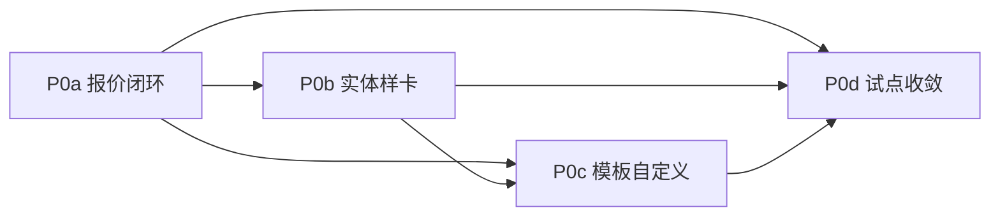

# AI 原生业务工作台 · 设计补充与 P0 迭代计划

> 版本：v0.1 ｜ 日期：2026-11-20 ｜ 作者：巧匠（产品设计 & 增长）
> 补充对象：`docs/ai-native-workbench-requirements.html` v0.2
> 用途：把需求评审稿补成可评审、可排期、可交给架构师评估的设计输入。本文不替代需求稿；二者冲突时，以本文 §2「决策记录」中标注为「建议裁决」的条目作为讨论基线；标注为「待拍板」的条目在确认前不得当作已定决策。

---

## 0. 怎么读这份文档

需求稿回答「产品要是什么」，本文回答「先做什么、界面怎么组织、状态怎么表达、怎么验收、哪些需要架构拍板」。

| 读者 | 建议先读 |
| --- | --- |
| 创始人 / 产品负责人 | §1 结论、§2 决策记录、§3 迭代计划、§14 待拍板 |
| 架构师 | §2、§3、§11 迁移、§13 架构评估输入 |
| 设计与前端 | §4 范围、§5 信息架构、§6 交互规范、§7 状态文案、§8 组件 |
| 项目协调 | §3、§14、§15 |

---

## 1. 结论

需求稿的产品判断成立，但 P0 需要拆成三个可独立交付的切片，否则无法在一个版本内验证核心假设，也无法给出可信排期。

本文的建议是：

1. **P0a 报价闭环**：名片/面料输入 → 客户与样品草稿 → 业务事项 → 报价依据、改价、确认、复制。这是唯一必须先成立的闭环。
2. **P0b 实体样卡**：默认模板、二维码、真实数据预览、浏览器打印/PDF 兜底、补打。验证「数字样品是否需要回到物理世界」。
3. **P0c 模板自定义**：可视化编辑、字段绑定、应用范围、版本、试打。验证「模板差异是不是采纳瓶颈」。

打印仍然可以留在 P0 的大版本里，但**自定义模板编辑器不能和报价闭环同一个迭代交付**。先把 P0a 做扎实，再决定 P0b/P0c 的投入比例。

---

## 2. 决策记录与替代关系

需求稿 v0.2 与现有文档、现有代码存在直接冲突。以下不是新增需求，而是必须由创始人或架构师裁决的「哪份文件说了算」。

| # | 主题 | 需求稿 v0.2 | 既有文档 / 代码 | 建议裁决 | 状态 |
| --- | --- | --- | --- | --- | --- |
| D1 | 报价审批 | P0 取消审批与特批，用户确认并负责 | `product-design.md` v1.8 把报价审批作为 P0 核心；`development-plan.md` Track A 为「草稿→改价→审批→confirm」 | P0 默认不启用阻塞式审批；保留「确认权限」和「按金额/毛利/客户触发复核」的策略钩子。多人公司可开启复核，但不阻断报价生成 | **待拍板** |
| D2 | 打印阶段 | P0 包含实体样卡与打印 | `development-plan.md` 把打印放在 P1 Track G；`apps/print-agent` 已存在 | 拆为 P0b：默认模板 + 浏览器打印/PDF + 补打；打印代理、更多纸型、箱唛等放 P1 | **待架构评估** |
| D3 | 模板自定义 | P0 支持用户自定义模板 | `product-design.md` 把模板工作室放在 P1/P2 | 拆为 P0c，排在 P0a 与 P0b 之后；P0b 只用系统默认模板 | **待拍板** |
| D4 | 信息架构 | 中间业务画布 + 右侧工作面 | `product-design.md` 的「3 + 1」：工作台 / 审批 / 全景 / 设置；代码已有 `today`、`approvals`、`panorama` | 以「事项」为中心重组：事项（首页）/ 资源 / 设置；旧「工作台」映射为事项列表，「全景」映射为资源，「审批」降级为可选的复核入口 | **待拍板** |
| D5 | 今天 | P1 的聚合视图 | 代码已有 `apps/web/app/(desktop)/today`，旧设计把今日作为 P0 首页 | P0a 提供最小「最近事项 / 待我处理」，不做完整「今天」聚合；完整今天放 P1 | **建议采纳** |
| D6 | 移动端 | 一段话：画布与全屏任务页切换 | `product-design.md` 的 5 入口 + 角色化首页 | P0 只做「拍照/上传 + 事项页 + 确认」；5 入口与角色化首页放 P1 | **建议采纳** |
| D7 | 客户报价链接 | 未提；P0 只承诺复制文本 | `product-design.md` v1.8 已把客户无登录报价页放入 P0，代码已有 `apps/quote`、`quote_shares` | 必须明确：客户链接算不算「对外发送」。建议 P0a 只做复制文本，链接作为租户开关放 P1；若保留，需同步隐私、有效期、撤回与水印规则 | **待拍板** |
| D8 | 标签体系 | P0 要求受控标签、别名、合并、批量归类 | 未见对应标签管理界面 | P0a 只保留 3–5 个建议标签 + 接受/忽略；别名、合并、治理放 P1 | **建议采纳** |
| D9 | 存量数据 | 未提 | 已有客户、样品、报价、订单 | 采用增量模型，不重写存量；老单据保留原视图，新增「转为事项」动作；试点租户可不做全量回填 | **待架构评估** |
| D10 | 多租户与权限 | 仅一行「信任边界」 | `product-design.md` §3、§15 有 RLS、角色、数据范围、审计 | 沿用既有结论，不在本稿重复设计；本文只补界面上的权限表达 | **沿用** |
| D11 | 计费与套餐 | 未提 | `product-design.md` §14 席位 + 动作计费 | 不在本 P0 范围；仅要求动作事件可计量 | **沿用** |
| D12 | 外部渠道 | P0 不接，统一输入约定 | 现有「说点什么」输入 | 一致；P0a 只做粘贴文本、上传图片/文件，不承诺微信/企微直连 | **沿用** |

**落地要求**：D1、D3、D4、D7 未拍板前，工程不应按任何一版开始大规模实现。建议在 P0a 开工前用一页决策记录确认这四项。

---

## 3. P0 切片与迭代计划

> 时间是规划假设，不是承诺；由架构师评估后按实际人力调整。

### 3.1 切片总表

| 切片 | 时间盒 | 目标 | 主要交付 | 明确不做 | 退出标准 |
| --- | --- | --- | --- | --- | --- |
| **P0a 报价闭环** | 4 周（2 × 2 周） | 零初始化也能产出可信、可复制的报价 | 统一输入、名片建档、面料建样、业务事项、报价草稿/依据/改价/确认/复制、跟进文本 | 打印、模板编辑器、标签治理、客户链接、自动发送 | 5 个真实用户、20 个真实案例；零初始化报价成功率 ≥ 80%；首次报价中位耗时 ≤ 10 分钟；平均字段修正 ≤ 3；阻塞式提问 ≤ 1 次/旅程 |
| **P0b 实体样卡** | 2 周 | 样品资源能落到实物，且能补打 | 默认模板、二维码、真实数据预览、浏览器打印/PDF、打印记录、补打 | 自定义模板、打印代理、多纸型、扫码后的库存/寄样入口 | 3 台打印机 × 2 种纸通过；打印成功率 ≥ 95%；补打可在 1 分钟内完成 |
| **P0c 模板自定义** | 2–3 周 | 客户专用模板可自助配置 | 可视化编辑、字段绑定、应用范围优先级、版本、试打 | 旧单据智能识别（P1）、批量模板导入 | 3 个客户专用模板由用户自己完成，无需支持介入 |
| **P0d 试点收敛** | 1 周 | 用真实数据修正判断 | 埋点核对、漏斗复盘、问题清单、下一阶段范围 | 新功能 | 形成 P0a 的保留/修改/删除清单 |

### 3.2 依赖关系



P0b 与 P0c 可并行，但都依赖 P0a 的事项与样品对象稳定。P0c 不应早于 P0b 的真实打印反馈。

### 3.3 阶段门

- **G1（P0a 结束）**：用户能否在无人指导下，从一张名片和两张照片走到确认报价？如果不能，停止加打印，先修闭环。
- **G2（P0b 结束）**：真实建样中，有多大比例需要打印？低于 30% 时，P0c 降级为 P2，不投入模板编辑器。
- **G3（P0c 结束）**：模板差异是否仍是采纳障碍？如果用户只用默认模板，停止模板产品化。

---

## 4. P0a 范围与 FR 映射

| FR | P0a 做什么 | 延后 |
| --- | --- | --- |
| FR-01 统一输入 | 粘贴文本、上传 1–3 张图片、上传 PDF/图片文件；生成统一输入记录；给出「我理解为」卡片；明确「新建事项 / 补充当前」；上下文以可移除标签带入 | 语音、微信/企微直连、邮件、批量导入 |
| FR-02 客户建档 | 名片识别公司/联系人/职务/电话/邮箱；最小字段；重复检测用非阻塞提示；字段出处；逐字段修改 | 批量合并、自然语言维护、客户 360 完整视图 |
| FR-03 面料建样 | 实物图 + 标签图分组假设；成分/克重/门幅/颜色/批号/供应商货号提取；内部样品编号；3–5 个建议标签；原件与规格来源分开 | 标签别名/合并/治理、以图搜样、库存与库位 |
| FR-04 业务事项 | 客户、样品、数量为最小必填集；先查再建；事项头部显示「现在怎样 / 下一步」；待补充与待决定分离；失败重试保留上下文 | 后台多任务、完整今天、跨角色工作视图 |
| FR-05 报价 | 解析客户/样品/数量；展示上次成交价、成本、毛利风险；修改并显示 diff；确认最终价格；复制报价文本 | 审批、特批、客户链接、PDF 报价单、完整版本对比（P0 保留原始建议、修改记录与确认版本） |
| FR-06 实体样卡 | 不在 P0a | P0b |
| FR-07 模板 | 不在 P0a | P0c |
| FR-08 跟进 | 生成可复制跟进文本；复制不等于已发送 | 自动发送、渠道回执、定时提醒 |

### 4.1 P0a 最小对象集

- 输入记录：来源、原件、文本、附件、上下文、提交人、时间。
- 资源草稿：客户、联系人、样品。
- 业务事项：客户、样品、数量、状态、当前阶段、下一步。
- 任务：类型、状态、输入、输出、失败原因、重试次数。
- 报价：行项目、单价、金额、依据、风险、确认人、确认时间、版本。
- 跟进文本：所属事项、生成依据、复制记录。

### 4.2 P0a 不做的事

- 不做审批流，不做价格特批，不做多级确认。
- 不做自动对外发送，不做客户链接（除非 D7 拍板保留）。
- 不做打印，不做模板编辑器，不做二维码。
- 不做标签治理，不做批量合并，不做库存。
- 不做完整「今天」，不做角色化首页。

---

## 5. 信息架构与布局

### 5.1 原则

1. **事项是首页，不是聊天窗口**。用户打开产品先看到「我在跟的事」，不是一段无限消息流。
2. **资源是资产，不是配置**。客户、样品、模板从工作中长出来，但仍需要可检索的归属地。
3. **输入是全局动作**。任何页面都能发起新输入；当前事项内输入默认是补充，用户可显式切换。
4. **决定必须浮出来**。「待补充」和「待决定」不能埋在任务日志里。

### 5.2 IA 树

```
事项（首页）
├── 最近事项
├── 待我处理（待补充 / 待决定 / 异常）
├── 已完成
└── 事项详情
    ├── 业务画布：客户 / 样品 / 报价 / 依据 / diff
    └── 右侧工作面：理解 / 执行 / 待补充 / 待决定 / 动作

资源
├── 客户
├── 样品
└── 模板（P0b 起）

设置
├── 成员与权限
├── 输入与渠道
├── 打印（P0b 起）
└── 审计

全局
├── 新输入（⌘K / 底部输入）
└── 复核（P0 默认关闭，D1 开启时出现）
```

与旧「3 + 1」的映射：工作台 → 事项；审批 → 复核（可选）；全景 → 资源；设置 → 设置。这样既保留旧导航的熟悉感，又不把「审批」当成必经步骤。

### 5.3 桌面布局与断点

| 宽度 | 布局 | 画布 | 右侧工作面 | 行为 |
| --- | --- | --- | --- | --- |
| ≥ 1440 | 双栏常驻 | ≥ 760px | 380–420px | 面板可折叠为 48px 图标条 |
| 1280–1439 | 双栏，面板可收起 | ≥ 720px | 360px | 打开报价依据/diff 时面板自动收起 |
| 1024–1279 | 单栏 + 覆盖式面板 | 全宽 | 抽屉 420px | 面板覆盖画布，Esc 关闭 |
| < 1024 / 平板 | 事项页 + 底部输入 | 全宽 | 全屏任务页 | 画布与工作面切换，不强行并排 |
| 手机 | 事项页 + 底部输入 + 拍照入口 | 全宽 | 全屏任务页 | 主行动固定底部拇指区 |

**画布内容优先级**（宽度不足时从下往上折叠）：事项头部 > 主结果（报价/样品/样卡） > 依据与 diff > 历史与审计。右侧面板优先级：当前状态 > 唯一主行动 > 执行日志（默认折叠）。

### 5.4 桌面线框

```
┌──────────────────────────────────────────────────────────────┐
│ 织序   事项 / 青禾服饰 · 220g 棉 · 500 米        ⌘K 新输入   │
├───────────────────────────────────┬──────────────────────────┤
│ 事项头：客户 · 样品 · 数量 · 状态  │ 小织工作面               │
│ 下一步：确认最终价格               │ 我理解为：报价 500 米     │
│                                   │ 已做：找样 / 查历史价     │
│ ┌───────────────────────────────┐ │ 待决定：老价格毛利偏低    │
│ │ 报价草稿                      │ │                          │
│ │ 样品 S-000128  500 米         │ │ [确认 ¥15.20]            │
│ │ 建议单价 ¥15.20   合计 ¥7,600 │ │ [查看依据] [继续修改]     │
│ │ 依据：上次成交 + 当前成本      │ │                          │
│ └───────────────────────────────┘ │ 执行日志（折叠）          │
│ 修改 diff / 原件 / 历史           │                          │
└───────────────────────────────────┴──────────────────────────┘
```

### 5.5 移动端

```
┌──────────────────────┐
│ ← 青禾服饰 · 500 米  │
│ 状态：待决定          │
├──────────────────────┤
│ 报价草稿              │
│ 单价 ¥15.20 / 米      │
│ 合计 ¥7,600           │
│ 依据 ▾                │
│                      │
│ ⚠ 毛利低于底线        │
├──────────────────────┤
│ [确认价格]            │
│ [继续修改] [复制文本] │
├──────────────────────┤
│ ＋ 说点什么 / 拍照    │
└──────────────────────┘
```

移动端 P0 不做 5 个 Tab，不做宽表全景，不做模板编辑。拍照入口直接进「客户名片 / 面料 / 标签」三种模式。

### 5.6 深链接与返回

- `/items/:id`：事项详情，默认打开画布。
- `/items/:id?panel=decision`：直接定位到待决定。
- `/customers/:id`、`/samples/:id`：资源详情，可查看关联事项。
- `/templates/:id`：P0b 起。
- `/inbox/new?from=...`：全局新输入。
- 从事项进入资源，返回键回到事项，不回到列表。
- 刷新页面必须恢复当前事项与面板状态。

---

## 6. 关键交互规范

### 6.1 统一输入与理解

输入后先出现「理解卡」，不直接执行有副作用的动作。

```
我理解为：给「青禾服饰 · 周敏」报「S-000128 · 220g 棉」500 米的价格
使用上下文：当前事项（青禾服饰）
[开始处理]  [改为新事项]  [仅保存原件]
```

规则：

- 没有当前事项时，默认「新事项」；有当前事项时，默认「补充当前」，必须显式显示。
- 上下文以标签显示，可单个移除；移除后重新校验最小必填集。
- 多图输入默认按「同一样品」分组，提供「拆分」和「这组都对」；不要每次弹模态。
- 识别不可靠时，列出「已识别 / 未识别 / 建议下一步」，不要只说「识别失败」。
- 不允许输入阶段直接打印、发送、合并、覆盖。

### 6.2 不确定性与出处

字段状态统一为四种：

| 状态 | 视觉 | 含义 | 是否阻塞确认 |
| --- | --- | --- | --- |
| 已确认 | 中性文字 + 勾选 | 用户确认或高可信来源 | 否 |
| 待确认 | 虚线边框 + 问号图标 +「待确认」 | AI 有候选但不确定 | 必填字段阻塞，非必填不阻塞 |
| 人工修改 | 左侧标记 +「已改」 | 用户改过 | 否 |
| 冲突 | 警示色 + 图标 + 两个候选 | 多来源不一致 | 必填字段阻塞 |

- 不使用置信度百分比，避免伪精确。
- 每个关键字段有来源标签：名片原件、标签照片、历史报价、人工输入。点击打开原件并高亮对应区域。
- 原件查看器支持缩放、翻页、字段定位；不允许要求用户重新上传才能修正。

### 6.3 先查再建与去重

| 匹配结果 | 界面行为 | 是否阻塞 |
| --- | --- | --- |
| 唯一精确匹配 | 顶部横幅「已接续到 青禾服饰 · 周敏」，可切换 | 否 |
| 疑似匹配 | 非阻塞横幅「可能是 青禾服饰，已按新客户处理。改为并入？」 | 否 |
| 多个候选 | 右侧选择器，默认不选，提供「都不是，新建」 | 仅创建前一次 |
| 合并/覆盖 | 全屏影响预览 + 确认 + 10 秒撤销 | 是 |
| 打印/生成正式单据 | 确认 | 是 |

目标：P0a 旅程中阻塞式提问不超过 1 次。任何自动接续都必须可撤销。

### 6.4 待补充与待决定

两种卡片，不能复用同一套视觉和文案。

**待补充**

```
还差 1 项：数量
[输入数量（米）]  [补充并继续]  [稍后]
```

**待决定**

```
两种价格方案
A ¥15.20 / 米，合计 ¥7,600，毛利 12%
B ¥15.80 / 米，合计 ¥7,900，毛利 16%
影响：A 更接近上次成交价；B 高于客户历史价 4%
[确认 A] [确认 B] [查看依据]
```

规则：每张卡只有一个主按钮；主按钮的文案是结果，不是「提交」。待决定必须展示影响与依据，不能只给风险标签。

### 6.5 报价

- 报价表列：项目 / 规格 / 数量 / 单价 / 金额 / 来源。
- 依据抽屉：上次成交价、当前成本、毛利、日期、来源单据；缺失时明确写「无历史成交」。
- 改价：行内编辑，实时重算，显示修改前后 diff；原始建议保留，不覆盖。
- 确认：底部确认条汇总客户、样品、数量、最终单价、合计、有效期、确认人；主按钮「确认价格并生成报价」。
- 确认后：生成报价记录与可复制文本；不自动发送。
- 复制前预览文本，复制后 toast「已复制，未发送」。
- 报价文本至少包含：报价编号、客户与联系人、样品编号与规格、数量、单价、合计、有效期、报价方与联系方式。
- 风险提示只帮助判断，不拦截确认；低毛利、低于底线、库存不足、交期不确定分别用不同文案。

### 6.6 打印（P0b）

- 入口：样品详情、事项详情、打印记录。
- 默认模板：80 × 50mm 标签；字段为样品编号、关键规格、批号/库位（可选）、公司信息、二维码。
- 预览：真实数据、1:1 比例、缺字段/溢出/边距/二维码可扫检查。
- 打印：浏览器打印或下载 PDF；不假设一定能直连打印机。
- 失败：保留样卡与样品，显示失败原因与重试；重试幂等，不重复建样。
- 补打：从样品或打印记录进入，默认最近版本，显示打印时间、模板、操作者。
- 二维码：稳定鉴权 URL；未登录扫码只显示样品编号与「请联系业务员」，不显示价格、客户与库存。

### 6.7 失败、重试与离线

- 所有失败保留输入、原件、已确认字段和用户补充。
- 重试从等待点继续，不要求重新描述背景。
- 取消时说明「已发生什么、哪些可撤销」。
- 移动端拍照可先入本地队列，恢复后按时间序提交；冲突时显示两版并让用户选择。
- 不虚构完成：模型成功不等于业务完成。

---

## 7. 状态与文案矩阵

### 7.1 资源

| 状态 | 界面 | 主行动 | 次行动 | 文案 |
| --- | --- | --- | --- | --- |
| 草稿 | 黄色「草稿」标记，缺字段可见 | 确认并转为可用 | 继续编辑 / 丢弃 | 「这份客户资料还没确认，确认后才能用于报价」 |
| 可用 | 中性，显示来源 | 发起报价 / 寄样 | 编辑 / 合并 | 「已可用于业务」 |
| 已归档 | 灰化，默认不出现在建议中 | 恢复 | 查看历史 | 「已归档，不参与新建议」 |

### 7.2 任务

| 状态 | 界面 | 主行动 | 文案 |
| --- | --- | --- | --- |
| 执行中 | 进度与已做事项 | 查看详情 | 「正在查历史价和当前成本」 |
| 待补充 | 缺项卡 | 补充并继续 | 「还差数量，补上就能继续」 |
| 待决定 | 决策卡 | 确认方案 | 「有两个价格方案需要你选」 |
| 失败 | 失败原因 + 已保留内容 | 重试 | 「报价工具超时，已保留客户、样品和数量」 |
| 已取消 | 已发生动作清单 | 查看 / 重新发起 | 「已取消，已生成的草稿仍可查看」 |
| 已完成 | 结果摘要 | 查看结果 | 「报价已确认，可复制发送」 |

### 7.3 业务事项

| 状态 | 界面 | 主行动 | 文案 |
| --- | --- | --- | --- |
| 进行中 | 当前阶段 + 下一步 | 继续 | 「正在核对价格」 |
| 等待人工（补充） | 待补充卡 | 补充并继续 | 「等你补充数量」 |
| 等待人工（决定） | 待决定卡 | 确认方案 | 「等你确认最终价格」 |
| 异常 | 影响范围 + 已核实事实 + 方案 | 处理 | 「打印失败，样卡已保留，可重试」 |
| 已完成 | 结果与时间 | 查看 / 复制 | 「报价已确认」 |
| 已关闭 | 原因 | 重新打开 | 「已关闭，未成交」 |

### 7.4 模板（P0b/P0c）

| 状态 | 界面 | 主行动 | 文案 |
| --- | --- | --- | --- |
| 草稿 | 未验证标记 | 预览 / 试打 | 「还没试打，先看一张真实预览」 |
| 试用 | 试打记录 | 启用 | 「已试打 1 张，检查无误后启用」 |
| 启用 | 当前版本 | 编辑（生成新版本） | 「当前用于青禾服饰」 |
| 停用 | 灰化 | 启用 / 复制 | 「已停用，历史打印记录保留原版本」 |

### 7.5 空、加载、错误

| 场景 | 文案 | 行动 |
| --- | --- | --- |
| 新用户无事项 | 「从一张名片、一段微信或一张面料照片开始」 | 拍照 / 粘贴 / 上传 |
| 无待处理 | 「现在没有要你决定的事，进行中的事项在下面」 | 查看最近事项 |
| 识别中 | 「正在读名片，大约几秒」 | 可取消；不阻塞其他页面 |
| 识别部分成功 | 「已读到公司名和电话，联系人职务没看清」 | 逐字段补 |
| 网络失败 | 「没提交成功，内容还在，可以重试」 | 重试 / 保存草稿 |
| 权限不足 | 「你没有确认价格的权限，可以请主管确认」 | 邀请确认 / 查看依据 |
| 数据为空 | 「还没有历史成交，这次报价没有上次价格可参考」 | 继续 / 手动输入 |

### 7.6 文案原则

- 先说结果，再说过程。
- 用业务词，不用模型词：不说「意图解析失败」，说「没看清这是报价还是建样」。
- 不用「AI 正在思考」；说清正在做什么。
- 不用「提交」「执行」作为主按钮；用「确认价格」「开始建样」「打印样卡」。
- 复制类动作必须说明「已复制，未发送」。
- 所有数字带单位与口径；金额带币种。

---

## 8. 组件清单

| 组件 | 使用位置 | 关键状态 | 可访问性要求 |
| --- | --- | --- | --- |
| ItemHeader | 事项页 | 进行中 / 等待 / 异常 / 完成 | 状态不能只靠颜色，配文字与图标 |
| ContextChip | 输入、事项头 | 可移除 / 锁定 | 删除按钮有可读标签 |
| InputComposer | 全局、移动底部 | 空 / 有文本 / 上传中 / 失败 | 键盘可达，粘贴与上传都有文字入口 |
| UnderstandingCard | 输入后 | 明确 / 模糊 / 需选择 | 标题与选项可被屏幕阅读器顺序读取 |
| SourceChip | 字段旁 | 有来源 / 无来源 / 多来源 | 点击目标 ≥ 24px，提供文字说明 |
| UncertainField | 资源草稿 | 待确认 / 冲突 / 人工修改 | 虚线之外必须有图标与文字 |
| DedupeBanner | 创建前 | 精确 / 疑似 / 多个 | 非阻塞，可键盘关闭 |
| MergePreview | 合并 | 差异 / 影响范围 / 撤销 | 差异用文字列出，不只高亮 |
| DecisionCard | 待决定 | 单方案 / 多方案 / 风险 | 主行动唯一，焦点落在主行动 |
| QuoteTable | 报价 | 草稿 / 修改 / 确认 | 移动端转卡片布局，无横向滚动 |
| BasisDrawer | 报价 | 完整 / 缺失 / 冲突 | 抽屉可 Esc 关闭，焦点陷阱正确 |
| DiffInline | 改价 | 增加 / 减少 / 无变化 | 用 +/- 与文字，不只红绿 |
| CopyPreview | 复制前 | 可复制 / 缺字段 | 文本框可选中，复制成功有读屏提示 |
| PrintPreview | P0b | 通过 / 缺字段 / 溢出 / 二维码不可扫 | 缩放不丢失检查信息 |
| ActivityTimeline | 事项、任务 | 折叠 / 展开 | 时间与操作者可读 |
| EmptyState | 各列表 | 新用户 / 无结果 / 无权限 | 主行动明确 |

设计令牌新增：`state.confirmed`、`state.pending`、`state.conflict`、`state.failure`、`state.archived`，并确保在浅色与深色下对比度 ≥ 4.5:1。颜色只作为辅助，必须配图标或文字。

---

## 9. 可访问性与移动优先

- 对比度：正文 ≥ 4.5:1，大字号 ≥ 3:1；状态色不单独承载信息。
- 键盘：所有主流程可用键盘完成；焦点可见；抽屉/模态有焦点陷阱与 Esc 关闭。
- 屏幕阅读器：表单字段有 label 与错误关联；动态状态用 aria-live 播报「已确认」「已复制，未发送」。
- 缩放：200% 不出现内容截断或横向滚动；报价表在窄屏转卡片。
- 触控：主行动 ≥ 44 × 44px，底部安全区适配。
- 动效：尊重 `prefers-reduced-motion`；不使用持续闪烁提示待确认。
- 相机：无相机权限时提供上传入口；照片压缩后上传，保留原件。
- 语言：中文为主，金额、单位、日期格式统一；不使用只有内部人懂的缩写。

---

## 10. 指标与埋点

| 指标 | 定义 | P0a 目标 | 事件 |
| --- | --- | --- | --- |
| 零初始化报价率 | 未预先建客户/样品即完成报价的比例 | ≥ 60% | `quote_confirmed` + `customer_created_in_flow` |
| 首次报价耗时 | 第一次输入到确认价格的中位数 | ≤ 10 分钟 | `input_submitted` → `quote_confirmed` |
| 字段修正数 | 每个资源草稿的平均修改字段数 | ≤ 3 | `field_edited` |
| 阻塞提问数 | 每个旅程的阻塞式确认次数 | ≤ 1 | `blocking_prompt_shown` |
| 确认流失率 | 到达报价草稿但未确认的比例 | ≤ 25% | `quote_draft_ready` → `quote_confirmed` |
| 改价率 | 确认前修改价格的比例 | 监测，不设目标 | `price_edited` |
| 复制完成率 | 确认后复制报价文本的比例 | ≥ 80% | `quote_copied` |
| 打印成功率 | 打印任务成功/总任务 | ≥ 95% | `print_succeeded` / `print_failed` |
| 补打率 | 补打次数/打印次数 | 监测 | `reprint_started` |
| 7 日回访率 | 首次使用后 7 日内再次打开事项的比例 | ≥ 40% | `session_started` |
| 错误合并率 | 合并后被撤销的比例 | ≤ 2% | `merge_undone` |
| 重复创建率 | 同一客户/样品重复创建比例 | ≤ 5% | `duplicate_detected` / `resource_created` |

埋点原则：

- 只记行为与状态，不记客户敏感内容。
- 每个事件带 `tenant_id`、`item_id`、`task_id`（可空）、`actor_type`（user/agent）、`result`。
- 失败事件必须带 `failure_code`，不能用自由文本。
- 数据口径与看板由慧眼统一，本文只给产品目标。

---

## 11. 存量数据迁移

原则：增量模型，不重写存量；老单据继续有效；用户不需要一次性整理 master data。

| 存量对象 | 新模型映射 | 迁移方式 | 备注 |
| --- | --- | --- | --- |
| 客户 | 资源（客户，状态=可用） | 直接映射，保留原 ID 与来源 | 不自动合并重复 |
| 联系人 | 客户下的联系人 | 直接映射 | 手机号默认脱敏展示 |
| 样品 | 资源（样品，状态=可用） | 直接映射，生成展示用内部编号 | 原编号保留为别名 |
| 报价 | 单据（报价） | 保留原记录；打开时按需生成「历史事项」包装 | 不回溯改写 |
| 订单/发货/应收 | 单据 | 关联到同一事项（若存在）或独立历史事项 | P0a 只读 |
| 打印记录 | 打印记录 | P0b 起新增；旧记录只读 | 模板版本保留 |
| 模板 | 模板（P0b） | 旧模板导入或复制为默认模板 | 不静默改写 |

迁移阶段：

1. **影子读**：新界面读取存量数据，不写入。
2. **按需转换**：用户打开老报价时，提供「转为事项」动作；不批量生成空事项。
3. **试点租户**：只对试点租户开启新事项流；其他租户保持旧界面。
4. **回滚**：功能开关按租户关闭，旧界面仍可用；新数据保留，不删除。

---

## 12. 设备与纸张矩阵（P0b）

P0b 只承诺浏览器打印与 PDF 兜底，不承诺打印代理。

| 设备/纸张 | A4  PDF | 80 × 50mm 标签 | 100 × 100mm 标签 | 说明 |
| --- | --- | --- | --- | --- |
| 普通激光打印机 | ✅ P0b | ❌ | ❌ | 主要 PDF 兜底 |
| 热敏标签机 203dpi | ❌ | ✅ P0b | ⚠️ 需验证 | 浏览器驱动边距不可控，需测试 |
| 热敏标签机 300dpi | ❌ | ✅ P0b | ⚠️ 需验证 | 二维码更清晰 |
| 打印代理（P1） | ✅ P1 | ✅ P1 | ✅ P1 | 统一队列、离线补打 |

二维码参数：

- 最小物理尺寸 20 × 20mm，纠错级别 M，静区 ≥ 4 模块。
- 内容为稳定鉴权 URL，不把价格、客户名、库存写进码。
- 未登录扫码页只显示样品编号与「请联系业务员」。
- 打印前必须实际扫码验证，不能只看预览。

打印检查项：缺字段、文字溢出、边距、缩放比例、二维码可扫、纸张方向、份数。任一项失败必须阻止「打印」并给出修正入口。

---

## 13. 架构评估输入（交给鲁班）

本节不是架构设计，而是设计侧对架构的约束与问题清单。请架构师据此评估可行性，输出独立架构文档。

### 13.1 领域对象与不变量

| 对象 | 关键不变量 |
| --- | --- |
| 输入记录 | 原件不可变；来源、提交人、时间可追溯；可关联多个任务 |
| 资源（客户/样品） | 草稿可缺非关键字段；合并/覆盖留痕；归档不参与新建议 |
| 业务事项 | 只有最小必填集完整才创建；跨页面持续存在；完成必须有可观察业务结果 |
| 任务 | 可补充、纠偏、取消、重试；重试不丢上下文、不重复建资源/单据 |
| 单据 | 字段确定、权限明确、确认与变更有审计；不能只存在聊天记录 |
| 模板 | 已使用版本不可静默改写，只能新增版本 |
| 打印任务 | 幂等；失败保留样卡；补打记录模板与样品版本 |

### 13.2 需要架构回答的问题

1. 业务事项、任务、单据、资源的关系如何建模？事项是否聚合根？
2. 先查再建的唯一性约束放在哪一层？客户/样品/事项的去重键是什么？
3. 确认事件如何保证幂等与审计？是否采用事件表 + 当前状态投影？
4. 多租户隔离沿用 RLS 还是按域拆分？输入原件、打印文件如何隔离？
5. OCR/意图理解的失败与重试如何建模？是否需要独立的任务队列与补偿？
6. 报价依据（历史价、成本、毛利）从哪里取？缓存与实时计算如何取舍？
7. 模板渲染放在服务端还是客户端？PDF 与标签如何保证 1:1？
8. 二维码 URL 的鉴权、有效期、撤回如何设计？
9. 移动端离线队列与冲突合并怎么处理？
10. 存量客户/样品/报价如何映射？是否需要迁移脚本与双读期？
11. 权限模型如何表达「可确认价格」「可合并客户」「可打印」？
12. P0a/P0b/P0c 的技术依赖与可并行边界是什么？各自工作量级？

### 13.3 非功能目标（建议）

- 输入理解：P95 ≤ 8 秒给出第一版理解；超时保留原件并可重试。
- 报价草稿：P95 ≤ 15 秒；失败可沿用上下文重试。
- 打印预览：P95 ≤ 3 秒；PDF 生成 ≤ 5 秒。
- 可用性：P0 试点 ≥ 99.5%；打印失败不丢数据。
- 审计：确认、合并、覆盖、打印、权限变更全部可追溯。
- 成本：单次报价的模型与 OCR 成本可计量，按租户汇总。

### 13.4 期望架构输出

建议架构师产出 `docs/ai-native-workbench-architecture.md`，至少包含：

1. 上下文图与模块边界。
2. 领域模型与状态机。
3. 核心 API 契约（输入、事项、报价、打印、模板）。
4. 数据模型与迁移方案。
5. 多租户、权限、审计、幂等设计。
6. 异步任务、OCR、LLM、打印的失败与补偿。
7. P0a/P0b/P0c 的技术依赖、风险与工作量级。
8. 与现有 `apps/web`、`apps/api`、`apps/print-agent` 的复用与改造清单。

**本轮只做评估与设计，不进入实现。**

---

## 14. 待拍板问题

| # | 问题 | 建议 | 需要谁 | 何时 |
| --- | --- | --- | --- | --- |
| Q1 | P0 是否彻底取消报价审批？多人公司如何控制价格风险？ | 默认不阻塞；保留确认权限与可选复核触发 | 创始人 | P0a 开工前 |
| Q2 | 客户报价链接是否属于 P0？ | P0a 只做复制文本；链接放 P1 或租户开关 | 创始人 + 范蠡 | P0a 开工前 |
| Q3 | 自定义模板是否必须 P0？ | 拆到 P0c，P0b 只用默认模板 | 创始人 | P0b 前 |
| Q4 | 信息架构用「事项/资源/设置」还是保留「3 + 1」？ | 事项为中心，旧导航做映射 | 创始人 + 设计 | P0a 设计评审 |
| Q5 | P0 是否支持已有租户？ | 先试点新租户；老租户按需转换 | 创始人 + 架构师 | P0a 开工前 |
| Q6 | 打印设备与纸张以哪套为准？ | 先 A4 PDF + 80×50 标签 | 创始人 + 神机 | P0b 前 |
| Q7 | 试点客户与真实案例从哪里来？ | 5 个用户、20 个案例 | 创始人 | P0a 第 2 周 |
| Q8 | 指标目标是否按本文执行？ | 以 §10 为基线，试点后校准 | 创始人 + 慧眼 | P0d |

---

## 15. 验收清单

### 15.1 本文档的验收

- [ ] 创始人确认 §2 的 D1、D3、D4、D7、D9。
- [ ] 架构师完成可行性评估与架构文档。
- [ ] 设计完成 P0a 的 IA、状态矩阵、关键页面高保真。
- [ ] 工程给出 P0a 的工作量与依赖。
- [ ] 试点客户与真实案例确定。

### 15.2 P0a 验收

- [ ] 从空资源开始，上传名片和两张面料照片，能生成客户与样品草稿。
- [ ] 缺数量时停在待补充，补充后在同一事项继续，不重新提交原文。
- [ ] 报价展示依据与风险，改价有 diff，确认后生成可复制文本。
- [ ] 复制文本包含报价编号、客户、样品、数量、单价、合计、有效期。
- [ ] 疑似重复客户不阻塞主流程，合并可撤销。
- [ ] 失败重试不重复创建客户、样品或报价。
- [ ] 移动端可完成拍照、补充、确认、复制。

### 15.3 P0b 验收

- [ ] 默认模板可打印 80×50mm 标签，二维码可扫。
- [ ] 真实数据预览能发现缺字段与溢出。
- [ ] 打印失败保留样卡，可重试，不重复建样。
- [ ] 补打默认最近版本，并显示打印记录。

### 15.4 P0c 验收

- [ ] 用户可新建/复制模板，绑定字段，设置应用范围。
- [ ] 模板修改生成新版本，历史打印保留原版本。
- [ ] 试打通过后才能启用。
- [ ] 应用范围优先级正确：单对象 > 客户专用 > 公司默认 > 系统默认。

---

## 16. 一句话

先把「零初始化到可确认报价」做成一个可信、可测、可复制的闭环，再让打印和模板跟着真实使用长出来。这样这份需求稿才会从「好文档」变成「能开工、能验收、能停下来判断」的产品计划。
