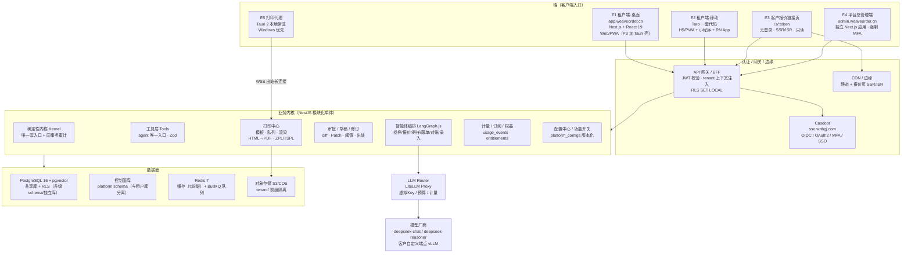

# 织序 WeaveOrder · 整体架构设计与技术选型

> 版本：v1.3 ｜ 日期：2026-11-12 ｜ 作者：鲁班（首席架构师）
> 依据：`docs/product-design.md`（v1.8）。本文只做架构与技术选型，不沿用任何既有代码实现；与产品文档冲突处以产品决策为准。
> 设计原则：KISS、一个产品一个仓库、managed service 优先、单人可维护、基础设施成本可控。

---

## 0. 一句话结论

织序是一套**「智能体干活、人只审批」的纺织业务操作系统**，由 **5 个端** + **1 个确定性内核** + **3 个外部依赖（Casdoor / LiteLLM / 数据面）** 组成。全栈 TypeScript 为主，前端一套 React 代码覆盖桌面 + 移动双端，打印代理用 Tauri 2，数据默认共享库 + RLS，登录交给 Casdoor，模型走 LiteLLM 网关。

---

## 1. 端清单（Ends）

从 `product-design.md` 可识别出 **5 个端**（客户端入口），外加 1 个内核与 3 类外部依赖：

| # | 端 | 域名 / 形态 | 谁在用 | 是否登录 | 阶段 |
| --- | --- | --- | --- | --- | --- |
| E1 | 租户端 · 桌面 | `app.weaveorder.cn`（Web / PWA，后期 Tauri 壳） | owner / manager / sales / merchandiser / sample_admin / finance | 是（Casdoor） | P0 |
| E2 | 租户端 · 移动 | PWA（可安装 / 离线），后续小程序/App | 同上，sales 手机优先 | 是（Casdoor） | P0 |
| E3 | 客户报价链接页 | `app.weaveorder.cn/s/<token>`（只读，无登录） | 客户（外部） | 否（签名 token） | P0 |
| E4 | 平台总管理端 | `admin.weaveorder.cn`（独立产品） | platform_owner / finance / support / ops | 是（Casdoor 独立应用 + 强制 MFA） | P1 |
| E5 | 打印代理 | 本地常驻桌面小程序（Windows 优先，后续 macOS） | 办公室 / 仓库的常驻机 | 是（打印专用 token） | P1 |

**非「端」但属于系统组成部分**：

| 组件 | 说明 |
| --- | --- |
| 确定性内核 + 工具层 + 智能体 | 后端模块化单体（NestJS），唯一业务写入口 |
| Casdoor | 身份认证（OIDC/OAuth2），`sso.wnbgj.com` |
| LLM Router | LiteLLM Proxy，多模型网关，token 计量 |
| 数据面 | PostgreSQL（RLS）+ Redis + 对象存储；控制面库分离 |

---

## 2. 技术选型总览

| 层 | 选型 | 理由（独立开发者视角） |
| --- | --- | --- |
| 前端·桌面（E1/E3） | **Next.js 15（App Router）+ React 19 + TypeScript + TailwindCSS + shadcn/ui** | 桌面宽屏/复杂表格/⌘K；E3 报价页需 SSR/ISR；全栈 TS 单人可维护 |
| 前端·移动（E2） | **Taro（React）**：一套代码编译 H5/PWA + 小程序 + React Native App | 一个技术栈覆盖三端，避免多套栈维护 |
| 桌面外设壳（P3） | **Tauri 2** | 只暴露 print/scan/readFile/电子秤，业务 UI 仍从 Web 加载 |
| 平台管理端（E4） | **Next.js 15 独立应用**（同仓库 `apps/admin`，复用 UI 包，隔离部署） | 独立产品，物理/逻辑隔离，强制 MFA |
| 打印代理（E5） | **Tauri 2（Rust）+ WebView 2 UI**（已定） | 常驻托盘、WSS 出站、自动更新、轻量 |
| 后端 API / 内核 | **NestJS 10+（TypeScript）模块化单体** | 依赖注入、Guard（租户上下文注入）、Pipe（Zod）、模块边界清晰，符合「内核 / 工具 / agent」铁律 |
| 智能体编排 | **LangGraph.js**（状态机 + PostgreSQL 检查点，工具调用 Zod 校验） | 可观测、可检查点、可恢复，适合「跑到只剩一个决定」 |
| 数据库 | **PostgreSQL 16 + pgvector** | RLS 行级隔离、JSONB 配置、向量检索 |
| ORM | **Drizzle ORM**（TS 优先） | 类型安全、迁移 SQL 可控 |
| 缓存 / 队列 | **Redis 7**（缓存）+ **BullMQ**（打印队列 / 异步任务） | 幂等 job、租户前缀 key |
| 对象存储 | **S3 兼容（腾讯云 COS / MinIO）** | 图片直传、PDF 快照，tenant 前缀隔离 |
| 身份认证 | **Casdoor**（自托管 `sso.wnbgj.com`） | 不自研登录，一个租户一个 Organization |
| LLM 网关 | **LiteLLM Proxy**（自托管） | 多模型、虚拟 Key、预算、用量日志最全；默认模型 DeepSeek |
| 搜索 | PostgreSQL FTS + pgvector（起步），后接 Meilisearch/OpenSearch（可选） | 先不做额外组件 |
| 监控 | **Uptime Kuma + Plausible**（或 Sentry + Prometheus/Grafana） | 成本低、可自托管 |
| 部署 | **腾讯云（CVM/RDS/COS/短信）容器化**；开发期可用 Railway/Vercel 快速验证 | 目标客户在国内，域名 `.cn` 需备案；.cn 访问稳定优先 |

---

## 3. 各端技术选型（详细）

### E1 租户端 · 桌面（浏览器 Web + 桌面软件，两种形态并存）

| 形态 | 技术栈 | 定位 | 阶段 |
| --- | --- | --- | --- |
| 浏览器 Web | Next.js 15（App Router）+ React 19，`/` 桌面路由 | 主形态，零安装、随浏览器访问 | P0 |
| 桌面软件 | Tauri 2 包裹同一 Web 业务 UI | 外设能力增强，非第二套界面 | P3 |

- **同一套 Web 业务 UI，两处加载**：浏览器直接访问 `app.weaveorder.cn`；桌面软件 = Tauri 2 的 WebView 加载**同一个 Web 应用**，只额外注入原生外设桥。**业务 UI 始终从 Web 加载，不为桌面软件重写界面**（§6 铁律，避免两套界面维护）。
- **原生外设桥**：Tauri 2 通过 IPC 暴露 `print / scan / readFile / 电子秤` 四类能力给 Web（`invoke('print')` 等），Web 内用 capability 检测降级：无 Tauri 环境时退回浏览器打印 / 文件上传。
- **桌面路由与 IA**：`/` 起，3 个业务窗口（工作台 ⌘1 / 审批 ⌘2 / 全景 ⌘3）+ 1 个管理面（组织与设置 ⌘,），顶栏 + 全局打印抽屉。

### E2 租户端 · 移动（Taro 一套代码，三端输出）

移动端统一用 **Taro（React）**：**一个代码库编译出三种形态**，不引入 Next.js + Taro + Capacitor 三套栈。

| 形态 | 输出方式 | 定位 | 阶段 |
| --- | --- | --- | --- |
| PWA（H5） | Taro H5 构建 + PWA 配置（manifest + Service Worker） | 主形态，覆盖 90%「手机上批一下」 | P0 |
| 小程序 | Taro 编译微信小程序（同代码再出支付宝/抖音） | 客户自助 / 分享传播场景 | P3（按需） |
| App | Taro React Native（一套 JS + 原生壳） | Face ID / 蓝牙打印 / 推送刚需 | P3（按需） |

**一套代码、三端复用的分层策略**（Taro 天然支持，单人可维护的核心）：

| 层 | 内容 | 复用率 |
| --- | --- | --- |
| `packages/core` | 业务逻辑、TanStack Query hooks、API client、离线队列、Zod 契约 | 100% 复用（与桌面端 Next.js 共享） |
| `apps/mobile`（Taro） | 页面 + Taro 跨端组件，用 `process.env.TARO_ENV` 做少量端差异分支 | ~90% 一套代码 |
| 端能力适配 | 相机/扫码/蓝牙/推送/Face ID 按平台调 Taro 或原生插件 | 薄壳 |

**各形态技术细节**：

- **PWA（H5，P0）**：Taro H5 输出为 SPA，叠加 manifest + Service Worker（Workbox）做可安装与离线缓存；离线队列落 IndexedDB（小程序端走 `Taro.setStorage`），恢复后按时间序提交，冲突「服务端版本 + 人工确认」。底部 5 入口（今日/审批/相机/客户/更多），独立组件密度。
- **小程序（P3）**：Taro 第一等公民，编译微信小程序零额外维护；同一套代码可再出支付宝/抖音小程序。相机/扫码走 Taro 原生 API。
- **App（P3）**：Taro React Native 输出，一套 JS + iOS/Android 原生壳；Face ID / 蓝牙标签打印 / 推送（TPNS/极光）用 Taro 插件或 RN 原生模块。

**为什么是 Taro 一个栈（而非「Next.js H5 + Taro 小程序 + Capacitor App」三栈）**：三栈方案虽然 H5 能与桌面端共用 Next.js 运行时，但代价是移动端要同时维护 Next.js、Taro、Capacitor 三套构建/依赖/调试链路，对单人团队是隐性成本。Taro 用一套 React 代码、一次构建产出 H5/PWA + 小程序 + RN App，工程面收敛到 1 套；业务逻辑仍通过 `packages/core` 与桌面端 100% 共享。

**选 Taro 需要接受的代价与对策**：

1. **H5 无 SSR/ISR**：移动端是登录后应用、无 SEO 诉求，可接受；需要 SSR 的客户报价页由 E3（Next.js）独立承担，两者不冲突。
2. **RN 渲染差异**：RN 非 DOM，某些 CSS/DOM 特性在 App 端不生效；对策是用 Taro 跨端组件 + `TARO_ENV` 条件分支，复杂自定义组件（审批卡 diff）在 App 端单独适配一次，H5/小程序不受影响。
3. **桌面端与移动端不再是同一份 UI**：改为「共享 `packages/core` 业务逻辑 + 设计 tokens，UI 各自维护」（桌面 shadcn/ui，移动 Taro 组件）。这是「移动端单栈」换来的主要代价，但业务逻辑与数据契约的复用率（最高价值部分）不受影响。

### E3 客户报价链接页（无登录只读）

- 与租户端**同一 Next.js 应用**，独立公开路由组 `/s/[token]`，无鉴权 Cookie、最小埋点，避免与租户会话串 Cookie。
- **SSR/ISR 优先**，CDN 边缘加速；这是产品唯一外部界面，加载速度即品牌，也是增长资产（§13.6）。
- 服务端校验签名 token（`token_hash` 命中 + 有效期 + 未撤回），页面只返回客户视图字段（**绝不返回成本/毛利/内部备注**）。
- 水印、中/英切换、PDF 下载走同一渲染链路。

### E4 平台总管理端（Control Plane）

- **独立 Next.js 应用**（`apps/admin`），独立部署到 `admin.weaveorder.cn`，与租户端物理/逻辑隔离。
- 独立 Casdoor 应用 `weave-platform`，强制 MFA、禁止社交登录、可选 IP 白名单。
- 复用 `packages/ui` 与 `packages/schema`（不复制业务 UI），但**只连控制面数据**：`platform_*` / `plans` / `subscriptions` / `usage_*` / `invoices`，默认看不到租户业务数据。
- 功能模块：总览 / 租户 / 订阅账单 / 用量 / 套餐与价格 / 开票设置 / LLM 设置 / 身份 / 配置中心 / 功能开关 / 支持 / 平台审计。
- Break-glass：租户同意 + 双人复核 + ≤60 分钟只读令牌 + 全程审计（§14.6）。

### E5 打印代理（Print Agent）

- **形态**：本地常驻桌面小程序，Windows 优先（后续 macOS），托盘常驻、崩溃自启、签名静默升级、可回滚。
- **技术**：**Tauri 2（Rust）+ WebView 2 UI**（已定，不再评估 Electron）。
  - 出站长连接：Rust `tokio-tungstenite` 建 WSS，**不开启入站端口**。
  - 打印：A4 PDF 走系统打印 / 内置 PDF 渲染；标签 ZPL/TSPL 走 RAW TCP（9100）直发；蓝牙便携机走 TSPL 协议。
  - 本地 spool：SQLite（`rusqlite`）或文件队列，任务载荷本地保留 ≤24h，`idempotency_key` 去重。
  - 自动更新：`tauri-plugin-updater` + 代码签名，灰度、可回滚。
- **兜底**：打印驱动生态（特殊针式/网络打印机）踩坑时，保留浏览器 PDF 兜底路径（§4.4 设备选型），不引入第二套运行时。
- **安全**：注册拿「只能打印、不能读业务数据」的 token；不落客户数据；日志脱敏、可一键清空。

---

## 4. 整体架构图

---

## 5. 数据面与多租户隔离

- **默认（P0）共享库 + RLS**：每张业务表带 `tenant_id`，连接进来先 `SET LOCAL app.tenant_id`，策略 `FORCE ROW LEVEL SECURITY`，应用角色无 `BYPASSRLS`；CI 常驻跨租户互查测试。
- **企业版（P1）schema-per-tenant**：`tenant_data_planes` 路由到不同 schema，迁移按租户编排，单向可升级（共享 → schema → 独立库 → 独立实例）。
- **对象存储 / 缓存 / 向量**：均按 tenant 前缀 / 分区隔离。
- **控制面与租户库分离**：`platform_*`、`plans`、`subscriptions`、`usage_*`、`invoices` 独立 schema/数据库；平台侧只看聚合用量与账单。

---

## 6. 身份与授权

- 认证全交 Casdoor（`sso.wnbgj.com`，**已部署就绪**）：一个租户 = 一个 Organization；一个产品 = 一个 Application（`weave-order`）；平台 = 独立 Application（`weave-platform`）+ 强制 MFA。
- 后端只做授权：`(sub, org)` 查本地 `memberships`（角色 / 数据范围 / 阈值），`tenant_id` 以本地 membership 为准，不信任前端。
- 令牌校验：RS256 + JWKS，issuer/audience/exp/nonce；access 15 分钟、refresh 7 天；`client_secret` 只存服务端环境变量/KMS，前端不存 token。

---

## 7. LLM 接入

- 所有 agent 走 LiteLLM Proxy，不直连厂商；密钥只存服务端，每租户虚拟 Key + 模型白名单 + 预算限额 + 重试/降级。
- 默认模型：`deepseek-chat`（日常报价/跟进，**默认**）、`deepseek-reasoner`（复杂报价/对账）、`qwen-plus`（备用/降级，后台可配）；租户默认白名单只开 `deepseek-chat` + `deepseek-reasoner`。
- token 只计量不收费：`usage` 幂等落 `token_usage`，每日汇总 `usage_monthly`，按采购价做成本/毛利看板；敏感字段出网前脱敏。

---

## 8. 部署与基础设施

- **国内为主**（目标客户国内，`.cn` 需备案）：**腾讯云** CVM（容器化，轻量 Docker Compose 起步，后接 K8s）+ CDB PostgreSQL（pgvector）+ COS + 短信服务。
- **开发/验证期**可用 Railway / Fly.io / Vercel 快速起环境（前端 Vercel，后端 Railway）。
- 打印代理：一个安装包、扫码绑定、自动发现打印机、打测试页，5 分钟装完。

---

## 9. 成本估算（单人运营，月）

| 项 | 估算 | 备注 |
| --- | --- | --- |
| 计算（API + 3 个前端 + LiteLLM + 打印网关） | ¥300–600 | 2–3 台小规格 CVM |
| CDB PostgreSQL + Redis | ¥200–400 | 起步共享实例 |
| 对象存储 + CDN | ¥50–150 | 图片/PDF 快照 |
| LLM 用量 | 随量（¥0–3,000+） | 按租户采购价核算，占比控在收入 15% 内 |
| Casdoor + Uptime Kuma + Plausible | ~¥100 | 自托管 |
| **合计（自用，不含 LLM）** | **约 ¥700–1,300/月** | 试点期可控在 ¥1,000 内 |

---

## 10. 分期落地建议（对应 §12 交付分期）

| 阶段 | 端 | 关键基础设施 |
| --- | --- | --- |
| P0 | E1 + E2（PWA）+ E3 | 共享库+RLS、Casdoor 登录、LLM 全局参数、报价链接、改稿 Patch |
| P1 | E4（v1）+ E5 | schema-per-tenant、企业 SSO、LiteLLM 接入 + token 记账、打印中心 |
| P2 | E4 完整 | 独立库/每租户 KMS、SaaS 订阅账单、模板工作室 + AI 识样张 |
| P3 | E1（Tauri 壳）+ E2（小程序）+ 客户门户 | 供应商协同、私有化、渠道商/多仓 |

---

## 11. 已拍板与风险

**已拍板（v1.1 决策）**：
1. 部署云：**腾讯云**（CVM/CDB/COS/短信），ICP 备案 + 短信签名。
2. 打印代理：**Tauri 2**（不再评估 Electron）。
3. Casdoor：**已部署就绪**（`sso.wnbgj.com`），无需再定。
4. LLM 默认供应商：**DeepSeek**（`deepseek-chat` 默认 + `deepseek-reasoner` 复杂场景）。

**主要风险与对策**（详见 §16）：
- 共享库漏加租户条件 → RLS 强制 + 应用角色无 BYPASSRLS + CI 跨租户互查。
- 打印代理打印驱动生态（针式/网络打印机）→ 保留浏览器 PDF 兜底 + Electron 备选。
- Casdoor 单点故障 → 独立部署 + 多副本 + 每日备份 + 会话短期宽限。
- 模型厂商停服/涨价 → provider 抽象 + 多厂商 + 备用端点 + 规则降级。
