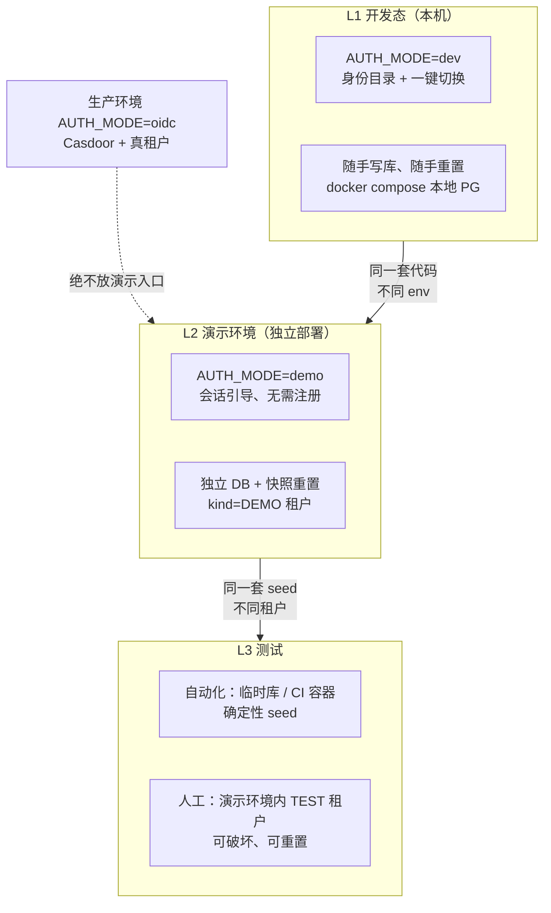
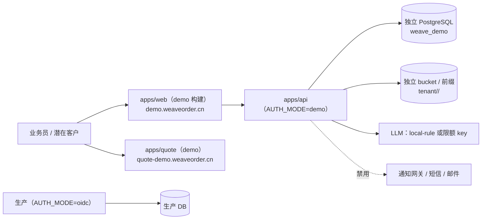

# 演示身份系统：开发免登录、销售演示与测试共用（方案建议）

> 版本：v1.0 ｜ 日期：2026-11-15 ｜ 作者：巧匠（产品设计 & 增长）｜ 对应 issue：WAN-132
> 依据：`docs/multi-tenant-selection.md`（WAN-81 租户会话）、`docs/data-ownership.md`（WAN-106 数据归属）、`docs/t0-foundation.md`（网关与多租户）、`docs/product-design.md` §3（角色与权限）。

## 0. 一句话结论

**把「演示」拆成三个互不混用的层次**：本地开发身份切换器（不登录、可切角色）、独立部署的演示环境（真会话、可重置、可给客户看）、测试专用数据与沙箱（自动化用临时库，人工用独立 TEST 租户）。

**不要**在生产实例里塞一个「演示租户」当演示环境。演示环境必须是**独立部署 + 独立数据库 + 独立域名**，用 `AUTH_MODE=demo` 的会话引导端点进入；演示租户在数据模型里是一等公民（`tenant_kind=DEMO`），账号、计费、用量、通知全部旁路。开发态则沿用现有 `AUTH_MODE=dev`，只补一个「身份目录 + 一键切换」。

理由一句话：演示要的是**零摩擦和可重置**，生产要的是**不可误入**。两者对认证与数据生命周期的要求相反，共用一套只会同时牺牲两边。

---

## 1. 现状盘点：已经有什么，缺什么

| 能力 | 现状 | 位置 |
| --- | --- | --- |
| 本地免登录令牌 | `Authorization: Bearer dev:<sub>:<org>`，仅 `AUTH_MODE=dev` 装配 | `apps/api/src/gateway/oidc.ts#createDevVerifier` |
| 浏览器进 dev 身份 | `/auth/dev` 写 `weave_token` Cookie（默认 `dev:demo:demo`） | `apps/web/app/auth/dev/route.ts` |
| 无令牌兜底 | 非生产态、无 Bearer 时按 OWNER + 默认租户运行 | `http/human-actor.service.ts`、`http/agent-actor.service.ts` |
| 租户会话 | opaque `weave_sid`；切换换 sid；`tenant_id` 只存在于服务端 | `gateway/session.service.ts`、`gateway/auth.service.ts` |
| 多租户选择 | `/api/auth/me` 返回 `MULTI_TENANT`，`/api/auth/switch` 选择 | `gateway/auth.controller.ts`、`packages/core/src/hooks.ts` |
| 角色事实来源 | `memberships.role` + `dataScope` + `approvalLimitAmount`，每次请求重查 | `packages/db/src/schema/tenants.ts` |
| 演示数据归属 | seed 幂等建 `demo`(OWNER/ALL) 与 `demo-sales`(SALES/OWN) 两个成员 | `apps/api/scripts/demo-identity.ts` |
| 纯前端演示 | `?demo=1` 走 mock transport；移动端 `TARO_APP_MOCK=1` | `apps/web/src/providers.tsx`、`apps/mobile/README.md` |
| 租户级对象隔离 | 对象 key 形如 `tenant/<tenantId>/samples/...` | `apps/api/src/platform/storage.ts` |
| 平台试用租户 | 控制面 seed 两家「演示租户」，是计费演示数据，不是可登录的演示环境 | `apps/platform-api/scripts/seed.ts` |

**缺口（按重要性排序）**

1. **只有两个身份**（OWNER / SALES）。经理、跟单、样品管理、财务、只读五种角色没有可登录的人，无法体验「角色不同，界面与权限不同」。
2. **没有角色切换器**。切身份要手改 Cookie 或换浏览器；`/auth/dev` 只写 `weave_token`。
3. **一个隐藏 bug**：`SessionCredentialMiddleware` 让 `weave_sid` 优先于任何 Bearer。一旦登录过一次，再访问 `/auth/dev?next=...` 写的新 token **不会生效**（旧会话仍然胜出）。做切换器必须先解决这个优先级问题。
4. **角色差异在界面上几乎不可见**。今天页三个窗口基本与角色无关，唯一一处角色分支是全景页对 FINANCE 隐藏订单（`panorama/page.tsx:57`）。「体验各角色的使用方式」光有登录身份不够，还需要角色化首页与动作。
5. **没有演示租户类型、没有重置机制、没有演示边界**。也无法阻止演示环境发真实通知、生成指向生产客户页的报价链接。
6. **CI/测试与人工演示共用同一套 seed 口径**，缺少「可破坏的沙箱」。

---

## 2. 三个层次，三套威胁模型



| 层次 | 谁能进 | 认证 | 数据 | 重置 | 允许的破坏性操作 |
| --- | --- | --- | --- | --- | --- |
| L1 开发态 | 开发者本机 | dev 令牌 / 会话引导 | 本地库 | `SEED_RESET=1` / 重建 compose | 全部 |
| L2 演示环境 | 业务员 + 受邀客户 | 演示会话（无密码） | 独立演示库 | 数据库快照恢复 | 业务数据可写；通知/计费/邀请旁路 |
| L3 测试 | 测试人员 / CI | dev 或演示会话 | TEST 租户 / 临时库 | 每次运行重建 | 全部 |

---

## 3. L1：开发环境免登录 + 多角色切换

### 3.1 身份目录：把「演示成员」升级为「角色名单」

现有 `ensureDemoIdentity()` 只保证两个成员。改成一份声明式名单 `DEMO_PERSONAS`（`apps/api/scripts/demo-identity.ts`），seed 幂等写入同一演示租户：

| key | 显示名 | subject | role | dataScope | approvalLimit | 用途 |
| --- | --- | --- | --- | --- | --- | --- |
| `owner` | 陈老板 | `demo` | OWNER | ALL | 无上限 | 全量、终审 |
| `manager` | 李经理 | `demo-manager` | MANAGER | TEAM | ¥200,000 | 中额审批、团队漏斗 |
| `sales` | 小林 | `demo-sales` | SALES | OWN | ¥50,000 | 只看得见自己的客户 |
| `merchandiser` | 阿珍 | `demo-merch` | MERCHANDISER | ALL | — | 寄样、物流、交期 |
| `sample_admin` | 样品间小王 | `demo-sample` | SAMPLE_ADMIN | ALL | — | 色卡、借还、扫码 |
| `finance` | 财务周姐 | `demo-finance` | FINANCE | ALL | — | 应收、回款、对账 |
| `viewer` | 只读访客 | `demo-viewer` | VIEWER | ALL | — | 给客户看界面 |

再加三个**异常态**（不是每天用，但演示与测试都需要）：

| key | 状态 | 用途 |
| --- | --- | --- |
| `no-membership` | 已认证、零成员关系 | 验证「你的账号还没加入公司」页 |
| `disabled-member` | membership `DISABLED` | 验证「权限已被停用」不可进 |
| `suspended-tenant` | 租户 `SUSPENDED` | 验证暂停态只读与原因文案 |

`subject` 仍走 `SEED_*_SUBJECT` 环境变量覆盖，生产演示不写死。

> `TEAM` 范围依赖 `memberships.team_id`：`manager` 与 `sales` 必须写入同一个 team id，且客户 `owner_id` 落在 sales 身上，否则 `ownerScopeFilter()` 会退化为「只看自己」，经理登录后看到空列表，演示直接翻车（`apps/api/src/kernel/data-scope.ts`）。seed 时一并固定 team id。

### 3.2 切换端点：用会话，不用换 token

新增**仅在 `AUTH_MODE=dev` 注册**的控制器（`apps/api/src/dev/identity.controller.ts`）：

| 方法 | 路径 | 行为 |
| --- | --- | --- |
| GET | `/api/dev/personas` | 列出 personas（key、显示名、角色、租户、是否可进） |
| POST | `/api/dev/session` | body `{ persona }`；校验该 subject 在演示租户有 ACTIVE membership；**新建会话并换新 sid** |
| DELETE | `/api/dev/session` | 退出当前 persona（复用登出语义） |

关键点：

- **不要复用 `/auth/dev` 写 `weave_token`**。原因是 `weave_sid` 优先级更高，写 token 等于没写。用 `SessionService.create()` 直接建会话，与生产登录后的路径完全一致，顺带把「会话绑定租户」这条链路天天跑一遍。
- **不接受任何角色字段**。客户端只传 `persona` key，角色由服务端 membership 决定。这条红线同时保护开发与演示：否则 `role` 会成为绕过审批阈值的后门。
- 切换后前端 `queryClient.clear()` 再重拉 `/api/auth/me`，保持当前路由不跳走（在审批页切到老板，原地批准，才是开发调试最顺的动线）。
- 保留无令牌兜底，但把兜底身份显式命名为 `developer`（OWNER），并在身份条上显示。避免「匿名 OWNER」把认证 bug 藏起来。

### 3.3 UI：一条开发身份条

- 固定在右下角的窄条：`身份：小林 · 业务员 · 青禾纺织`，点击展开 persona 列表（按租户分组），支持 `⌘⇧I` 打开、方向键选择、`Enter` 切换。
- 只在 `NEXT_PUBLIC_IDENTITY_SWITCH=1` 且非生产构建时渲染；组件用动态 `import()`，生产构建不引用。
- 深链：`/today?as=finance`，方便写进 issue、录屏、E2E。
- CLI 辅助：`pnpm dev:as finance` 打印带 `?as=` 的地址；比记 subject 好。

### 3.4 顺带修掉的坑

1. `weave_sid` 与 `weave_token` 的优先级要在注释与测试里写死：**会话优先，切换必须换会话**。
2. `apps/web/src/providers.tsx` 的 `?demo=1` mock transport 与真实 dev 会话是两条路。建议在登录页把入口文案区分清楚：「本地假数据（不连后端）」vs「本地开发身份（连后端）」，否则新人会以为后端坏了。

### 3.5 生产不泄漏的硬约束

- 身份条组件与修改器只在 `AUTH_MODE=dev` 且 `NODE_ENV !== production` 时存在；API 控制器在 `verifierFactory` 同层条件注册，非 dev 模式路由不存在（404，而不是 403）。
- 增加一个构建期检查脚本（照抄移动端 mock 门禁 `apps/mobile/scripts/check-prod-bundle.mjs` 的思路）：生产产物里出现 `persona` 种子特征串就判红。

---

## 4. L2：演示环境（销售演示 + 对外展示）

### 4.1 部署拓扑：独立，是方案的核心



- **独立数据库**（至少独立 database，理想独立实例）。理由见 §4.5：审计日志 append-only，演示重置只能靠数据库级快照。
- **独立域名**：`demo.weaveorder.cn`（应用）+ `quote-demo.weaveorder.cn`（客户报价页）。报价链接必须指向 demo 站点，绝不能生成指向生产客户页的链接。
- 控制面（`apps/admin` / `platform-api`）**不部署到演示环境**。
- 演示环境只开业务面，不开注册、开通、计费、邀请。

### 4.2 认证：`AUTH_MODE=demo` + 会话引导，而不是「免登录」

新增第三种鉴权模式（`apps/api/src/platform/env.ts` 的 `AUTH_MODE` 枚举、`gateway/gateway.module.ts` 的 `verifierFactory`）：

| 项 | 设计 |
| --- | --- |
| 令牌 | 演示模式**不接受任何外部 Bearer**。verifier 直接拒绝；唯一入口是会话引导端点 |
| 入口 | `POST /api/demo/session`（`@Public`，仅 demo 模式注册）body `{ persona }` → 校验 persona 属于 `DEMO_TENANT_IDS` 白名单 → `SessionService.create()` → 下发 `weave_sid` |
| 后续请求 | 与生产完全一致：BFF 转发 `weave_sid` → 中间件归一成 `Bearer session:<sid>` → 每次请求重查 membership |
| 退出 | `DELETE /api/auth/session`（已有） |
| 访问控制 | P0 用 `DEMO_ACCESS_CODE`（销售发给客户的一串短码）+ IP 限流；不留公开注册入口。码可轮换 |
| 会话时长 | 12 小时（比生产的 7 天短），切 persona 换 sid |

必须同时改的守卫：

1. `isProductionLike()` 加入 `AUTH_MODE === "demo"`。否则 `NODE_ENV=development + AUTH_MODE=demo` 会打开匿名 OWNER 兜底，演示入口变成越权入口。
2. `loadEnv()` 的启动校验：
   - `AUTH_MODE=demo` 必须配 `DEMO_TENANT_IDS`（或 slug 列表）与 `DEMO_ACCESS_CODE`；
   - 启动时校验白名单里的每个租户 `tenant_kind=DEMO`，否则**拒绝启动**；
   - demo 模式**强制** `NOTIFY_PROVIDER=log`（或 sandbox sink）、`LLM_PROVIDER=local-rule`，并禁止 `PLATFORM_*` 连接；
   - demo 模式禁止签发 PAT（`/api/auth/tokens` 返回 403）。
3. `main.ts` 的生产启动拦截保持原样：`NODE_ENV=production` 仍禁止 `AUTH_MODE=dev`；`AUTH_MODE=demo` 是显式白名单，不是把 dev 打开。

> 为什么不用 Casdoor 演示账号：演示要求「客户扫个码就进、销售一键换角色」。Casdoor 的密码/验证码/MFA 流程是为真实身份设计的，用它做演示等于把摩擦转嫁给销售。演示会话是有边界的、短时的、只读写演示库的，不需要第二套身份源。

### 4.3 租户标识：`tenant_kind` 是一等字段

当前 `tenants.status` 只有 `ACTIVE / TRIAL / SUSPENDED / CLOSED`，无法区分「真实试用客户」与「演示租户」。建议在业务库与控制面各加一列：

```ts
// packages/db/src/schema/enums.ts
export const tenantKindEnum = pgEnum("tenant_kind", ["CUSTOMER", "DEMO", "TEST"]);
```

`packages/db/src/schema/tenants.ts` 增 `kind`（默认 `CUSTOMER`），控制面 `packages/control-db/src/schema.ts` 同步。用途：

- 演示入口的**服务端白名单校验**（每次建会话都读，不信任 env 单点）；
- 控制面报表、MRR、用量、告警**排除** DEMO/TEST；
- 平台侧「开通演示租户」是一个明确动作，而不是手写 SQL。

零迁移替代方案是 `tenants.settings.kind = "DEMO"`。不推荐：它是安全判定依据，应该是列 + 索引 + 约束，而不是 JSON 里的约定。

平台侧新增：

- `POST /platform/api/tenants`（已有）扩展 `kind`；或新增 `POST /platform/api/demo-tenants`，强制套餐为 `DEMO`、订阅豁免、不计费。
- 演示租户**不产生账单、不占套餐席位、不触发用量告警**。

### 4.4 演示数据：一份「剧本」而不是一堆随机行

演示的可信度来自「一眼看懂业务」，不是数据量。建议一份版本化 fixture（`data/demo-seed/`，由 `pnpm demo:seed --tenant <slug>` 导入，复用现有 `ImportService` 与内核，确保走真实校验与审计）：

| 客户 | 状态 | 演示什么 |
| --- | --- | --- |
| 杭州青禾服饰 | 报价 ¥118,000 待经理审批 | 审批链、阈值升级、diff |
| 绍兴瑞纺织 | 寄样在途，agent 已出跟进建议 | 智能体出草稿、人只批结果 |
| 宁波海辰制衣 | 应收逾期 3 天 | 财务视图、催收建议 |
| 广州米蓝 | 报价已发送，客户刚打开链接 | 客户报价页、分享链接追踪 |
| 苏州锦程 | 大货生产异常 | 异常处理、待办 |

要求：

- **全部合成数据**，姓名/电话/公司均为虚构；绝不复用任何真实客户数据。
- 时间用**相对偏移**（`now - 3 days`），保证每次重置后「逾期 3 天」仍然成立。
- 固定 ID / code，便于 E2E 与录屏复用。
- 每个角色登录后都能看到「属于自己的那一屏」，而不是同一屏换权限。

### 4.5 重置：数据库级快照，不是 SQL 删除

这是本方案里最容易被低估的一条。`audit_log` 有数据库触发器：`UPDATE` / `DELETE` / `TRUNCATE` 一律抛异常（`packages/db/drizzle/0001_audit-append-only.sql`、`0012_audit-truncate-guard.sql`）。因此：

- **不能用「删租户业务数据再重灌」做重置**，审计行删不掉，历史会越堆越乱，还会指向已删除实体；
- 也不应该为演示租户给审计触发器开后门（那等于把「账本不可改」这条产品铁律打折）。

推荐做法：

```
演示库模板（demo_template）
  ├─ 每晚 03:00：从模板 CREATE DATABASE weave_demo（或 pg_restore 快照）
  ├─ 销售手动「重置演示数据」：同样操作，60s 限流 + 审计到运维日志
  └─ 重置后：清理对象存储 tenant/<demoTenantId>/ 前缀，重放 fixture
```

- 托管 PG 有分支/快照能力时直接用（Neon branch、RDS snapshot restore）。没有就用 `pg_dump` + `pg_restore`，演示库很小，几十秒内完成。
- 对象存储必须同步清理，否则数据库重置了、图墙还挂着上一场演示的图片。按 `tenant/<id>/` 前缀列举删除，已有 `maintain:media` 的孤儿清理逻辑可复用。
- 重置节奏：夜间自动 + 销售手动。演示通常 15-30 分钟，不需要保留上一场状态。

### 4.6 并发：先一个「剧本租户」，再谈沙箱池

- **P0：一个精选演示租户**。最简单、剧本最稳。风险是两个销售同时演示会互相看到对方刚批准的单。用「演示前点一下重置」缓解。
- **P1：沙箱池**（推荐给 3 人以上销售团队）：预置 5 个同构租户 `demo-1..5`，通过 `?sandbox=3` 或一次性链接分配，租约 2 小时，释放即重置。对客户来说无感，对销售来说互不干扰。
- **P2：按会话克隆租户**。隔离最强、成本最高、重置最复杂，只在对外公开演示、流量不可控时考虑。

自动化测试**不要**打共享演示租户，见 §6。

### 4.7 演示边界：把「会捅到外面」的动作全部关掉

| 动作 | 演示环境处理 |
| --- | --- |
| 邮件 / 短信 / webhook 通知 | 强制 `NOTIFY_PROVIDER=log` 或沙箱 sink；绝不发真实消息 |
| 邀请成员 | 可演示流程，但不真正发信；邀请链接指向 demo 域名且 24h 失效 |
| 客户报价分享链接 | 保留（这是核心卖点），但域名是 `quote-demo.*`，页面顶部有「演示报价」标识，`noindex` |
| LLM 调用 | `local-rule` 默认；若要用真实模型，单独限额 key + 日预算，防止演示烧钱 |
| 文件上传 | 允许，但走独立 bucket/前缀，重置时清理；单租户配额限制 |
| 数据导出 / 打印 | 允许；打印代理关闭，避免真的出纸 |
| 计费 / 订阅 / 开票 | 不部署控制面；相关入口隐藏 |
| 统计 | demo 主机单独 site / 事件打 `demo` 标记，绝不进生产转化漏斗 |

### 4.8 演示 UI：让人一眼知道「这是演示」

- 顶部细横幅：`演示环境 · 数据每 6 小时重置 · 请勿填写真实客户信息`，右侧「切换身份」「重置数据」。
- 身份切换器复用 L1 的组件（同一份 persona 列表），但数据来自 `/api/demo/personas`。
- 页面右下角固定「演示剧本」入口：一键跳到「待审批的报价」「在途寄样」等关键场景，销售不用现场找菜单。
- `noindex, nofollow`、`robots.txt` 全站禁止、demo 域名不进 sitemap、不外链到官网主导航。
- 可选：`?tour=1` 的 5 步导览（高亮 + 一句话说明），比销售口头解释稳定。

---

## 5. 角色剧本：5 分钟演示什么

| 分钟 | 身份 | 动作 | 想让客户记住的一句话 |
| --- | --- | --- | --- |
| 0:00 | 小林（销售） | 粘贴客户微信原话 → 出候选样品与报价草稿 | 「业务员不用填表，10 分钟出报价」 |
| 1:00 | 小林 | 改一个单价，草稿版本 +1，显示 diff | 「改了什么、为什么改，全留痕」 |
| 2:00 | 小林 | 提交审批（金额 12 万，超过 5 万） | 「超过阈值自动找主管」 |
| 2:30 | **切到李经理** | 审批页看到 diff、成本底线、出处，批准 | 「经理只做决定，不做录入」 |
| 3:30 | **切到财务周姐** | 应收逾期列表、催收建议；尝试改报价金额被拒 | 「财务能对账，但改不了价格」 |
| 4:00 | **切到陈老板** | 全景：在途寄样、未决报价、逾期应收一屏 | 「老板 5 分钟知道公司哪里不对」 |
| 4:30 | 匿名（客户视角） | 打开 `quote-demo` 链接，接受报价 | 「客户不用登录就能确认」 |

**设计含义**：切换身份不是为了展示权限页，而是为了让**同一笔业务在不同角色眼里呈现不同决策面**。这要求界面有真正的角色化（§7 的 P0 项），否则切换后只有右上角名字变了。

---

## 6. 测试怎么用

| 场景 | 用什么 | 为什么 |
| --- | --- | --- |
| 单元 / 集成 / E2E（CI） | 本地 docker PG + `pnpm seed`（现有） | 确定性、可并行、失败可复现；演示环境不适合做断言 |
| 人工功能测试 | 演示环境内的 **TEST 租户**（`kind=TEST`），独立 persona | 可随便写坏、随时重置，不污染销售剧本 |
| 演示前彩排 | 演示租户 + 手动重置 | 与销售看到的一致 |
| 兼容性 / 多端 | 现有 e2e（Playwright）+ 移动 H5 | 已有覆盖，不重复造 |

规则：

- 自动化测试**禁止**连演示环境（防止把销售正在讲的数据改掉）；演示环境只接受人工与小流量冒烟。
- 若必须对演示环境做冒烟，使用只读 persona `viewer`，且只断言「页面能打开、关键区块存在」，不断言计数。
- 测试人员需要「造异常」时，用 TEST 租户 + 专门的异常 persona，而不是把演示剧本改坏。

---

## 7. 安全红线（评审时逐条对照）

1. `role` / `dataScope` / `tenantId` **永远不来自客户端**。客户端只能传 `persona`（映射到 subject）或 `tenantId`（走 membership 校验）。
2. `AUTH_MODE=demo` 计入 `isProductionLike()`，匿名兜底、"dev" 快捷路径全部关闭。
3. 演示入口每次建会话都校验：subject 有 ACTIVE membership **且**租户 `kind=DEMO` **且**租户在白名单内。三层 fail-closed。
4. 演示部署与生产**不共享数据库、不共享对象存储 bucket、不共享通知网关、不共享 LLM key**。
5. 生产构建中不存在演示路由与 persona 种子（构建期 grep 门禁）。
6. 演示环境无 PAT、无邀请外发、无计费、无控制面。
7. 演示报价链接带明显标识且 `noindex`，避免被搜索引擎当成真实报价收录。
8. 重置只走数据库快照，不改审计触发器；演示数据永不写入生产库。
9. 演示数据全部合成，禁止导入真实客户 CSV；`SEED_RESET` 在演示环境禁用。
10. 切换身份写审计（`TENANT_SWITCHED` 已有；persona 切换补 `DEMO_IDENTITY_SWITCHED`，actor=persona subject），保证「谁在演示环境做了什么」可回溯。

---

## 8. 备选方案对比

| 方案 | 优点 | 致命问题 | 结论 |
| --- | --- | --- | --- |
| A. 生产库里建一个 `demo` 租户，公开演示账号 | 最省部署 | 演示写入落在生产库；重置被审计触发器挡住；演示数据进 MRR/告警；通知可能真发；一处 demo 认证 bug = 生产写面 | ❌ 不采用 |
| B. Casdoor 建一组演示账号，共用一个演示租户 | 复用现有 OIDC | 客户要登录/验证码；销售换角色要退出重登；MFA/风控策略与演示冲突 | ❌ 不作为主路径 |
| C. 纯前端 mock（`?demo=1`） | 零后端、零风险 | 演示不了智能体、审批、审计、分享链接；客户一看就知道是假的 | ⚠️ 仅保留为「只看界面」的降级入口 |
| D. 独立演示部署 + 独立库 + `AUTH_MODE=demo` + 快照重置 | 摩擦最低、隔离最强、可重置、可审计 | 多一套部署与运维；需要 `tenant_kind` 与重置脚本 | ✅ 推荐 |

---

## 9. 分期与工作量（单人估算）

| 阶段 | 内容 | 工作量 | 交付验收 |
| --- | --- | --- | --- |
| **P0-a 开发态** | 7+3 personas seed；`/api/dev/personas`、`/api/dev/session`；身份条；`?as=` 深链；修 sid 优先级坑；生产 bundle 门禁 | 2-3 天 | 本地打开任意页，右下角切 7 个角色，页面数据与权限立即变化；生产构建无痕迹 |
| **P0-b 演示环境** | `AUTH_MODE=demo` + 启动守卫；`tenant_kind` 迁移（业务库 + 控制面）；演示会话端点 + 访问码；演示三件套部署（api/web/quote）；横幅与身份切换 | 3-4 天 | 客户用访问码进入，切 7 个角色，审批/报价全链路可走；生产代码路径 404 |
| **P0-c 演示数据与重置** | `data/demo-seed/` 剧本；`demo:seed`；快照重置脚本 + 对象前缀清理；夜间任务；手动重置按钮 | 2-3 天 | 重置后 60 秒内回到「待审批 12 万」的初始剧本；图片不残留 |
| **P1 角色化界面** | 今日页按角色重排区块；关键动作按权限隐藏/禁用；财务/样品角色专属视图 | 3-5 天 | 7 个角色登录后首屏不同；越权动作在 UI 上不可见，后端仍兜底 |
| **P1 沙箱池** | 5 个同构租户 + 租约分配 + 释放重置 | 2-3 天 | 两场演示同时进行互不干扰 |
| **P2 对外公开演示** | 免访问码、线索采集、转化埋点、导览 | 3-5 天 | 公开链接可进；demo→trial 转化可统计 |

**P0 合计约 7-10 人天**，其中一半是部署、数据与守卫，不是 UI。建议 P0-a 先落，开发者当天就能受益；P0-b/c 再排一个迭代。

---

## 10. 验收标准（P0）

- [ ] 本地 `pnpm dev` 后无需登录，默认进入 `developer` 身份；右下角可切 7 个角色 + 3 个异常态。
- [ ] 切角色后**不刷新到首页**，当前页面保留；数据、权限、审批阈值立即变化。
- [ ] 同一浏览器从 `sales` 切到 `owner` 后，旧 `weave_sid` 立即失效（不能靠旧会话继续以 sales 身份访问）。
- [ ] 客户端任何请求都不包含 `role`、`dataScope`、`tenantId`（除 `/api/auth/switch` 与 persona 引导）。
- [ ] 生产构建产物中 grep 不到 persona 种子、`/api/dev`、`/api/demo`。
- [ ] 演示环境用访问码进入，7 个角色可切；审批、报价、分享链接全链路可走。
- [ ] 演示环境的通知只写日志，不触达真实邮箱/短信；报价链接指向 demo 域名。
- [ ] 手动重置后，剧本回到初始状态；对象存储无残留；审计日志随数据库快照一起重置。
- [ ] 演示租户不出现在控制面 MRR / 用量 / 告警中。
- [ ] `AUTH_MODE=demo` 缺失白名单或白名单含非 DEMO 租户时，进程拒绝启动。

---

## 11. 待决策（老板 / 架构师）

1. **演示数据库**：独立实例，还是同实例独立 database？建议至少独立 database；若预算允许，独立实例（故障与误操作都隔离）。
2. **演示入口是否公开**：P0 建议「销售发访问码」，不挂官网公开链接；对外公开等到有线索采集与转化埋点之后（P2）。
3. **重置节奏**：夜间 + 手动是否够？销售是否需要「保留我上一场的修改」？（建议不保留，演示要的是确定性。）
4. **角色化界面是否纳入本期**：如果只做身份切换而首页不按角色变，演示效果会打折一半。建议 P1 立即跟上。
5. **QA 写入哪里**：建议 TEST 租户，不与销售剧本共用；自动化继续用本地临时库。

---

## 附：落地位置索引

| 事项 | 文件 |
| --- | --- |
| 身份模式枚举与启动守卫 | `apps/api/src/platform/env.ts`、`apps/api/src/platform/runtime-mode.ts` |
| dev / demo 控制器注册 | `apps/api/src/gateway/gateway.module.ts` |
| 会话创建与切换 | `apps/api/src/gateway/session.service.ts`、`session-credential.middleware.ts` |
| persona seed | `apps/api/scripts/demo-identity.ts` |
| 演示数据剧本 | `data/demo-seed/`、`apps/api/scripts/import-data.ts` |
| 租户类型 | `packages/db/src/schema/enums.ts`、`tenants.ts`、`packages/control-db/src/schema.ts` |
| 平台开通演示租户 | `apps/platform-api/src/control/tenants.service.ts`、`scripts/seed.ts` |
| 前端身份条 | `apps/web/src/`（新增 `identity-bar.tsx`）、`apps/web/src/providers.tsx` |
| 生产 bundle 门禁 | 参考 `apps/mobile/scripts/check-prod-bundle.mjs` |
