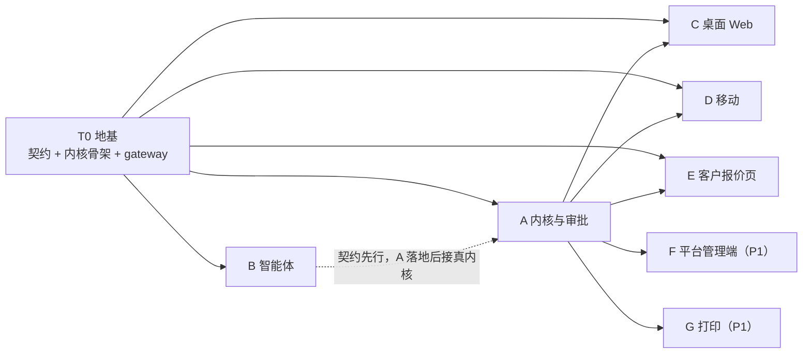

# 织序 WeaveOrder · 粗颗粒度开发计划（并行编排）

> 版本：v1.0 ｜ 日期：2026-11-12 ｜ 作者：鲁班（首席架构师）
> 依据：`docs/architecture-and-tech-stack.md`（v1.3）、`docs/development-guide.md`、`docs/product-design.md`（v1.8）。
> 用途：把 P0/P1 拆成可并行的工作流（Track），明确依赖与先后，供多人/多 Agent 同时开工。
> 颗粒度：只到「工作流 + 里程碑 + 交付物」，不拆到单任务（单任务在开工后由各 Track 内再切）。

---

## 0. 并行总原则

1. **先立契约，再并行**：`packages/schema`（Zod）+ `packages/db`（Drizzle + RLS）+ `apps/api` 的内核/tools 骨架 + gateway 是最小地基。**API 契约一旦冻结，其余 Track 可同时开工**，前端先按契约 + mock 开发，后端真实现就绪后切换。
2. **按「端」切 Track，不按「层」切**：一条 Track 拥有一个端（或一个内核域）的端到端交付，避免「前后端分家后无法联调」。
3. **每 Track 有独立验收**（沿用「一个人做一次具体动作」的口径），可独立合并、独立验证。

---

## 1. 工作流总览（Track）

| Track            | 端 / 域                              | 阶段 | 交付物（验收）                                                                                | 依赖              |
| ---------------- | ------------------------------------ | ---- | --------------------------------------------------------------------------------------------- | ----------------- |
| **T0** 地基      | 契约 + 内核骨架                      | P0   | monorepo 脚手架跑通；schema/db/gateway 骨架；本地 docker-compose（PG+pgvector+Redis+LiteLLM） | —                 |
| **A** 内核与审批 | 后端 `apps/api`                      | P0   | 报价「原话→草稿→改价→审批→confirm」后端全链路；定价继承+管控夹取                              | T0                |
| **B** 智能体     | 后端 `apps/api/agents`               | P0   | 找样/报价 agent 出 `DRAFT`；LiteLLM 接入 + token 计量                                         | T0（与 A 并行）   |
| **C** 桌面 Web   | E1 `apps/web`                        | P0   | 三窗口（工作台/审批/全景）+ 组织设置 + 设计系统 `packages/ui`                                 | T0 + A（可 mock） |
| **D** 移动       | E2 `apps/mobile`                     | P0   | 今日/审批/相机/客户；手机粘贴原话→改价→批→分享链接                                            | T0 + A（可 mock） |
| **E** 客户报价页 | E3 `apps/quote` 独立 Next.js 应用    | P0   | 客户无登录打开 `/s/[token]` 可看/接受/提问；`quote_shares`                                    | T0 + A            |
| **F** 平台管理端 | E4 `apps/admin` + 控制面             | P1   | 控制台开通公司/改套餐/看用量/开票                                                             | A + billing 模块  |
| **G** 打印       | E5 `apps/print-agent` + 后端 `print` | P1   | A4 PDF + 标签（ZPL/TSPL）打印流水线；打印代理安装包                                           | A                 |

---

## 2. 依赖与并行关系

**关键点**：T0 之后，A / B / C / D / E 五条 Track 可并行。C/D/E 对 A 的依赖是「API 契约」而非「A 的代码」——只要 T0 冻结了契约，C/D/E 先按 mock 开发，A 真实现就绪后再联调切换，不必等 A 全部完成。

---

## 3. 三个 Wave 的编排

### Wave 0（串行，约 1 周）—— 只做 T0

- 目标：**冻结契约**。产出稳定 API 契约 + 数据模型 + 骨架，这是并行开工的前置。
- 范围：monorepo 补 `apps/mobile` / `packages/core` / `packages/ui` 骨架；`packages/schema` 核心实体（customer/sample/quote/order/shipment/receivable + revision_requests/draft_revisions + quote_shares）；`packages/db` 全表 + `tenant_id` + RLS；`apps/api` 的 kernel/tools 骨架 + gateway（Casdoor OIDC + membership + tenant 注入）；docker-compose。
- 人数：1–2 人（契约设计必须收敛，不宜多人并行改同一份 schema）。

### Wave 1（并行 5 条，约 2–3 周）—— A + B + C + D + E

| Track        | 谁适合做              | 交付验收                                              |
| ------------ | --------------------- | ----------------------------------------------------- |
| A 内核与审批 | 后端主力              | 一条报价从草稿到 confirm 全链路跑通，含定价继承与阈值 |
| B 智能体     | 有 LangGraph/LLM 经验 | 粘贴客户原话 → agent 出报价 DRAFT（带候选样品+依据）  |
| C 桌面 Web   | 前端主力              | 桌面三窗口 + 审批卡（出处/diff/草稿态）可用           |
| D 移动       | 前端（Taro）          | 手机「粘贴原话→改价→批→分享链接」走通                 |
| E 客户报价页 | 前端（Next.js）       | 客户无登录打开报价页可看/接受/提问，访问数据回传      |

### Wave 2（并行 2 条，约 2–3 周）—— F + G（P1）

| Track        | 谁适合做          | 交付验收                                                  |
| ------------ | ----------------- | --------------------------------------------------------- |
| F 平台管理端 | 后端 + 前端       | 控制台开通公司/改套餐/看用量/开票，默认看不到租户业务数据 |
| G 打印       | 有 Tauri/打印经验 | 一单发货→扫码拣货→一键打箱唛×N+发货单→扫码复核            |

---

## 4. 建议人员/Agent 编排

| 配置    | 分工                                                 |
| ------- | ---------------------------------------------------- |
| 1 人    | 按 Wave 顺序：T0 →（A→B）→（C→D→E）→（F→G）          |
| 2 人    | 人1 后端（T0+A+B）、人2 前端（T0 参与契约后，C+D+E） |
| 3 人    | 人1 后端内核(A)、人2 智能体(B)+后端、人3 前端(C+D+E) |
| 5 Agent | T0 集中 1 个，之后 A/B/C/D/E 各 1 个并行，F/G 顺延   |

> 契约（T0）是唯一「必须串行」的环节；之后按「一个人（或 Agent）认领一条 Track，端到端交付」的原则分配，不要按层拆给不同人。

---

## 5. 里程碑与总工期

| 里程碑 | 内容                                     | 工期    |
| ------ | ---------------------------------------- | ------- |
| M0     | T0 契约冻结（并行前置）                  | 1 周    |
| M1     | P0 五条 Track 交付（报价核心链路端到端） | +2–3 周 |
| M2     | P1 两条 Track 交付（控制面 + 打印）      | +2–3 周 |

P0 总工期：串行约 6–8 周；**并行可压到 3–4 周**（T0 1 周 + Wave1 2–3 周）。P1 再 +2–3 周。

---

## 6. 每 Track 开工前必须对齐的三件事

1. **契约**：本 Track 涉及的实体与接口，在 `packages/schema` 是否已冻结；未冻结先补契约再动手。
2. **铁律**：对照 `docs/development-guide.md` 的全局铁律（G1–G10）与本端约束，确认不越界（例：移动端不做批量导入；admin 不读租户业务数据）。
3. **验收口径**：用「一个人做一次具体动作」定义完成的定义（DoD），开工前写清。
