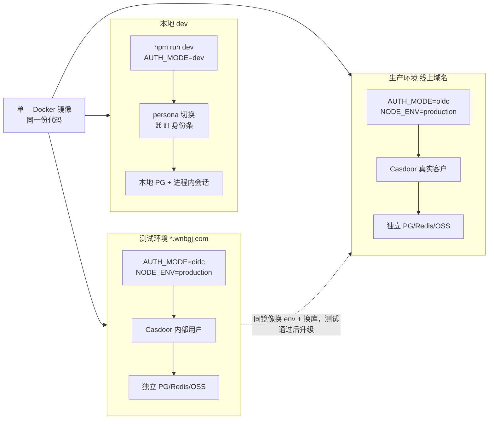

# 环境架构：dev / 测试 / 生产 三环境同构（WAN-132）

> 版本：v1.0 ｜ 日期：2026-11-15 ｜ 作者：鲁班（首席架构师）｜ 对应 issue：WAN-132
> 依据：老板 2026-11-15 决策（三条落点见 §1）；`docs/multi-tenant-selection.md`（WAN-81 会话模型）；`docs/architecture-and-tech-stack.md`。
> 本文只做环境与身份架构，不沿用任何「独立演示环境」的旧方案；与老板决策冲突处以老板决策为准。

## 0. 一句话结论

三种环境、一套代码、一个镜像，环境差异全部由 env 注入。本地 dev 用 **persona 切换** 实现免登录多角色体验；测试环境（`*.wnbgj.com`）与生产环境在代码层面**完全同构**（同 `AUTH_MODE=oidc`、同 `NODE_ENV=production`），只差域名 / 数据库 / 密钥 / Casdoor 实例 / 用户池；测试通过后再发布生产。

## 1. 老板决策的三条落点

| 老板原话 | 架构结论 |
| --- | --- |
| 本地 `npm run dev` 要便利切换、体验所有功能、不受登录制约 | dev 模式 persona 切换，是**唯一** dev-only 能力，条件注册、不进生产镜像 |
| `wnbgj.com` 作测试环境，可当生产环境，两环境无差异，用户都是自己人 | 测试环境 = 生产环境同构部署，真实 OIDC + RLS + 通知；**不新增第三种认证模式** |
| 测试环境没问题才发布线上 | CI 出单一镜像，测试 → 生产 = 「同镜像换 env + 换库」的一次升级，不是二次构建 |

这条决策直接**消解**了此前讨论里的两个分歧点：不再需要「独立演示环境」（L2），也不再需要 `AUTH_MODE=demo`（第三种认证模式）。测试环境就是生产环境的一份部署，只是用户是内部人。

## 2. 环境拓扑

## 3. 环境矩阵

| 维度 | 本地 dev | 测试 `*.wnbgj.com` | 生产 线上 |
| --- | --- | --- | --- |
| `AUTH_MODE` | `dev` | `oidc` | `oidc` |
| `NODE_ENV` | `development` | `production` | `production` |
| `WEAVE_ENV` | 不设 / `dev` | **`test`** | 不设 / `production` |
| 身份源 | persona 目录（`memberships` 行） | Casdoor（内部用户） | Casdoor（真实客户） |
| 免登录 / 切角色 | ✅ `⌘⇧I` persona 切换 | ❌ | ❌ |
| 会话存储 | 进程内（`SESSION_STORE=memory`） | Redis | Redis |
| 数据 | 本地 PG / MinIO | 独立 PG / Redis / OSS | 独立 PG / Redis / OSS |
| 通知 | log | 真实（内部收件人） | 真实 |
| 可重置 | ✅ `demo:reset` | ✅ `demo:reset`（限 test） | ❌ 脚本拒绝执行 |
| 生产态判定 `isProductionLike()` | false | true | true |

## 4. 核心决策（ADR）

### ADR-1：测试环境与生产环境同构，不做独立「演示环境」

测试环境与生产共用同一镜像、同一 `AUTH_MODE=oidc`、同一 `NODE_ENV=production`、同一 RLS 与通知链路，唯一差异是域名、数据库、密钥、Casdoor 实例与用户池。好处：

- 「测试环境和生产无差异」是老板的硬要求，代码层面直接成立，而不是靠「记得把 demo 行为关掉」来保证；
- 没有第三种认证模式，就没有「demo 算 dev 还是算生产」这类 22 处调用点都要回答的问题；
- 通知、计费、审计在生产怎么跑，测试就怎么跑，测试发现的问题才是生产会有的问题。

### ADR-2：persona = 目录里的 subject，切换 = 换会话，不是传 role

`apps/api/scripts/demo-identity.ts` 已经是正确范式：persona 是 `(subject, membership.role, dataScope)` 三元组，落在 `memberships` 表。切换 persona 复用现有 `SessionService`（`sessions.create` / `destroy`）+ `resolveMembership`，客户端只传 `personaKey`，**永远不传 role**。服务端每次请求都 `resolveOrThrow(sub, tenantId)` 重查 membership，角色停用/调整即时生效（`apps/api/src/gateway/auth.service.ts:107`）。

### ADR-3：不新增 `AUTH_MODE` 第三值；dev-only 能力条件注册

`AUTH_MODE` 保持 `dev | oidc` 两值。persona 端点放 `apps/api/src/dev/`，按鉴权策略**条件注册**：非 dev 模式下路由不存在（404），而不是「存在但 403」。这保证生产/测试镜像里连端点都没有，`grep` 不到、也打不进去。`isProductionLike()`（`NODE_ENV=production || AUTH_MODE=oidc`）语义不变，测试/生产天然为 true。

### ADR-4：capability 收敛，单一权限事实源（前后端同包）

角色规则现在散在后端 4 处、前端 1 处（`mappers.ts`、`samples.service.ts`、`pricing-scope.ts`、`approval-policy.ts`、`panorama/page.tsx`）。新建 `packages/schema/src/capabilities.ts` 纯函数，前后端共用同一份；`/api/auth/me` 返回 `capabilities`，前端 `<Can cap="...">` 驱动显隐。这是「切 persona 后界面真的变」的前提，否则演示只剩右上角名字变。

### ADR-5：重置脚本化 + 生产禁用；不引入 `tenant_kind`、不引入快照运维

测试环境重置用脚本（`DROP SCHEMA public, drizzle` → migrate → seed），本地/CI/测试都能跑；脚本入口用共享的 `canResetDemoData()` 断言（`isProductionLike() && !isTestEnv()`）时拒绝执行，生产永不误触。因为测试环境是独立库，不存在「演示数据污染生产口径」问题，故 **`tenant_kind` / `billable_tenants` 视图暂不做**，等真正出现共享控制面跨环境统计的需求再上。

`WEAVE_ENV` 不是 `NODE_ENV` 的别名：测试环境仍 `NODE_ENV=production + AUTH_MODE=oidc`（同构），只是额外标记 `WEAVE_ENV=test`。只有这个值会放行重置与剧本接口；拼错/缺失一律按生产处理。`WEAVE_ENV=test + AUTH_MODE=dev` 会在 api 启动期拒绝。

## 5. 身份模型（代码落点）

| 组件 | 位置 | 说明 |
| --- | --- | --- |
| persona 目录（唯一事实源） | `packages/schema/src/personas.ts`（新） | `{ key, subject, role, dataScope, teamId }[]`，7 角色；seed / 端点 / 身份条 / e2e fixture 全读它 |
| persona seed | 扩展现有 `apps/api/scripts/demo-identity.ts` → 由目录驱动 | 幂等写 `memberships`，含 `teamId`（经理与业务员同 team） |
| 切换端点 | `apps/api/src/dev/personas.controller.ts`（新，条件注册） | `GET /api/dev/personas` + `POST /api/dev/session {personaKey}`；复用 `sessions`，毁旧建新 |
| 身份条 | `apps/web` 右下角 `⌘⇧I` | 切换后 `queryClient.clear()` + invalidate `["auth","me"]`，**不整页 reload**，保留当前路由 |
| 异常态 | 深链 `?as=disabled-member` 等，仅供 e2e | 不进产品 UI，避免销售误触 |

`SessionCredentialMiddleware`（`session-credential.middleware.ts:39-41`）里 `weave_sid` 优先于 Bearer 是**设计不是 bug**：切换必须走「换会话」路径而非「换 token」，与 `switchTenant` 的 `rebind` 语义一致，只补注释与回归测试，不改行为。

## 6. 数据与重置

- `pnpm demo:reset` = 入口门控 → 清对象存储 → `DROP SCHEMA public, drizzle` → migrate（含 RLS）→ seed → `demo:scenes` → 清 Redis 会话；十秒级，可进 CI、可本地复现。连跑两次结果一致（uuid 会变，剧本按业务锚点解析）。
- seed 用相对时间（SQL `now() - interval '3 days'`），代码里不出现绝对时间戳，重置后「3 天前的待审批」永远成立。
- 剧本做深链 `/today?scene=approval-pending`：`data/demo-scenes.json` 是唯一事实源，服务端按「客户编号 + 单据类型」从审批队列解析当前真实 id，前端高亮；同一份文件同时给销售与 e2e。
- 对象存储按 `tenant/<id>/` 前缀删，复用 `MediaMaintenanceService.purgeTenantObjects`（`maintain:media -- --purge-tenant --tenant=<id>` 也可单独执行）。
- **重置连 Redis 会话一起刷**（`weave:session:*`），否则重置后浏览器旧 sid 指向不存在的 membership，`resolveMembership` 抛 `PERMISSION_DENIED` 表现为「重置完白屏」。
- 剧本接口 `GET /api/demo/scenes[/:key]` 只在本地 dev 与 `WEAVE_ENV=test` 装配；生产镜像里路由不存在（404）。

## 7. 明确不做（KISS）

- `tenant_kind` 列 / `billable_tenants` 视图：测试环境独立库，无口径污染，暂缓。
- `AUTH_MODE=demo` 第三值：测试环境走真实 oidc。
- 访问码、`noindex`、`quote-demo.*` 域名：独立演示环境专属，已不需要。
- 3 个异常态进产品 UI：走深链给 e2e。

## 8. 交付顺序与分工

| 步骤 | 内容 | 负责 | 依赖 |
| --- | --- | --- | --- |
| 1 | capability 表 + `/api/auth/me` 返回 capabilities + 前端 `<Can>` | 墨子 | 无 |
| 2 | persona 目录 + 7 角色 seed + dev 切换端点（条件注册）+ 身份条 | 墨子 | 1 |
| 3 | 生产态判定统一（web 侧 7 处 `NODE_ENV` 与 api 侧 `isProductionLike` 对齐） | 墨子 | 无 |
| 4 | `demo:reset` 脚本 + scenes + 测试环境部署（独立库 / Redis / OSS） | 墨子 | 2、3 |
| 5 | 测试通过 → 生产发布（同镜像换 env + 换库） | 老板拍板 | 4 |

契约形状（`capabilities.ts`、`personas.ts`、`/api/dev/*` 的请求/响应）由本文 + 代码 schema 定义，墨子按 §8 顺序实现，先做第 1 步（独立可合、不依赖任何未决项）。
