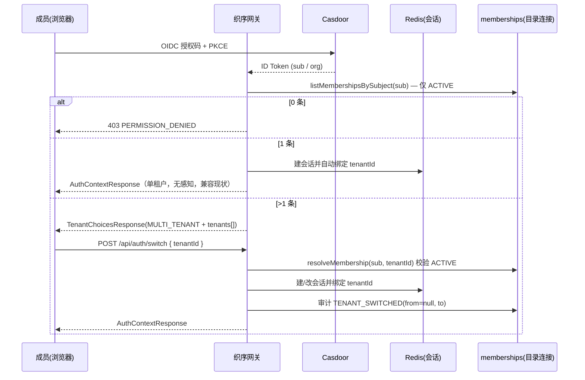
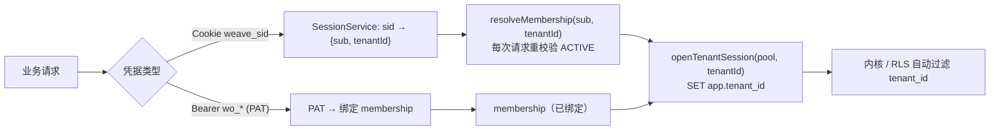

# 多租户成员：一个账号多个 ACTIVE membership 的登录租户选择（架构设计）

> 版本：v1.0 ｜ 日期：2026-11-14 ｜ 作者：鲁班（首席架构师）｜ 对应 issue：WAN-81
> 依据：`docs/t0-foundation.md` §2/§3/§7、`docs/product-design.md` §3.6
> 本文只做架构与技术方案，不改任何产品决策；与产品文档冲突处以产品决策为准。

## 0. 一句话结论

把「登录态」从**完全无状态**（每请求重验 Casdoor token）演进为**「OIDC 认证 + 本地租户会话」**：
认证仍交给 Casdoor（只验 `sub`），租户选择交给本地 **Redis 会话**（网关签发的 opaque `sid` 存 httpOnly Cookie）。
`tenant_id` 依旧只由网关注入，前端唯一能传 `tenantId` 的地方是**选择/切换端点**，且每次都回到 `memberships` 表做 ACTIVE 校验。

## 1. 现状与问题

当前 `kernel/tenancy.service.ts#resolveMembership(sub, org)`：

- 一个 subject 有 0 条 ACTIVE membership → `PERMISSION_DENIED`；
- 有 **多条** ACTIVE membership → 直接拒绝登录（「该账号属于多个租户，请选择组织后再登录」）。

多公司顾问 / 代运营 / 集团客户被挡在门外。目标（冻结于 WAN-81 issue）在不破坏租户隔离的前提下：

1. 登录后返回可选租户列表（只含该 subject 的 ACTIVE membership，不泄露其他租户）；
2. 选择租户后签发/换取绑定 `tenant_id` 的会话或短期令牌；
3. 切换租户必须重新走网关解析，**禁止前端直接传 tenant_id**；
4. 每次选择/切换写审计（actor、from/to tenant、时间）。

## 2. 核心决策（ADR）

### ADR-1：用「有状态 Redis 会话」而非「无状态租户 JWT」

| 方案 | 说明 | 取舍 |
| ---- | ---- | ---- |
| A. 无状态租户 JWT（网关自签） | 选择后网关签发含 `sub/tenantId/role` 的短命 JWT 作业务 Bearer | 引入第二套签名密钥与信任域，轮换/吊销复杂；「切换必须重新走网关」难落地 |
| B. **有状态 Redis 会话（选定）** | 网关生成 opaque `sid`，Redis 存 `{sub, tenantId}`，httpOnly Cookie 传递 | 每请求多一次 Redis 读；换取：吊销简单、切换即重绑、天然满足「tenant_id 只从网关来」 |

**理由**：Redis 已在栈内（`platform/redis.ts` 用于会话缓存/限流/队列）；`sid` 是随机值，Cookie 里不含 `tenant_id`，前端拿不到也传不了；登出即删会话，符合 `product-design` §3.6「同时撤销本地会话」。KISS：只加一个 `SessionService`，不新增外部依赖。

### ADR-2：PAT（`wo_` 凭据）保持绑定单条 membership，不引入多租户会话

- CLI / agent 的 PAT 在签发时已绑定**一条 membership**（一个租户），是租户作用域的一次性选择。
- 多公司顾问的 agent 需要访问多个租户 → 建多枚 PAT（各自绑定对应 membership），与「agent run 本身租户作用域」一致。
- 设备登录确认页（`/cli-login`）由已登录的人类在浏览器完成；若该人属多租户，确认时需**额外指定绑定哪条 membership**（见 §7 开放问题）。

### ADR-3：`org` claim 从「硬校验」降级为「提示性默认」

- 现状 `resolveMembership(sub, org)` 会校验 `membership.casdoorOrg === org`。
- 多租户选择场景下，用户登录 Casdoor 时只有一个 `org`，但要切换到的租户可能对应**另一个** org，硬校验会误拦合法切换。
- 授权事实来源是 `memberships` 行（`(subject, tenantId) ACTIVE`），不是 token 的 `org`。选择/切换以「该 subject 在该 tenant 是否有一条 ACTIVE membership」为唯一门槛，fail-closed。
- **保留**单租户自动绑定路径的 `org` 一致性校验作为纵深防御（不影响选择路径）。

## 3. 租户会话模型

Redis 键值（TTL 7 天，滑动续期）：

```
key:   weave:session:{sid}          // sid = 256-bit crypto random, opaque
value: { sub: string, tenantId: string|null, createdAt, lastSeenAt }
```

- `tenantId = null` 表示「已认证、未选租户」（MULTI_TENANT 中间态）。
- 业务请求的租户解析：`sid` → `sub/tenantId` → **每次请求重新** `resolveMembership(sub, tenantId)`（角色/数据范围变更立即生效，membership 被 DISABLE 时 fail-closed）。
- 会话凭据只走 httpOnly + Secure + SameSite=Lax Cookie；浏览器不持有 Casdoor token（沿用 BFF 约定，见 §5）。

## 4. 契约（`packages/schema/src/tenancy.ts`）

```ts
/** 选择器条目：只暴露租户身份 + 该 subject 自己的角色，不泄露他人/其他租户。 */
export const TenantChoice = z.object({
  tenantId: EntityId,
  slug: z.string().min(2).max(64),
  name: z.string().min(1).max(255),
  brand: z.string().max(255).nullable(),
  role: MemberRole,
}).strict();

export const TenantChoicesResponse = z.object({
  status: z.literal("MULTI_TENANT"),
  subject: z.string().min(1).max(128),
  tenants: z.array(TenantChoice).min(1),
}).strict();

/** 选择（首次）与切换共用同一输入形状。 */
export const SwitchTenantInput = z.object({ tenantId: EntityId }).strict();
```

`/api/auth/me` 的响应类型扩为判别联合：`AuthContextResponse`（已绑定）`| TenantChoicesResponse`（多租户未选）。

## 5. 网关端点与流程



端点（`apps/api/src/gateway/auth.controller.ts`）：

| 方法 | 路径 | 身份来源 | 返回 |
| ---- | ---- | -------- | ---- |
| GET | `/api/auth/me` | 会话 Cookie / Bearer OIDC / Bearer PAT | `AuthContextResponse` 或 `TenantChoicesResponse` |
| GET | `/api/auth/tenants` | Bearer OIDC 或会话 Cookie | `TenantChoicesResponse` |
| POST | `/api/auth/switch`（body `SwitchTenantInput`） | 会话 Cookie 或 Bearer OIDC | `AuthContextResponse` |
| DELETE | `/api/auth/session`（登出） | 会话 Cookie | 204，删 Redis 会话 + 走 Casdoor end_session |

业务端点（`/api/auth/customers` 等）**只认会话 Cookie 或 PAT**，租户解析顺序：



> 铁律不变：`DatabaseProvider`（目录/控制面连接）只用于 `(sub, tenantId) → membership` 映射，
> **绝不**承载业务数据请求；业务读写仍走 `openTenantSession` 的 `weave_app` 租户会话。

## 6. 内核方法与审计

`kernel/tenancy.service.ts`（均在目录连接 `this.db` 上执行，因为 `memberships` 受 RLS 保护）：

```ts
/** 返回 subject 的全部 ACTIVE membership（跨租户，目录连接）。 */
async listMembershipsBySubject(subject: string): Promise<Membership[]>;

/** 按 (subject, tenantId) 解析唯一 ACTIVE membership，否则 PERMISSION_DENIED。 */
async resolveMembership(subject: string, tenantId: string): Promise<Membership>;
```

- `resolveMembership` 签名从 `(subject, org)` 改为 `(subject, tenantId)`；`org` 交叉校验仅在单租户自动绑定路径保留（ADR-3）。
- 现有调用方 `auth.service.ts`（OIDC）与 PAT 路径同步收敛到新签名。

审计（`packages/schema/src/kernel.ts` 新增封闭动作）：

```ts
"TENANT_SWITCHED",   // entityType: "membership", entityId: membership.id
                     // before: { fromTenantId: string|null }  after: { toTenantId }
                     // actorType: HUMAN, actorId: subject
```

- 首选择 `fromTenantId = null`；切换为真实 `from`。
- 写入落 **to 租户** 的 `audit_log`（目录连接显式 `tenantId`，与 `access.service.ts` 的 `API_TOKEN_CREATED` 同模式）。
- 可选加固：同时在 from 租户追加一条「成员切换离开」，P0 可先只写 to（见 §7）。

## 7. 前端状态（`packages/core` + 桌面/移动登录入口）

- `packages/core`：新增 `TenantChoicesResponse` / `SwitchTenantInput` 类型与 `switchTenant()` API；`useTenantContext()` 返回
  `{ status: "LOADING" | "READY" | "MULTI_TENANT", tenant?, tenants?, select(tenantId), switch(tenantId) }`。
- 登录入口（E1 桌面 `apps/web` / E2 移动 `apps/mobile`）：`/api/auth/me` 返回 MULTI_TENANT 时渲染租户选择器；
  选择/切换成功后**只重拉 `/api/auth/me`**，不在 localStorage 存 `tenant_id`（租户随会话 Cookie，服务端为准）。
- `tenantId` 出现在前端的唯一位置是 `select/switch` 请求体，服务端以 membership 校验后决定是否接受。

## 8. 安全审查

| 威胁 | 缓解 |
| ---- | ---- |
| 租户枚举 | `listMembershipsBySubject` 只返回 subject 自己的 membership，无跨租户泄露 |
| 越权切换 | `resolveMembership(sub, tenantId)` fail-closed；非 ACTIVE 一律 403 |
| 会话固定 | `sid` 每次登录/切换重新生成；绑定前重新校验身份 |
| Cookie 窃取/重放 | httpOnly + Secure + SameSite=Lax；TTL 7d 滑动；登出即删 |
| 跨租户数据 | RLS 不变；业务请求仍走 `openTenantSession`，`tenant_id` 来自会话而非请求体 |
| 角色变更 | 每请求重解析 membership，角色/数据范围立即生效；DISABLE 立即失效 |

## 9. 迁移与回滚

- `memberships` / `tenants` 表**无 schema 变更**（`subject`/`status`/`casdoorOrg` 已存在，`memberships_subject_idx` 已存在），无需新迁移。
- 唯一新增：`AuditAction` 枚举值（纯契约，向后兼容）。
- 单租户（恰好 1 条 ACTIVE）自动绑定、PAT 路径不变 → 完全向后兼容，可灰度：先部署网关 + SessionService，MULTI_TENANT 分支在未命中时兜底走旧拒绝逻辑。

## 10. 测试

- 多租户账号可列出并切换；选择后 `/api/auth/me` 返回所选租户上下文。
- 未授权 `tenantId`（非该 subject 的 membership）一律 403；DISABLE 的 membership 切换一律 403。
- 跨租户数据仍被 RLS 拦截（复用 `tenancy.integration.test.ts` 口径）。
- 审计：每次 select/switch 在 to 租户落一条 `TENANT_SWITCHED`（含 from/to）。
- 会话：登出后旧 `sid` 失效；Redis 掉线时网关 fail-closed（拒绝业务请求，不降级为无租户）。

## 11. 成本估算

- 无新增基础设施；Redis 已在栈内，会话每条约几十字节，成本增量 ≈ **$0/月**。
- 新增代码面：`SessionService`（网关）+ 2 个内核方法 + 3~4 个端点 + 前端 1 个 hook，单人可维护。

## 12. 开放问题（交产品 / 实现确认）

1. **记住上次租户**：切换后是否默认回到最近使用的租户（产品决策，巧匠）。
2. **按域名自动进入**（`company.weaveorder.cn` 自动选租户）：建议 P1+，不并入 WAN-81。
3. **CLI 设备登录多租户**：`weave login` 确认页需否加租户选择（建议加，device decision 增可选 `membershipId`）。
4. **审计落点**：to 租户单条（P0 推荐）vs from+to 双条（合规更强）。
