# 后 AI 时代纺织管理软件 · 产品设计

> 版本：v1.7 ｜ 日期：2026-11-12 ｜ 作者：巧匠（产品设计 & 增长）
> v1.7 变更：确认「席位 + 动作」收费、token 只计量不收费（§14.2）；新增配置优先原则与配置中心（§14.11），模型/价格/限额/开关等统一进总后台。
> v1.6 变更：接入 LLM Router（LiteLLM）与 token 计量（§14.2 / §15.4）；Casdoor 落地到 `sso.wnbgj.com`（§3.6）；新增「表单 + Chat→Patch」改稿（§7.8）；隔离升级包价格改为后台合同配置。
> v1.5 变更：确认共享库+RLS 默认、schema/独立库仅作升级项；LLM 不做自部署，改为平台端参数设置；数据区域改为按合同启用；新增 Casdoor 统一登录（§3.6）。
> v1.4 变更：新增多租户隔离（共享库+RLS / schema-per-tenant / 独立库）与 LLM 部署设计，见 §15。
> v1.3 变更：打印代理（Print Agent）与每家公司个性化（模板工作室 + AI 识样张）、总后台版本化价格表与租户合同价、开票设置可配（§4.4 / §14.1 / §14.3 / §14.5）。
> v1.2 变更：打印与单证流水线（§4.4 / §7.7 / §8.6 / §8.7）、SaaS 商业化与平台总管理端（§14）、打印与 SaaS 数据模型和指标。
> v1.1 变更：配置继承链（§3.5）、移动端 5 入口与能力矩阵（§5.2）、客户报价链接（§7.6 / §8.5）、分享指标与增长闭环（§11 / §13.6）。
> 面向：`weave-order`（织序）现有代码与三份既有文档（`mvp-usability-assessment.md`、`usability-roadmap.md`、`platform-and-engineering-plan.md`）
> 本文回答的是**产品该怎么设计**：定位、角色、能力、双端、界面、权限、指标与分期。工程可行性沿用既有文档的结论，不重复论证；如有冲突，以本文的产品决策 + 既有文档的阶段排序为准。

---

## 0. 一句话

**织序不是「带 AI 功能的纺织 ERP」，而是一套「智能体干活、人只做决定」的纺织业务操作系统。**

布管家这类软件的前提是「业务员是操作者」：人选菜单、人录单、人查表。织序的前提是「智能体是默认操作者」：系统听懂一句话、自己找样、自己起草、自己跟进，人只在一张卡片上按「批」。所以它不是把布管家的功能搬上 AI，而是把布管家的**能力**重新组织成**智能体可调用的工具** + **人可审批的草稿**。

产品名沿用 **织序 WeaveOrder**。对外一句话：

> **你说生意，系统做单。**
> 报价、寄样、跟单、对账，智能体做完，你只点头。

---

## 1. 产品判断：后 AI 时代到底变了什么

| 维度       | 前 AI 时代（布管家 / 珍妮类） | 后 AI 时代（织序）                                     | 设计含义                                     |
| ---------- | ----------------------------- | ------------------------------------------------------ | -------------------------------------------- |
| 软件价值   | 存得住、查得到                | **替人做完一段工作**                                   | 首页不是菜单，是「今天替你做了什么、等你决定什么」 |
| 人的角色   | 操作者：录入、查询、点击      | **审批者 / 异常处理者**                                | 交互从「填表单」变成「看草稿、改一处、批」   |
| 数据入口   | 人逐条录入                    | 微信原话、照片、Excel、扫描件、语音 → 智能体结构化     | 输入必须是自然的多模态，不是 20 个字段       |
| 功能组织   | 按模块（样品/客户/订单）      | 按**任务**（这单客户要什么，谁去做，卡在哪）           | 模块仍在，但用户不按模块工作                 |
| 多用户     | 账号 + 权限，防越权           | 人 + **智能体成员**，都要有范围、预算、审计            | 权限模型要把 agent 当一等公民                |
| 护城河     | 数据量                        | **客户上下文 + 决策增量**（越用越懂这家客户）          | 每次改价/驳回都是训练信号，必须沉淀          |
| 交付形态   | PC 为主，移动端是查询器       | **双端同权**：PC 做批量与深度，手机做现场与决定        | 不是「PC 功能搬到手机」，是按场景切          |

**结论**：产品设计的第一性问题不是「功能够不够全」，而是**一条工作流能不能由智能体跑到「只剩一个决定」**。功能表再长，只要中间还要人搬数据，就仍是前 AI 时代的软件。

---

## 2. 产品架构：三层 + 一个自主等级

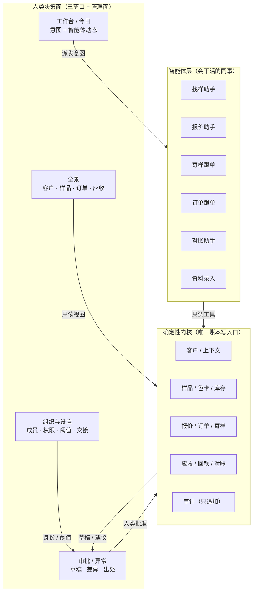

### 2.1 自主等级（每个 agent 能力都要标级）

| 等级 | 名称       | 行为                                       | 适用                                 |
| ---- | ---------- | ------------------------------------------ | ------------------------------------ |
| L0   | 只建议     | 给选项、给理由，不动任何数据               | 定价口径不明、新客户、首次合作       |
| L1   | 出草稿     | 产出 `DRAFT`，等人批（**当前默认**）       | 报价、寄样单、对账单、消息           |
| L2   | 执行后告知 | 低风险动作直接做，进「已办」并可撤销       | 建跟进任务、更新物流、打标签、提醒   |
| L3   | 自主运行   | 在预算与规则内闭环，只在异常时找人         | 常规催办、库存预警、日报（后期开放） |

设计原则：**默认 L1，升级靠证据**。一个 agent 在某客户/某品类上连续 N 次被原样采纳，才允许把该场景升到 L2；任何金额类动作永远不低于 L1。自主等级是**按场景配置**的，不是按 agent 全局开关，避免「一放就乱」。

---

## 3. 用户与组织

### 3.1 角色（先 6 个，不要再加）

| 角色 | 代号 | 每天在干什么 | 主端 | 关键诉求 |
| ---- | ---- | ------------ | ---- | -------- |
| 老板 / 总经理 | `owner` | 看经营、批大单、处理客户交接 | 手机 + PC | 5 分钟知道公司今天哪里不对 |
| 主管 / 合伙人 | `manager` | 批中额单、带新人、看团队漏斗 | PC + 手机 | 团队的单卡在哪、谁在摸鱼 |
| 业务员 | `sales` | 客户现场、找样、报价、寄样 | **手机优先** | 客户一句话，10 分钟给出报价 |
| 跟单 | `merchandiser` | 寄样物流、大货进度、交期 | 手机 + PC | 不漏一单、不被客户催 |
| 样品间 / 仓管 | `sample_admin` | 色卡、借还、盘点、扫码 | **手机 / 扫码枪** | 找得到、数得清 |
| 财务 | `finance` | 应收、回款、对账、开票 | PC | 月底对得上、逾期看得见 |

只读外部角色（客户/供应商）**本期不做**，见 §12 的 P3。财务不是「只读」：能登记回款、生成对账单，但不能改报价与订单金额。

### 3.2 智能体也是「成员」

| 字段       | 说明                                                       |
| ---------- | ---------------------------------------------------------- |
| 名称/头像  | 「小织 · 报价」「小样 · 找样」，让人能指名道姓地找它       |
| 归属       | 属于公司，不属于个人；可被分配给某个团队/客户              |
| 工具范围   | 只拥有该角色需要的工具（找样 agent 不能确认报价）          |
| 数据范围   | 与创建人一致或更窄；跨客户检索需显式授权                   |
| 每日预算   | 模型调用 / 外部查询次数上限，超限降级为 L0 并通知 owner     |
| 审计       | 每次工具调用、草稿、失败都记 `actorType=AGENT` + `actorId` |

**设计要点**：界面上不要叫「AI 功能」，要叫「小织正在做…」。人会对「同事」有预期，对「功能」只有开关。

### 3.3 权限模型：三层 + 两条阈值

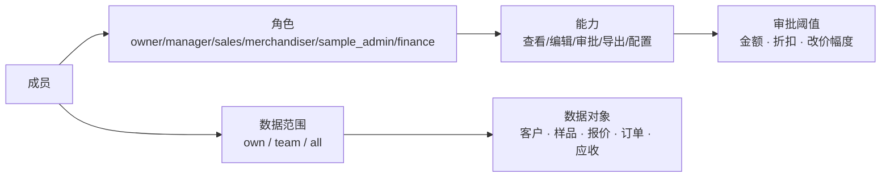

| 能力             | owner | manager | sales | merchandiser | sample_admin | finance |
| ---------------- | :---: | :-----: | :---: | :----------: | :----------: | :-----: |
| 查看全公司客户   |   ✓   |  团队   | 自己  |     自己     |      —       |  金额向 |
| 新建/编辑客户    |   ✓   |    ✓    |  自己 |      —       |      —       |    —    |
| 查看成本底线     |   ✓   |    ✓    |  ✗    |      ✗       |      ✓       |    ✓    |
| 生成报价草稿     |   ✓   |    ✓    |   ✓   |      —       |      —       |    —    |
| 批准报价 ≤ 5 万  |   ✓   |    ✓    |   ✓   |      —       |      —       |    —    |
| 批准报价 ≤ 20 万 |   ✓   |    ✓    |  ✗    |      —       |      —       |    —    |
| 批准 > 20 万     |   ✓   |    ✗    |  ✗    |      —       |      —       |    —    |
| 改价 > 10%       |   ✓   |    ✓    | 需上级 |      —       |      —       |    —    |
| 库存出入库       |   ✓   |    ✓    |  ✗    |      ✓       |      ✓       |    —    |
| 登记回款         |   ✓   |    ✓    |  ✗    |      ✗       |      —       |    ✓    |
| 客户交接         |   ✓   |    ✓    | 发起  |      —       |      —       |    —    |
| 成员/权限/阈值   |   ✓   |  部分   |  ✗    |      ✗       |      ✗       |    ✗    |
| 修改公司级定价策略 |   ✓   |  建议   |  ✗    |      ✗       |      ✗       |    ✗    |
| 修改客户/个人默认值 |   ✓   |    ✓    |  自己 |      ✗       |      ✗       |    ✗    |
| 分享报价链接     |   ✓   |    ✓    |  自己 |      ✓       |      ✗       |    ✗    |
| 查看链接访问数据 |   ✓   |    ✓    |  自己 |      ✓       |      ✗       |    ✗    |

三条硬规则：

1. **数据范围默认 `own`**。纺织贸易里客户是业务员的命，跨人可见会直接引发抵触；共享必须显式（项目协作或交接），并留痕。
2. **金额阈值在阶段一就留字段**。阈值后改要重写审批流；先允许全公司一个默认值。
3. **审计存快照**：`actorRole` / `tenantId` / `dataScope` 在动作发生时落库，员工调岗后仍能还原「当时他有没有这个权限」。

### 3.4 客户交接（离职 / 调岗）

不是「改个 owner 字段」就完了，要做成一次**带清单的移交**：

1. 主管发起交接 → 系统列出：在跟客户、未决报价、在途寄样、未回款订单、待办跟进。
2. 新业务员逐项确认接收；客户上下文（偏好、历史价、付款习惯）只读带过去。
3. 交接期 7 天内双方都能看；到期后原业务员自动失去 `own` 权限。
4. 全程审计 + 通知客户负责人（内部，不通知客户）。

### 3.5 配置优先级：系统推荐 → 公司 → 团队/客户/品类 → 个人

毛利率、报价有效期、付款方式、税率口径、改价阈值、取整规则这些「会因为公司不同而不同」的参数，**不写死在代码里，也不要求每家公司从零填**。统一按一条继承链取值：

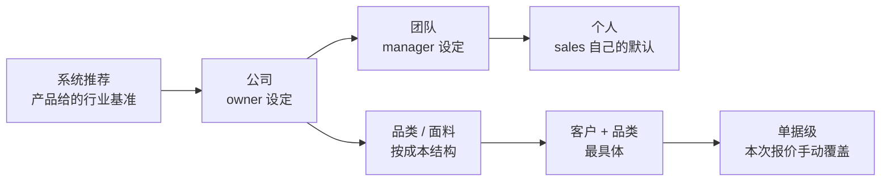

**取值顺序（从最具体到最通用）**：

```
单据级 > 客户+品类 > 品类 > 客户 > 团队 > 个人 > 公司 > 系统推荐
```

**但优先级不是简单的「就近覆盖」**，否则业务员可以给自己设 5% 毛利。参数分两类：

| 类型 | 例子 | 规则 |
| ---- | ---- | ---- |
| **管控类**（下限 / 上限 / 审批线） | 成本底线、最低毛利率、审批金额阈值、改价幅度上限、税率 | **公司级是硬边界**。下级只能收紧，不能放宽；越界时取边界值并显式提示「已按公司底线修正」 |
| **建议类**（默认值 / 偏好） | 默认毛利率、报价有效期、付款方式默认值、条款模板、取整规则 | 按上面的顺序就近覆盖；个人可以改自己的默认值 |

所以最终生效值 = **就近取到的值，再被管控层夹一次**。举三个例子：

| 参数 | 系统 | 公司 | 品类（棉氨纶） | 客户（青禾） | 个人（李娜） | 生效值 | 说明 |
| ---- | ---- | ---- | -------------- | ------------ | ------------ | ------ | ---- |
| 默认毛利率 | 18% | 20% | 22% | 21% | 19% | **22%** | 品类比客户更具体，且高于个人 |
| 客户+品类毛利率 | — | 20% | 22% | — | — | **21.5%** | 客户+品类是最具体的一层 |
| 最低毛利率 | 12% | 15% | — | — | 8% | **15%** | 个人想设 8%，被公司底线夹回 15% |

**四条产品规则**：

1. **每个值都显示来源**。设置页、客户 360、报价审批卡上都标注「生效值 + 来自哪一层 + 谁在什么时候设的」。审批人看到的不是孤零零一个 18%，而是「18% · 客户专属，李娜 2026-08 设定」。
2. **继承不是复制**。下级没设就实时继承上级；上级改了，下级立刻跟着变。要「冻结」当前值必须显式点「固定为…」并留痕。
3. **智能体只读生效值**。agent 可以在建议里引用「公司底线 15%、该客户历史 21%」，但不能修改任何配置；它只能提议「这家客户建议下调 1%」，由人批。
4. **系统推荐会学习，但不会偷偷变**。推荐值 = 行业基准 + 该公司被采纳的历史（决策增量）。每月生成一次「建议调整」清单，owner 确认后才生效。

**谁能设哪一层**：

| 层级 | 谁可以设 | 备注 |
| ---- | -------- | ---- |
| 系统推荐 | 产品团队 | 所有公司可见，不可被单公司改写 |
| 公司 | owner | 管控类参数的唯一出口；修改写审计 |
| 团队 | manager | 只能在不突破公司边界的范围内 |
| 品类 / 面料 | manager、sample_admin（仅成本字段） | 按成本结构，通常由主管维护 |
| 客户 / 客户+品类 | 客户的 owner、manager | 销售可提议，超出公司边界需审批 |
| 个人 | 每个成员 | 只影响自己的默认值，不影响他人 |
| 单据级 | 报价的创建人 / 审批人 | 只影响本单，必须在审批卡上显示偏离与理由 |

**交互形态**：设置页不是一堆输入框，而是一张「继承表」：

```
参数            系统推荐   公司     团队    我的     生效值      来源
默认毛利率       18%       20%      —      19%      22%        品类：棉氨纶
最低毛利率       12%       15%      —      8%       15%        公司底线（你的 8% 已被修正）
报价有效期       15 天     30 天    —      —        30 天      公司
付款方式         月结 30   月结 30  —      月结 45  月结 30    公司（个人不可放宽）
```

每一行可展开「为什么是这个值」，显示完整的继承链和最近三次修改。客户 360 里多一个「该客户专属」页签，只显示与默认值不同的项，避免配置迷宫。

### 3.6 身份与登录：Casdoor 负责认证，我们只做授权

**决定：不自研登录。** 密码、短信验证码、微信扫码、MFA、SSO、找回密码、登录风控全部交给 **Casdoor**（自托管，OIDC/OAuth2），我们只保留业务角色与数据范围。这样少写一大块最容易出安全事故的代码。

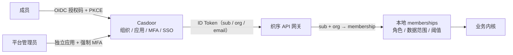

**租户与组织的映射**：

- **一个租户 = 一个 Casdoor Organization**，用户池天然隔离，支持每家公司自己的登录方式与品牌。
- **一个产品 = 一个 Casdoor Application**（`weave-order`）；平台管理端是**另一个应用**（`weave-platform`），强制 MFA，禁止社交登录。
- 登录后 ID Token 里有 `sub` 与 `org`；后端用 `(sub, org)` 查本地 `memberships`，**tenant_id 以本地 membership 为准**，不直接信前端。

**四种登录入口**：

| 入口 | 方式 | 说明 |
| ---- | ---- | ---- |
| 租户员工 | 手机号+密码 / 微信扫码 / 企业 SSO | 按公司配置；邀请制，不开放自助注册 |
| 企业 SSO | SAML / OIDC（钉钉、企微、飞书、Azure AD） | 按租户开通，域名验证 + JIT 建号 |
| 平台管理员 | 邮箱+密码 + 强制 MFA | 独立应用，可选 IP 白名单 |
| 客户（报价链接） | 无需登录 | 只读 token 链接，见 §7.6 |

**账号生命周期**：

1. 邀请：管理员填手机/邮箱 → 在 Casdoor 对应组织建号 → 同步创建 `memberships`（角色、数据范围）。
2. 调岗：只改 `memberships`，不动 Casdoor 账号；角色变更立即生效。
3. 离职：禁用 Casdoor 账号 + 撤销会话 + 触发客户交接（§3.4）；历史审计保留。
4. 多公司顾问：一个 Casdoor 用户可属于多个 Organization；登录后选择租户，或按域名自动进入。

**我们不做的事**：不存密码、不做短信通道、不做 MFA、不做找回密码、不做登录限流。Casdoor 负责这些，我们只校验 token（issuer / audience / exp / nonce）并映射权限。

**Casdoor 部署**：已部署在 `https://sso.wnbgj.com`（单点登录）。独立 Postgres、每日备份；与业务库分离；升级走灰度。它是登录的单点，必须监控可用性与延迟；故障时保留已签发会话的短期宽限，但禁止新登录。

**接入参数（施工清单）**：

| 项 | 值 |
| -- | -- |
| Issuer | `https://sso.wnbgj.com` |
| Discovery | `https://sso.wnbgj.com/.well-known/openid-configuration` |
| 租户端应用 | `weave-order`，回调 `https://app.weaveorder.cn/auth/callback` |
| 平台端应用 | `weave-platform`，回调 `https://admin.weaveorder.cn/auth/callback`，强制 MFA |
| Scopes | `openid profile email phone` |
| Claims | `sub`、`org`、`name`、`email`、`phone` |
| Token | RS256，JWKS 校验，clock skew ≤ 60s；access token 15 分钟、refresh 7 天 |
| 登出 | 走 Casdoor `end_session_endpoint`，同时撤销本地会话 |
| 组织 | 每租户一个 Organization；平台单独 Organization |

**配置原则**：`client_secret` 只存服务端环境变量/KMS；回调地址白名单精确匹配；不在前端存 token；跨域用 BFF/同源代理，避免把 access token 暴露给浏览器脚本。

**数据模型增量**：`users` 增加 `idp_subject` / `idp_org`；新增 `idp_connections`（租户 SSO 配置）、`idp_org_map`（tenant ↔ Casdoor org）、`sso_domains`（域名验证）。不存密码字段。

---

## 4. 能力地图：布管家能力 → 织序能力

### 4.1 行业基准能力（布管家 / 珍妮类软件的共性）

面料库与色卡、样品管理（借还/样品间/条码）、以图找样与按规格找样、客户档案与跟进、报价与合同、订单与生产进度、库存出入库、寄样物流、应收与对账、报表、移动端查询、账号与权限。

**我们不做「功能对齐清单」。** 对齐的是**任务完成度**：同一件事，布管家要人做 8 步，织序要做到「人只说一句 + 批一次」。

### 4.2 能力对照

| 能力域 | 布管家类做法 | 织序做法（智能体 + 草稿） | AI 增量 | 端 |
| ------ | ------------ | ------------------------- | ------- | -- |
| 面料/色卡库 | 手工建卡、传图、填 20 个字段 | 拍照/Excel/供应商表 → 自动结构化；缺失字段标红待补 | 识别成分/克重/门幅，自动去重合并 | PC 建，手机拍 |
| 找样 | 关键词/类目筛选 | 一句话、一张图、一段客户原话 → 候选 + 命中理由 + 库存 | 多模态检索、相似度解释、替代料建议 | 手机为主 |
| 客户档案 | 人录 + 跟进记录 | 微信原话/通话摘要自动归档；客户 360 自动生成 | 偏好、价格敏感度、付款习惯沉淀为上下文 | 双端 |
| 报价 | 选模板、填单价、算总价、导出 | 客户一句话 → 草稿（含定价依据、历史价、毛利）→ 人改一处 → 批 → PDF/链接 | 定价建议、底线校验、改价写决策增量 | 手机批，PC 改 |
| 定价/毛利 | 固定系数，或每个业务员手填 | 系统推荐 → 公司 → 团队/客户/品类 → 个人继承链；审批卡显示生效值与来源 | 推荐值随采纳率变准、公司底线自动夹取、越权配置拦截 | 双端 |
| 寄样 | 建单、填运单、人工催 | 建单 → 自动追踪 → 到样提醒 → 生成跟进话术 → 识别回复 → 转报价 | 中断可视化、自动催办、回复意图识别 | 手机 |
| 订单/生产 | 手工排期、Excel 跟 | 报价成交自动转订单；按交期倒排节点；异常自动升级 | 延期预测、缺料预警、客户同步话术 | PC 看板，手机收异常 |
| 库存 | 扫码出入库、盘点 | 扫码/拍照出入库；安全库存自动补货建议 | 呆滞料识别、按订单预留 | 手机/扫码枪 |
| 对账 | 月底拉 Excel 对 | 自动生成对账单；差异定位到单/行；回款自动核销 | 差异解释、逾期分级催收 | PC 为主 |
| 打印/单证 | 各模块各自打印，模板散落 | 统一打印中心：模板继承、队列、打印代理、扫码重打、日志 | 一单一码、自动补打、缺字段预检 | PC + 手机蓝牙 |
| 报表 | 固定报表 | 问一句「这个月谁毛利最高」→ 图表 + 口径说明 | 自然语言取数、异常归因 | 双端 |
| 权限 | 账号 + 角色 | 角色 + 数据范围 + 金额阈值 + 交接 + agent 权限 | 越权拦截、审批路由 | PC 配置 |
| 移动 | 查询/审批 | 与 PC 同权的「现场工作台」 | 拍照、语音、扫码、离线队列 | 手机 |

### 4.3 只有后 AI 时代才成立的新能力

1. **客户上下文（护城河）**：每个客户的价格带、常用品类、付款节奏、沟通偏好、历史争议。每次改价/驳回都写 `decision_deltas`，下一次建议显式引用「上次给该客户 15.0，本次 15.2，因为棉价涨了 4%」。
2. **决策出处（Provenance）**：任何数字都能点开看来源：哪张样品、哪次报价、哪条消息、哪个规则。没有出处的数字不许出现在审批卡上。
3. **差异审批（Diff Approval）**：人改过的草稿，审批人看到的是「智能体原稿 vs 人的修改」逐行 diff，而不是一坨新数字。
4. **异常优先（Exception-first）**：默认视图不是全量列表，而是「今天有 3 件事不对」。正常的事智能体做完就沉下去。
5. **自然语言取数**：老板问「上周寄样转化率」，系统给图 + 口径 + 可下钻，不再等报表。
6. **交接即知识转移**：客户上下文跟着客户走，人走单不断。

### 4.4 打印与单证：把每天几十次的动作做成一条流水线

纺织贸易的打印不是「页面上放个打印按钮」，而是仓库和办公室每天几十次的高频动作：**箱唛、发货单、拣货单、报价单、对账单、样品标签、货架标签**。它有三个硬特点：

1. **设备杂**：A4 激光、热敏标签机（ZPL/TSPL）、蓝牙便携机、针式打印机，各自协议不同。
2. **场景碎**：办公室打单据、仓库打箱唛、展会打样品标签、老板在手机上补打一张。
3. **错不起**：箱唛贴错 = 发错货；发货单数量错 = 对账扯皮。打印必须能追溯、能重打、能作废。

所以打印要做成**一套独立的基础设施**，而不是在每个页面复制粘贴：


**六条设计原则**：

1. **模板与数据分离**。模板只能引用后端给的变量白名单，不能写业务逻辑、不能查库。金额、数量、批次永远来自内核视图。
2. **一次配置，处处可打**。打印机、纸张、模板在「打印中心」配一次；报价、订单、发货单、寄样都复用同一套。
3. **一单一码，扫码即打**。每个箱唛/样品标签带二维码，扫码能查单据、验箱、重打；仓库不用回去翻电脑。
4. **打印即留痕**。每次打印记录人、时间、模板版本、份数、设备、结果；对外单据存快照，事后能还原「当时打出来是什么样」。
5. **失败不吓人**。打印机离线就进队列，显示「已排队 3 张，恢复后自动补打」，不弹红色报错。
6. **默认安全**。外部单据带客户名/报价编号水印；重打要选原因；作废标签要留记录；不允许打印任意本地文件。

#### 打印中心（全局抽屉，不新增第四个窗口）

```
打印中心
├── 队列    待打 / 打印中 / 已完成 / 失败（可重试、可取消）
├── 模板    单据（报价/发货/对账/合同）· 标签（箱唛/样品/货架）
│           系统模板 → 公司覆盖 → 单据类型覆盖；版本与预览
├── 设备    打印代理（在线/离线）· 打印机（A4/热敏/蓝牙）· 耗材余量
└── 记录    谁打了什么、几份、哪版、重打原因、作废记录
```

入口只有三个：顶栏「打印」、任何单据详情里的「打印」、手机扫码。**不做「打印」一级导航**，因为打印是动作，不是工作区。

#### 单据与标签矩阵

| 类型 | 触发点 | 数据来源 | 输出 | 设备 |
| ---- | ------ | -------- | ---- | ---- |
| 报价单 | 批准后 / 分享链接 | 报价版本快照 | A4 PDF / 客户链接 | 服务端渲染 |
| 发货单（送货单） | 订单发货 | 订单行 + 实发数量 + 箱号 | A4 PDF，可多页 | 服务端 / 浏览器 |
| 拣货单 | 发货前 | 订单行 + 货位 + 批次 | A4 PDF（可勾选） | 办公室 A4 |
| 装箱单 | 装箱完成 | 箱号 + 每箱明细 | A4 PDF / 随箱 | 服务端 |
| 箱唛 | 装箱完成 | 箱号、订单号、客户、目的地、箱数、毛重 | 100×100 / 100×150 热敏 | ZPL/TSPL / 蓝牙 |
| 样品标签 | 建样品 / 借出 | 样品编号、品名、克重、色号、二维码 | 50×30 / 60×40 | 热敏 / 蓝牙 |
| 货架位标签 | 盘点 / 入库 | 货位、品类、容量 | 70×40 | 热敏 |
| 对账单 | 月度对账 | 客户 + 期间 + 差异 | A4 PDF | 服务端 |
| 洗水唛 / 吊牌 | 大货生产（P3） | 成分、洗涤说明、尺码 | 织唛/吊牌机 | 第三方 |

#### 发货单 + 箱唛：一条真实的仓库流水线

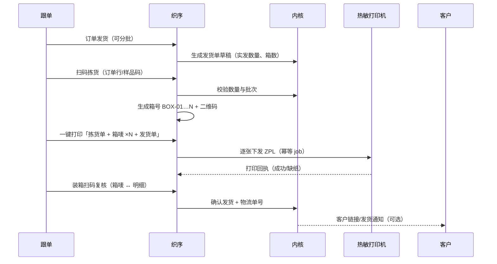

**关键细节**：

- **分批发货**：一张订单可拆多张发货单，每张有自己的箱号与单据；对账按发货单汇总，不重复计。
- **扫码复核**：装箱时扫箱唛再扫商品码，不匹配就拦下；这是「发错货」的唯一有效防线。
- **一箱一码**：二维码内容 = `tenant/order/box/seq`，不含价格；外部扫描无法枚举。
- **可补打**：重打要选原因（损坏/丢失/客户要求/打错），超过 3 次提示主管；作废标签记录 `voided_at`。
- **耗材与成本**：按标签张数统计耗材，月底能看到「这个客户用了多少张箱唛」。

#### 模板与渲染

- **系统模板**：产品自带 3 套（简洁/经典/出口英文），开箱即用。
- **公司覆盖**：owner 可改抬头、Logo、银行账号、条款、字体；继承规则与 §3.5 一致。
- **单据类型覆盖**：同一张发货单，内销/出口用不同模板。
- **变量白名单**：`{{customer.name}}`、`{{order.no}}`、`{{box.no}}`、`{{qty}}` 等，由后端提供；模板里出现未知变量直接渲染失败并提示。
- **预览用真实数据**：选一张真实单据预览，不用假数据；缺字段标黄，不允许打印空值。
- **版本化**：模板改动生成新版本；已打印单据绑定当时版本，重打默认用原版本，避免「补打出来不一样」。
- **中文与条码**：内嵌中文字体；Code128 / QR 由渲染器生成，不依赖打印机字体。

#### 打印代理（Print Agent）：装一次，所有打印机都能用

打印代理是一个**常驻在办公室/仓库的本地小程序**（Windows 优先，后续 macOS），不是一个网页，也不是某个人的电脑。它负责最后一公里：

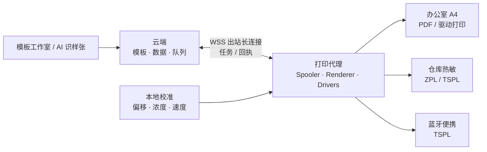

**三种渲染模式**（按需混用，模板不必二选一）：

| 模式 | 谁渲染 | 适用 | 好处 |
| --- | --- | --- | --- |
| 云端渲染 | 服务端 | 标准 A4 / 标准标签 | 所见即所得、任何代理都能打 |
| 本地渲染 | 代理 | 特殊字体、特殊纸张、离线 | 不依赖网络、支持本地驱动 |
| 本地校准 | 代理叠加 | 每台打印机的偏移/浓度/速度 | 不改云端模板也能调好位置 |

**代理的职责**：

1. 注册到租户，拿一个**只能打印、不能读业务数据**的 token；出站长连接，不开入站端口。
2. 发现并登记打印机（系统驱动 / 网络 IP / USB / 蓝牙），每台机器一个 profile。
3. 接收打印任务（PDF / ZPL / TSPL / RAW），本地排队、重试、回报状态。
4. 离线时本地 spool，联网后按序补传；重复任务用 `idempotency_key` 去重。
5. 自动更新（签名包、灰度、可回滚）；崩溃自启；托盘常驻，不弹广告。
6. 本地只保留任务载荷 ≤24 小时，不落客户数据；日志脱敏，可一键清空。

**部署与运维**：一个租户可以有多个代理（办公室、仓库、门店），按打印机分组；代理掉线 5 分钟告警到 IT/管理员；每台新打印机必须打一张**测试标签**（对齐、浓度、条码可扫）才算配置完成。

#### 每家公司个性化：模板工作室 + AI 识样张

标准化模板只能解决 70%。剩下 30% 是每家公司的「老单据」：自己的抬头、条款、银行账号、英文品名、客户专属格式、特殊字段。产品要能**让业务自己改，不用找开发**。

**四个层次**，从轻到重：

| 层次 | 做什么 | 谁来做 | 需要开发吗 |
| --- | --- | --- | --- |
| 1. 参数覆盖 | Logo、抬头、银行、条款、字体、颜色、纸张 | owner / 主管 | 不需要 |
| 2. 字段与布局 | 加字段、调列宽、换顺序、显示/隐藏价格、加签字栏 | 主管 | 不需要 |
| 3. 模板工作室 | 拖拽区块 + HTML/CSS 片段 + 条件显示 | 主管 / 实施 | 不需要 |
| 4. 模板包 | 私有化/渠道商的定制模板包，可导入导出、锁版本 | 实施 / 渠道 | 少量 |

**AI 识样张（Template Copilot）**：这是最能打动老板的一步。

```
上传一张旧发货单/箱唛（PDF 或照片）
  → 视觉识别：标题、表格、字段、Logo、条款、条码位置
  → 生成模板草稿（block JSON）
  → 人改 3 处（字段映射、纸张、字号）
  → 用真实订单预览
  → 打测试页 → 发布为公司模板 v1
```

它不是「AI 生成一张图」，而是**生成一个可编辑、可版本化、能绑定真实数据的模板**。识别错的字段用黄色标出，必须人工确认；所有变量只能从白名单选。

**个性化必须有的约束**：

- **变量白名单**：模板只能引用后端给的字段；自定义字段也在白名单里注册后才能用。
- **条件显示**：内销/出口、含税/不含税、是否显示价格、客户语言，用规则而不是复制 N 套模板。
- **模板优先级**：单据类型 → 客户 → 地区/语言 → 公司默认。和定价继承一样，显示「当前生效的是哪一套、为什么」。
- **版本与回滚**：每次发布新版本；已打单据绑定旧版本；一键回滚；灰度到一台打印机试打。
- **测试数据**：必须用真实单据预览，缺字段标黄；不允许「先上线再发现打不出来」。
- **权限**：改模板 = owner/manager；打测试页 = 任何有打印权限的人；发布 = 主管。

**典型个性化场景**：

| 场景 | 做法 |
| --- | --- |
| 每家公司抬头/银行/条款不同 | 参数覆盖，继承表 |
| 客户要求发货单不显示单价 | 模板条件 `showPrice=false`，按客户绑定 |
| 出口箱唛要英文品名 + HS Code | 双语模板 + 自定义字段 |
| 不同客户要不同箱唛尺寸 | 模板优先级 + 打印机 profile |
| 老单据是纸质样张，没有电子版 | AI 识样张 → 模板草稿 |
| 渠道商要给客户换品牌 | 模板包 + 独立域名 |

#### 设备选型与首发路径

| 方案 | 适用 | 优点 | 限制 |
| ---- | ---- | ---- | ---- |
| 服务端 PDF + 浏览器打印 | 办公室 A4、临时 | 零安装、最快上线 | 依赖人点、无法拿打印机状态 |
| 打印代理（办公室常驻机） | 仓库/办公室固定打印机 | 自动补打、状态回传、批量、本地渲染 | 需要一台常开机器 |
| 手机蓝牙标签机 | 展会/客户现场/仓库走动 | 随时随地 | 型号适配、离线队列 |
| 云打印（厂商 API） | 连锁/多仓 | 免代理 | 依赖厂商、成本 |

首发建议：**A4 走服务端 PDF + 浏览器**，**标签走打印代理（ZPL/TSPL）**，手机蓝牙放到 P2。代理软件要像「装一个驱动」一样简单：一个安装包、扫码绑定、自动发现打印机、打测试页，5 分钟完成。

#### 打印的异常与体验文案

| 情况 | 文案 | 动作 |
| ---- | ---- | ---- |
| 打印机离线 | 「热敏打印机离线，3 张已排队，恢复后自动补打」 | 查看队列 / 换设备 |
| 缺纸/碳带 | 「缺纸，补纸后继续」 | 重试 / 换打印机 |
| 模板缺字段 | 「发货单缺少收件地址，补齐后可打印」 | 去补录 |
| 重复点击 | 幂等 job，不重复出纸 | — |
| 箱唛与明细不符 | 「箱 2 应有 12 件，实扫 10 件」 | 继续核对 / 标记差异 |
| 误打/打错 | 重打需选原因，记录次数 | 重打 / 作废 |

---

## 5. 信息架构

### 5.1 一个明确的产品决策：3 + 1

既有铁律 #4 是「人类界面只有三个窗口」。多用户公司化之后，必须有成员、角色、阈值、交接、连接器这些配置。**建议扩展为「3 个业务决策面 + 1 个管理面」**：

- **3 个业务面**（所有人）：工作台 / 审批 / 全景。仍然是铁律说的三个窗口，业务操作只在这里发生。
- **1 个管理面**（owner/manager）：组织与设置。它不是业务窗口，不产生业务单据，等价于「操作系统的设置」，不违背铁律的初衷（防止界面按模块碎片化）。

```
织序（桌面）
├── 工作台 Today            ⌘1
│   ├── 意图栏（说一句话 / 粘贴微信 / 拖文件 / 拍照）
│   ├── 智能体动态（正在做 / 做完了 / 卡住了）
│   ├── 我的待办（今天必须决定的）
│   └── 异常提醒（交期、逾期、库存、客户流失）
├── 审批 Approvals          ⌘2
│   ├── 待我批（按金额×紧急度排序）
│   ├── 我发起的（含被驳回）
│   ├── 已办（可撤销窗口 10 分钟）
│   └── 审批详情（草稿 / 出处 / diff / 修改 / 批准）
├── 全景 Panorama           ⌘3
│   ├── 客户 360（含上下文、历史、在途）
│   ├── 样品/色卡（图墙 + 规格 + 库存）
│   ├── 报价与订单（漏斗 + 交期）
│   ├── 应收与对账
│   └── 审计流水（可按人/单/时间）
└── 组织 Settings           ⌘,
    ├── 成员与角色
    ├── 数据范围与交接
    ├── 审批阈值与自主等级
    ├── 订阅与用量（套餐、席位、账单、发票）
    ├── 打印中心（模板、设备、打印记录）
    ├── 连接器（微信/物流/邮件/Excel）
    └── 模板（报价单/对账单/箱唛）
```

**打印中心是全局抽屉，不是导航项**。从顶栏、任意单据、扫码三处打开；它是「动作」而不是「工作区」，所以不破坏 3 + 1。

### 5.2 移动端（不是桌面缩小版）

底部 5 个入口：**今日 / 审批 / 相机 / 客户 / 更多**。「相机」不是相册，是**现场能力入口**：拍照找样、扫运单、扫色卡、拍签收、拍大货进度、拍名片。

```
手机
├── 今日      按角色变的首页：智能体动态 + 待我决定 + 异常 + 快捷动作
├── 审批      大卡片、拇指区、左滑驳回、语音批注、委派、大额二次验证
├── 相机      6 个模式：找样 / 扫运单 / 拍签收 / 拍大货 / 建样品 / 名片·截图
├── 客户      我的客户、360、快速报价、寄样/订单、拜访记录、报价链接访问
└── 更多      样品 · 订单 · 库存 · 对账 · 打印 · 报表 · 设置 · 切换身份 · 离线队列
```

**「今日」按角色变**（同一套组件，不同的块排序）：

| 角色 | 首页第一屏 | 第二屏 | 快捷动作 |
| ---- | ---------- | ------ | -------- |
| 业务员 | 待决定（报价/跟进） | 我的客户待办、今天要拜访 | 拍照找样、粘贴微信、语音报价 |
| 老板 | 经营一句话（今天哪里不对） | 待我批、异常、团队漏斗 | 看周报、批单、客户交接 |
| 跟单 | 异常（交期/物流/签收） | 在途寄样、生产中订单 | 扫码录运单、拍签收、更新进度 |
| 样品间 | 待办（借还/盘点/补样） | 货架与库存预警 | 扫码借还、盘点、拍照建样品 |
| 财务 | 逾期与待核销 | 本月应收、差异对账 | 拍回款凭证、生成对账单 |

**手机端能力清单（这是「够不够」的答案）**：

| 能力 | 业务员 | 跟单 | 样品间 | 老板 | 财务 |
| ---- | :----: | :--: | :----: | :--: | :--: |
| 拍照/以图找样、看色卡 | ✓ | 只读 | ✓ | 只读 | — |
| 语音/粘贴微信 → 报价草稿 | ✓ | — | — | — | — |
| 改价、批单、分享报价链接 | ✓ | — | — | ✓ | — |
| 扫码录运单、拍签收 | ✓ | ✓ | — | — | — |
| 拍大货进度、更新交期 | 只读 | ✓ | — | 只读 | — |
| 扫码借还、盘点、出入库 | — | — | ✓ | — | — |
| 扫箱唛重打、蓝牙打标签 | ✓ | ✓ | ✓ | — | — |
| 拍回款凭证、核销 | — | — | — | 只读 | ✓ |
| 客户拜访签到 + 语音记录 | ✓ | — | — | — | — |
| 名片/微信截图建客户、建样品 | ✓ | — | ✓ | — | — |
| 审批委派、大额二次验证 | — | — | — | ✓ | — |
| 经营看板、团队漏斗 | — | — | — | ✓ | 只读 |
| 离线队列（弱网/仓库/展会） | ✓ | ✓ | ✓ | ✓ | ✓ |

**七条移动端设计规则**：

1. **单手可达**。主操作固定在底部拇指区；审批卡不要求滚动才能批。
2. **相机优先于表单**。能拍就不填：拍布 → 建样品；拍运单 → 录单号；拍名片 → 建客户；拍签收单 → 推进状态。
3. **语音优先于打字**。现场手上有布、有笔、有客户，长按说话；转写结果可改，原始录音留档。
4. **离线优先**。今日待办、客户列表、待批单据缓存到本地；扫码/拍照先入队，恢复后按时间序提交，冲突弹「保留哪一版」。
5. **颜色不当真**。手机屏幕看色卡必须显示「屏幕色仅供参考，以实物色卡为准」，并支持拍标准光源对比图。
6. **隐私最小化**。拜访定位只在点击「签到」时取一次，不后台持续定位；客户手机号默认脱敏；报价链接水印到客户名。
7. **大额审批升门槛**。超过个人阈值的单，手机端要求 Face ID / 指纹二次验证；验证记录进审计。

**手机不做**：批量导入、模板编辑、宽表全景、权限配置、审计检索、多行复杂改价。这些在 PC 上 10 秒能做完，在手机上做是自虐。

**移动端首发范围（P0 → P1）**：

| 阶段 | 范围 | 验收 |
| ---- | ---- | ---- |
| P0 | 今日、审批、相机（找样/扫码/拍签收）、客户（列表/360/分享报价链接） | 业务员手机粘贴原话 → 改价 → 分享链接；老板手机批单 |
| P1 | 更多（样品/订单/库存/对账入口）、拜访签到、拍大货、回款凭证、离线队列、审批委派 | 跟单在仓库扫码；样品间盘点；财务拍凭证核销 |

### 5.3 全局入口

- **⌘K 命令栏**：任何页面可呼出，输入自然语言直接派发意图；也支持跳转（「青禾的报价」）。
- **长按/右键**：任何单据可「问小织」（为什么这个价、这单卡在哪）。
- **通知**：只推「需要你决定」和「出事了」，不推「已完成」。已完成的进工作台动态流。
- **打印**：顶栏「打印」打开全局队列；任何单据详情的「打印」预填该单据；手机扫码箱唛直接重打。

---

## 6. 双端分工

| 场景 | 桌面（Web / PWA，后期 Tauri 壳） | 手机（PWA → 小程序/App） |
| ---- | -------------------------------- | ------------------------ |
| 报价 | 多行编辑、批量改价、模板、导出 PDF、对比历史 | 看摘要、改单价、一键批、语音备注 |
| 找样 | 图墙、多条件筛选、批量建寄样 | 拍照/相册、以图搜样、现场给客户看 |
| 寄样 | 列表、批量打印面单 | 扫码录运单、拍签收、推进状态 |
| 客户 | 360 全量、批量分配、交接 | 最近沟通、快速报价、导航到客户 |
| 订单 | 交期看板、批量排期、对账 | 收异常、拍大货进度、确认收货 |
| 库存 | 盘点表、批量调整 | 扫码出入库、拍照建样品 |
| 定价 | 继承表、批量调整、品类/客户专属、审计 | 看生效值来源、改本单、提议调整 |
| 报价分享 | 批量生成链接、访问分析、撤回、模板 | 生成/转发链接、看访问提醒、客户提问 |
| 对账 | 对账单、差异定位、批量核销 | 拍回款凭证、看逾期、核销一笔 |
| 拜访 | 团队拜访地图与记录 | 签到、语音记录、拍现场 |
| 打印 | 模板编辑、批量打箱唛/发货单、队列与设备管理 | 扫箱唛重打、蓝牙打样品/箱唛、看打印状态 |
| 管理 | 全部 | 只做「批个假/加个人」的轻操作 |

**形态策略**：

1. **一套代码，两套布局**。同构 React，移动端走独立路由与组件密度，不做「响应式压缩」。
2. **先 PWA**。可安装、可离线缓存、免审核，覆盖 90% 的「手机上批一下」需求；小程序等有客户自助诉求时再做（见 P3）。
3. **桌面壳只为外设**。Tauri 只暴露 `print / scan / readFile / 电子秤`，业务 UI 仍从 Web 加载，避免两套界面。
4. **离线队列**：仓库/展会弱网下，扫码与拍照先落 IndexedDB，恢复后按时间序提交，冲突以「服务端版本 + 人工确认」解决。
5. **移动端前置条件**：图片先压缩再上传（长边 1600px、≤ 1MB），或直传对象存储，不能走 base64 JSON。

**PC 独占（手机永远不做）**：Excel/CSV 批量导入与字段映射、报价模板/条款编辑、多行报价批量改价、宽表全景与自定义报表、角色与数据范围配置、审计全文检索、对账单批量调整。

**手机独占（PC 做不了）**：拍照找样/拍签收/拍大货、扫码录运单与盘点、名片扫描、现场签到、语音批注、离线队列、Face ID 大额审批。

---

## 7. 关键旅程

### 7.1 客户一句话 → 报价发出（核心链路）

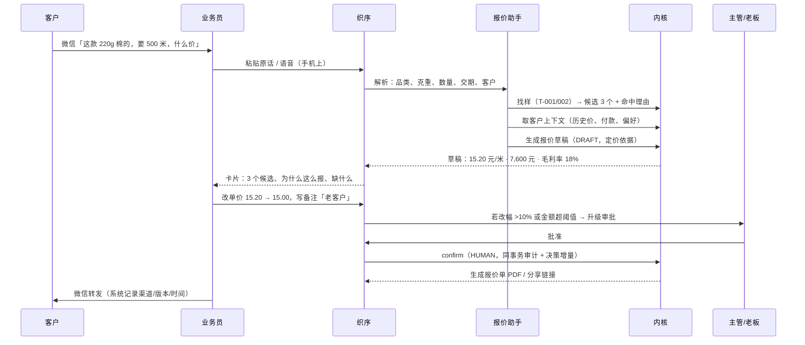

**设计要点**：
- 输入不是表单，是「原话」。系统要能展示它**听懂了什么**（解析出的 4 个槽位），错了可点开改。
- 候选样品必须给**命中理由**（「克重一致、成分一致、有现货」），否则人不敢选。
- 报价卡上必须有**定价依据**与**缺失项**（「未确认交期」），而不是只给一个数。
- 改价不是重新生成，是**原地改 + 版本 + diff**。

### 7.2 寄样 → 跟进 → 回复 → 报价

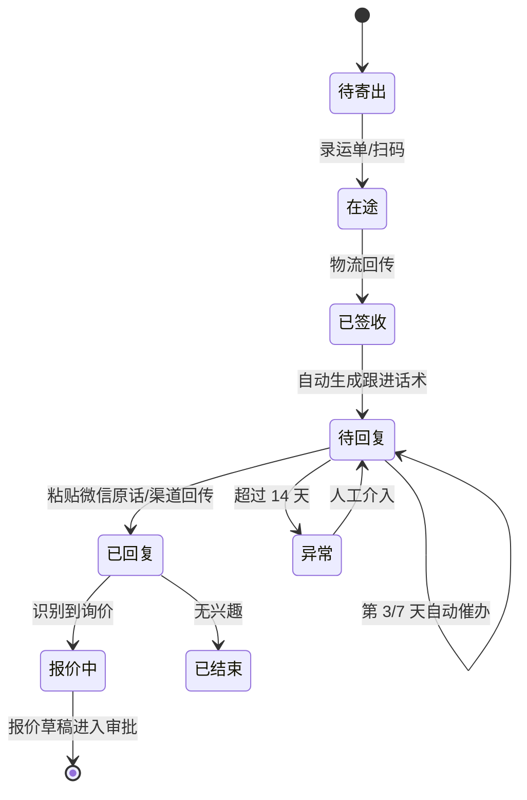

界面必须回答三个问题：**卡在等什么、等了几天、下一步谁做**。现在只有「等待客户回复」一个状态是不够的。

### 7.3 成交 → 订单 → 对账

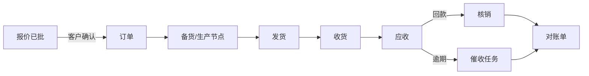

智能体的职责：从交期倒排节点、每天比对进度、异常升级给人、自动生成对账单并解释差异（「这 320 米是补损，未在订单内」）。

### 7.4 新公司冷启动（第一次打开）

1. 建组织：公司名、抬头、银行账号、默认币种。
2. 导入：拖 Excel / 微信通讯录截图 / 供应商面料表 → 预览 → 逐行可判别的错误 → 整批原子导入（沿用现有 ImportService 语义）。
3. 邀请成员：手机号/链接，预设角色与数据范围。
4. 设阈值：默认 5 万 / 20 万 / 无上限，可改。
5. 第一个任务：系统给一个「用你刚导入的客户试报一次价」的引导，5 分钟内产出第一张草稿。
6. 验收：老板在手机上批掉第一单。

### 7.5 人机协作改稿（决定产品好不好用）

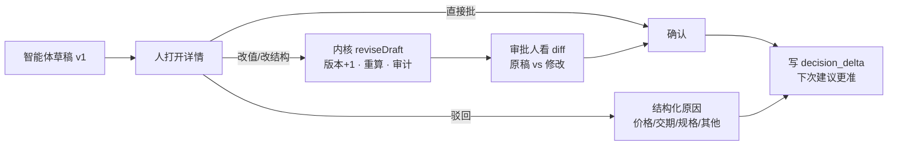

**三条体验规则**：
1. 改完能直接批（同一个人负责一单），换人改必须重新审批。
2. 驳回必须选原因 + 可补一句话；原因进上下文，不允许自由文本黑洞。
3. 界面上显示「你改了它 2 处」，但不做说教式提示；改动本身就是训练信号。

### 7.6 报价链接：客户不登录也能看、能问、能接受

报价批准之后，系统生成一条**带签名的只读链接**。客户在微信里点开就能看，不需要账号、不需要装 App；业务员能看到「谁看了、看了几次、看到哪一行、有没有接受」。

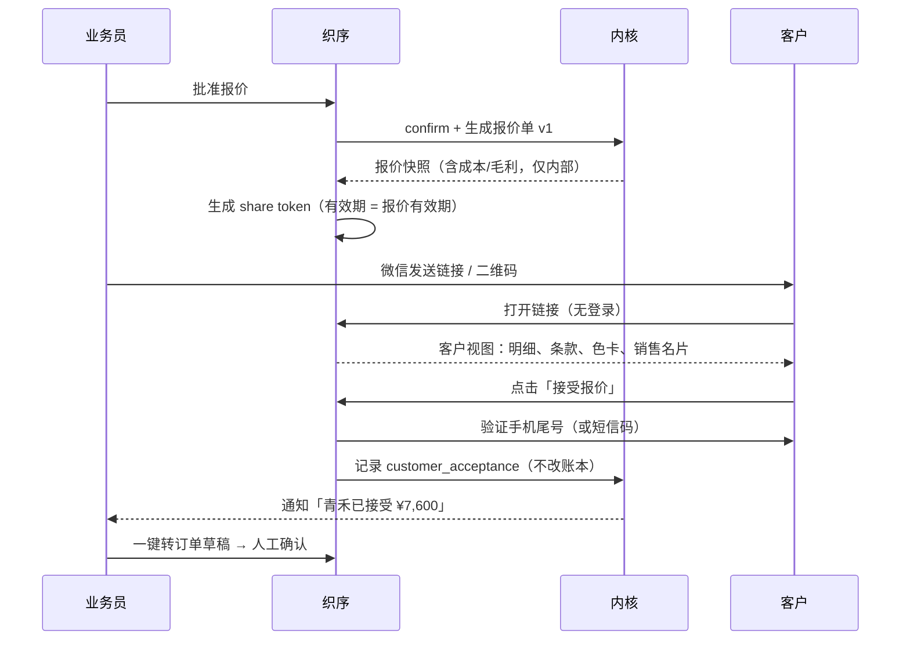

**链接的 12 条规则**：

1. **只有已批准的报价能分享**。`DRAFT` 状态的报价不生成链接，避免把内部草稿发出去。
2. **链接指向版本快照**。报价改了就是 v2 新链接；旧链接打开显示「此报价已更新」并可跳转最新版（是否允许跳转由业务员控制）。
3. **默认有效期 = 报价有效期**，到期自动失效；可提前撤回（`revoked_at`），撤回后立即 410。
4. **不暴露内部字段**：成本、毛利率、成本底线、内部备注、其他客户、提成，一律不在客户视图出现。
5. **水印到客户名 + 报价编号**，PDF 下载带同一水印；截图外流也能追溯。
6. **可选身份门槛**：默认「手机尾号后 4 位」；高金额可开短信验证码；不强制注册。
7. **接受 ≠ 合同**。客户点「接受」只产生「成交意向」，需要业务员确认后转订单草稿，再由人批准；页面必须写清这一点。
8. **能提问**。客户可在任意行留言（「这个克重有没有更厚的」），进入小织的消息队列，小织起草回复，人批后回。
9. **访问提醒有度**。只推「首次查看 / 接受 / 提问 / 过期前 3 天」，不推每一次刷新；访问数据聚合展示。
10. **隐私最小化**：不写 Cookie 做跨站追踪，IP 只存哈希；客户无需填任何资料即可看。
11. **多语言**：中/英一键切换，价格与条款跟随报价版本；导出 PDF 同步语言。
12. **分享渠道可记录**：微信复制、二维码、邮件、短信；记录「发给了谁、哪个渠道、哪一版」。

**状态机**：`不可分享（DRAFT）→ 可分享 → 已查看 → 已接受 / 已提问 / 已过期 / 已撤回`。状态变化全部进审计，业务员在客户 360 里能看到时间线。

### 7.7 一单发货：从拣货、打箱唛到客户签收

这是「打印」真正的使用场景，不是单独一个功能页。

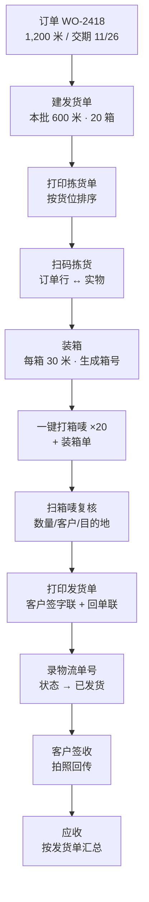

**体验上的三个「优雅」**：

1. **一次点击打全套**：拣货单、箱唛 ×N、装箱单、发货单在同一个打印任务组里，失败可单张重试。
2. **数量不对打不出来**：实扫数量与发货单不一致时，打印按钮变成「先核对差异」；不允许「先打了再说」。
3. **补打不用找电脑**：仓库拿手机扫箱唛上的码，直接选「重打这张」；系统记录谁在什么设备上补打。

**发货单本身的设计**：一张 A4 两联（客户联 + 回单联），必须包含订单号、发货单号、客户、收货地址、每行品名/规格/数量/单价（可选隐藏价格）、箱数、毛重、物流单号、签字栏、公司抬头与盖章位。出口单加英文品名、HS Code、原产地（模板变量）。

### 7.8 改稿：表单改值，Chat 改意图，最后都落成 Patch

Agent 出的东西要调整，**不是二选一**。三种入口，按场景用：

| 入口 | 适合 | 交互 |
| ---- | ---- | ---- |
| 直接改 | 改一个值：单价、数量、交期、备注 | 点字段 → 输入 → 失焦保存，自动重算 |
| 快捷表单 | 一次改一组：价格+数量+交期、换样品、改条款 | 「调整」面板只显示相关字段 + 原因 |
| 和小织说 | 复杂/模糊：换成同成分更厚的替代料、按上次成交价、整单改英文条款 | 自然语言 → Agent 生成变更单（Patch）→ 人确认 |

**核心原则：Chat 不直接改数据，只生成 Patch。** 所有入口最终都走内核 `reviseDraft`：版本 +1、重算金额、写审计、必要时升级审批。人看到的永远是「原值 → 新值」的 diff，而不是一坨新数字。

```
用户：「第二行换成 32S 精梳棉，数量 500 改 800，交期 7 天」
  → 小织解析成 3 个字段变更
  → 变更单：
     样品   40S 精梳棉 → 32S 精梳棉（库存 1,200m）
     数量   500 米 → 800 米
     交期   未确认 → 7 天
     总额   ¥7,600 → ¥12,160（内核重算）
  → [应用修改] [放弃] [继续让小织改]
```

**为什么不让 Chat 直接写**：自然语言有歧义、无法校验、难追溯；用户也不知道它到底改了哪几处。**为什么不做一个大表单**：复杂变更（换料、改条款、批量）表达不了，而且表单越长人越不想用。

**四种界面形态**：

1. **行内编辑**：审批详情里每个字段可点，输入框带单位与校验；保存即新版本。
2. **调整面板**：右侧抽屉，页签「表单 / 对话」。表单是常用字段；对话是输入框 + 示例指令。
3. **变更单（Patch Card）**：无论从哪来，结果都先落成一张变更单；逐行 diff + 重算总额 + 应用/放弃。
4. **Agent 追问**：信息不足时，Agent 给 2–3 个选项（「换成 220g 还是 260g？」），不让用户写长句。

**文案类产出**（跟进话术、客户回复）不走向量字段，用文本编辑器 + 快捷指令：「更简短」「更正式」「按上次语气」，Agent 重写后仍给 diff。

**权限与风控**：

- 改自己的草稿：直接改；改别人的：需 owner 权限或交接。
- 改价超阈值、换成本更低的料：自动升级主管审批。
- Chat 指令原文脱敏后保留，和 Patch 一起进审计；不把客户隐私写进训练数据。
- 所有变更都写 `decision_deltas`，下次建议更准（§7.5）。

**数据模型**：`revision_requests`（source: inline/form/chat、instruction、patch_json、status、actor、reason）；`draft_revisions` 存版本；`revision_reasons` 存结构化原因（价格/交期/规格/客户要求/其他）。

**指标**：改稿入口占比、Chat→Patch 应用率、平均改稿时长、改后再次驳回率。目标：80% 改稿在 30 秒内完成。

---

## 8. 界面与交互规范

### 8.1 工作台：从「功能入口」变成「同事汇报」

```
┌──────────────────────────────────────────────────────────────┐
│  织序        ⌘K 说点什么…                         小织 ▾   │
├──────────────────────────────────────────────────────────────┤
│  今天，小织替你做了 7 件事，3 件等你决定                     │
│                                                              │
│  ┌─ 等你决定 ──────────────────────────────────────────┐    │
│  │ 青禾服饰 · 报价 ¥7,600      改幅 0%   [看详情] [批] │    │
│  │ 例外：单价低于该客户历史均价 3%                       │    │
│  └──────────────────────────────────────────────────────┘    │
│  ┌─ 正在进行 ──────────────────────────────────────────┐    │
│  │ 小样 · 找样   3 个候选，等你选                       │    │
│  │ 小跟 · 寄样   SF1234 已签收，第 2 天待回复           │    │
│  │ 小账 · 对账   8 月对账单已生成，差异 1 处            │    │
│  └──────────────────────────────────────────────────────┘    │
│  ┌─ 出事了 ────────────────────────────────────────────┐    │
│  │ 华瑞订单交期只剩 6 天，染厂进度 40%                  │    │
│  └──────────────────────────────────────────────────────┘    │
└──────────────────────────────────────────────────────────────┘
```

- 每一行都必须可**一键展开为决定**，不允许「点了跳到另一个模块再找一遍」。
- 智能体动态要有「为什么」：一行说明它依据了什么。
- 空状态不是插图，是「你现在可以说什么」的三个示例。

### 8.2 审批卡解剖

```
┌────────────────────────────────────────────────────────────┐
│ 报价 · 青禾服饰                              金额 ¥7,600   │
│ 500 米 × 15.20 元/米 · 毛利率 18% · 有效期 15 天          │
│ ────────────────────────────────────────────────────────── │
│ 智能体依据                                                  │
│  • 历史：该客户 3 次成交价 15.0 / 15.4 / 15.2              │
│  • 成本：坯布 11.8 + 染费 1.4 = 13.2（底线 14.2）          │
│  • 库存：32S 精梳棉 220g 现货 1,200 米                     │
│  • 缺失：交期未确认                                         │
│ ────────────────────────────────────────────────────────── │
│ 你改过 2 处  [查看 diff]        [驳回]  [改价]  [批准]     │
└────────────────────────────────────────────────────────────┘
```

规则：
- **金额永远在右上角**，等宽数字，千分位。
- **出处必须可点**：历史价点开是那 3 张报价；成本点开是成本构成。
- **缺失项用黄色徽标**，不用红色错误（不是错误，是待补）。
- 主操作只有一个（批准），「改价」是次操作，驳回在左。
- 移动端：卡片占满，批准按钮在拇指区；左滑驳回、右滑通过（可撤销 5 秒）。

### 8.3 AI 交互的 7 条规范

1. **草稿，不是结果**。所有 AI 产出用「草稿」视觉（浅底 + 虚线边 + 版本号），批准后才变实底。
2. **不显示置信度百分比**。显示「依据」和「缺什么」，百分比是伪精确。
3. **说人话的失败**。「缺运单号，补一下就能继续」，不给 Zod 原文/堆栈。
4. **可撤销**。任何 L2 动作 10 分钟内可撤销；撤销也是一次审计。
5. **可指名**。用户可以说「让小样再找一次」「换小织报价」，agent 是同事不是功能。
6. **人改即学习**。改价、驳回原因、补的字段都写上下文，并在下次建议里可见（「因为你上次改了…」）。
7. **不抢戏**。AI 不弹窗、不自动聚焦输入框、不在人打字时插话；结果进动态流。

### 8.4 异常与空状态

| 状态 | 文案 | 动作 |
| ---- | ---- | ---- |
| 没有待办 | 「今天没有要你决定的事。小织在跟 12 个客户。」 | 看动态 / 派个新任务 |
| 智能体失败 | 「小样没找到匹配的面料：这张图太暗。重拍 / 改用规格找。」 | 重试 / 换方式 / 转人工 |
| 权限不足 | 「成本底线仅主管可见。需要的话让小织发起申请。」 | 申请 / 关闭 |
| 网络断开（移动） | 「已存本地，联网后自动提交（3 条）。」 | 查看队列 |
| 数据为空 | 「先导入客户和样品，或者让小织从一张 Excel 开始。」 | 导入 / 手动建一个 |

### 8.5 客户看到的报价页（无登录）

这是产品**唯一一个外部界面**，也是每个销售每天都会发出去的东西。它必须像一个正经公司发的报价，而不是一个后台页面。

```
┌──────────────────────────────────────────┐
│  青禾纺织 · 报价单            [中/EN]    │
│  Q-20261112-018           剩余 14 天     │
│  ──────────────────────────────────────  │
│  致：杭州青禾服饰  周敏                   │
│  ──────────────────────────────────────  │
│  32S 精梳棉汗布 220g  本白               │
│  500 米 × ¥15.20            ¥7,600.00    │
│  [色卡图] 克重 220g · 门幅 180cm         │
│  ──────────────────────────────────────  │
│  合计（含税）                ¥7,600.00    │
│  付款：月结 30 天 · 交期：7 天            │
│  有效期至：2026-11-26                    │
│  ──────────────────────────────────────  │
│  [ 接受此报价 ]   [ 有疑问，留言 ]        │
│  [ 下载 PDF ]                            │
│  ──────────────────────────────────────  │
│  李娜 · 138****6621 · 微信二维码          │
│  本报价为要约邀请，接受后由业务员确认订单  │
└──────────────────────────────────────────┘
```

**设计规则**：

- **先给结论，再给细节**：首屏是面料、数量、单价、总额、有效期；规格、条款、色卡在下面。
- **一个主操作**：「接受此报价」。提问与下载是次操作，不抢主按钮。
- **有效期可视化**：剩余天数用文字 + 细进度条，过期后整页变成「已过期，联系李娜」。
- **信任元素**：公司抬头、报价编号、销售实名与可拨电话、营业执照/地址（可配）、水印、条款。
- **移动优先**：375px 宽下不横向滚动；表格在窄屏改成「一行一卡片」。
- **无障碍**：金额用 `tabular-nums`；对比度 ≥ 4.5:1；接受按钮 ≥ 48px 高。
- **空/错状态**：链接失效、已撤回、已更新、需要验证，四种状态各有明确文案与下一步动作。
- **不做**：轮播图、在线支付、客服浮窗、推荐其他产品。客户是来看这一单的。

### 8.6 打印中心：一个抽屉解决所有纸

从顶栏或单据详情打开，右侧抽屉 480px，不打断当前工作。

```
┌──────────────────────────────────────────────┐
│  打印中心                              ✕     │
│  [队列 3]  [模板]  [设备 2]                  │
│ ──────────────────────────────────────────── │
│  待打 3                                      │
│  ┌────────────────────────────────────────┐  │
│  │ 发货单 DN-2418-01 · A4 · 2 份          │  │
│  │ 客户联 + 回单联 · 青禾服饰             │  │
│  │ 打印机：办公室 A4（在线）      [取消]   │  │
│  └────────────────────────────────────────┘  │
│  ┌────────────────────────────────────────┐  │
│  │ 箱唛 ×20 · 100×100 · 热敏              │  │
│  │ 组任务：DN-2418-01 · 已完成 12/20       │  │
│  │ ████████████░░░░░░   [查看失败 1 张]    │  │
│  └────────────────────────────────────────┘  │
│  ┌────────────────────────────────────────┐  │
│  │ 拣货单 · A4 · 1 份                    │  │
│  │ 缺货位 2 行，已标黄                    │  │
│  └────────────────────────────────────────┘  │
│ ──────────────────────────────────────────── │
│  快捷打印                                    │
│  [发货全套]  [箱唛]  [样品标签]  [对账单]    │
└──────────────────────────────────────────────┘
```

**队列卡的信息层级**：单据类型 > 单号 > 份数/纸张 > 设备 > 进度/失败原因。失败卡直接给「重试 / 换设备 / 作废」，不让人猜。

**模板页**：左边模板列表（系统/公司），右边真实单据预览；改动后「保存为新版本」，旧版本仍可用来补打。

**设备页**：打印代理在线状态、每台打印机的纸张/碳带、最近一次心跳；提供「打印测试页」。

**移动端打印**：只保留「扫箱唛重打」「蓝牙打一张样品标签」「查看队列」，不做模板编辑。

### 8.7 标签设计规范（箱唛 / 样品 / 货架）

| 规则 | 说明 |
| ---- | ---- |
| 信息层级 | 客户名/目的地 > 箱号 > 订单号 > 件数/毛重 > 二维码；一臂距离能读 |
| 字号 | 100×100 箱唛：客户名 ≥ 14pt 粗体，箱号 ≥ 28pt，其余 ≥ 8pt |
| 二维码 | ≥ 20×20mm，四周留 2mm 静区；内容仅 `tenant/order/box/seq`，不含价格 |
| 颜色 | 热敏黑白；彩色标签用预印刷底，只打变量 |
| 语言 | 出口箱唛中英双语；内销可单语 |
| 条码 | Code128 用于箱号，QR 用于扫码复核；不依赖打印机内置字体 |
| 对齐 | 左对齐字段，数字右对齐；不同纸张尺寸共用一套模板变量 |
| 测试 | 新打印机首次配置必须打一张测试标签，确认边距/浓度/条码可扫 |

**发货单/对账单的排版**：A4 纵向，页边距 ≥ 12mm；表头公司信息 + Logo；明细表 zebra 可选但打印时关闭底色；金额右对齐等宽；每页重复表头；页码「第 x / y 页」；底部条款与签字栏。

---

## 9. 设计系统

### 9.1 品牌与色彩

纺织的质感来自「布」与「靛蓝」，不是科技蓝紫渐变。

| Token | 值 | 用途 |
| ----- | -- | ---- |
| `--ink-900` | `#14202B` | 主文字、深色底 |
| `--ink-700` | `#2B3B4A` | 次级文字 |
| `--ink-400` | `#7A8896` | 辅助、占位 |
| `--paper` | `#F7F4EE` | 页面底色（米白，像样布卡） |
| `--surface` | `#FFFFFF` | 卡片 |
| `--indigo-600` | `#1F4E79` | 品牌主色、主按钮 |
| `--indigo-100` | `#E6EEF5` | 选中、信息底 |
| `--vermilion-600` | `#C0492F` | 警示、驳回、金额异常 |
| `--moss-600` | `#3F6B4F` | 成功、已批准 |
| `--amber-600` | `#B7791F` | 待补、风险提示 |
| `--line` | `#E3DED4` | 分隔线、草稿虚线 |

深色模式不是反色：用 `--ink-900` 作底、`--paper` 作文字，保持低饱和。

### 9.2 字体与排版

- 中文：思源黑体 / PingFang SC；西文与数字：Inter。
- 数字一律 `font-variant-numeric: tabular-nums`，金额右对齐。
- 字号阶：12 / 13 / 14 / 16 / 20 / 24 / 32；行高 1.5（正文）、1.25（标题）。
- 审批卡标题 20/600，金额 24/700，依据 13/400。

### 9.3 组件清单（首批 16 个）

`DraftCard` `ApprovalSheet` `DiffRow` `ProvenanceChip` `AgentRunStrip` `CommandBar` `IntentComposer` `RiskBadge` `MissingFieldBadge` `MoneyText` `CustomerHeader` `SampleTile` `StatusRail` `MobileActionBar` `OfflineBanner` `AuditTrail`

每个组件的关键状态：默认 / 草稿 / 已批准 / 已驳回 / 失败 / 加载 / 空 / 无权限。**草稿态是本产品最重要的组件状态**，必须有统一视觉。

### 9.4 动效与可达性

- 动效只用于「状态变化」：草稿→批准（200ms 实底填充）、卡片进队列（120ms 上移）、撤销倒计时。
- 触控目标 ≥ 44×44；对比度 ≥ 4.5:1；审批主按钮在手机底部安全区内。
- 键盘优先：`J/K` 上下、`Enter` 详情、`A` 批准、`R` 驳回、`E` 改价、`Esc` 返回。
- 屏幕阅读器：金额读「七千六百元」，diff 读「原 15.20，改为 15.00」。

---

## 10. 数据模型增量

现有表：`customers` `customer_contexts` `samples` `sample_shipments` `quotes` `sample_embeddings` `audit_log`。

新增（按阶段）：

| 表 | 关键字段 | 阶段 |
| -- | -------- | ---- |
| `tenants` | id, name, brand, bank, currency, settings | P0 |
| `users` | id, tenant_id, name, phone, email, status, idp_subject, idp_org | P0 |
| `idp_connections` / `idp_org_map` / `sso_domains` | tenant_id, protocol, config_json, casdoor_org, domain, verified_at | P0 |
| `memberships` | user_id, role, team_id, data_scope, approval_limit | P0 |
| `teams` | id, tenant_id, name, manager_id | P0 |
| `customer_owners` | customer_id, user_id, scope, granted_by, granted_at | P0 |
| `quote_versions` / `draft_revisions` | entity, entity_id, version, patch, actor, reason | P0 |
| `revision_requests` | entity, entity_id, source (inline/form/chat), instruction, patch_json, status, actor, reason | P0 |
| `revision_reasons` | code, label, applies_to, active | P1 |
| `pricing_policies` | tenant_id, scope_type, scope_id, key, value_json, priority, locked, effective_from, created_by | P0 |
| `policy_change_log` | policy_id, old_value, new_value, actor, reason, created_at | P0 |
| `quote_shares` | quote_id, version, token_hash, expires_at, require_phone_tail, allow_pdf, revoked_at, created_by | P0 |
| `quote_share_events` | share_id, event, meta, ip_hash, ua_hash, created_at | P0 |
| `quote_acceptances` | share_id, customer_name, phone_tail, accepted_at, ip_hash | P1 |
| `customer_messages` | customer_id, share_id, body, status, reply_draft_id | P1 |
| `orders` / `order_items` | quote_id, status, due_date, progress | P1 |
| `order_milestones` | order_id, node, planned_at, actual_at, status | P1 |
| `inventory` / `stock_moves` | sample_id, warehouse, qty, direction, ref | P1 |
| `receivables` / `payments` | order_id, amount, due_date, paid_at | P2 |
| `statement_runs` | customer_id, period, totals, diff | P2 |
| `agents` | id, tenant_id, name, scope, autonomy, daily_budget | P1 |
| `agent_runs` | agent_id, intent, tools, status, tokens, cost | P0（审计已有雏形） |
| `attachments` | entity, entity_id, storage_key, mime, size | P0（PDF/图片/签收单） |
| `visit_logs` | customer_id, user_id, checked_in_at, location_hash, note, voice_asset | P1 |
| `offline_queue`（客户端） | op_id, entity, payload, base_version, status | P1 |
| `print_templates` | tenant_id, doc_type, scope, name, current_version_id, status | P1 |
| `print_template_versions` | template_id, version, body, variable_schema, created_by, created_at | P1 |
| `print_agents` | tenant_id, name, token_hash, version, last_heartbeat_at, status | P1 |
| `printers` | agent_id, name, protocol, paper, online, last_seen_at | P1 |
| `print_agent_versions` / `printer_profiles` | version, channel, signature, offset_x, offset_y, density, speed, paper | P1 |
| `template_packages` | tenant_id, name, version, locked, source, assets_json | P2 |
| `custom_fields` / `template_assignments` | tenant_id, doc_type, key, label, type, required, priority, template_id, customer_id | P1 |
| `template_copilot_runs` | tenant_id, source_asset, extracted_json, status, created_by | P2 |
| `print_jobs` | tenant_id, doc_type, entity_id, template_version_id, agent_id, copies, status, idempotency_key, error_code, requested_by | P1 |
| `print_job_items` | job_id, seq, payload, status, reprint_reason, printed_at | P1 |
| `document_snapshots` | entity, entity_id, version, pdf_key, hash, template_version_id, created_at | P1 |
| `delivery_notes` / `delivery_note_items` | order_id, no, status, shipped_at, carrier, tracking_no, address, qty | P1 |
| `boxes` / `box_items` | note_id, box_no, qr_payload, gross_weight, dims, item_id, qty | P1 |
| `plans` | code, name, price_month, price_year, seat_limit, agent_quota, storage_gb, features_json | P0 |
| `price_books` / `plan_prices` | version, status, currency, region, effective_from, plan_code, month_price, year_price | P0 |
| `tenant_price_overrides` / `discounts` | tenant_id, plan_code, price, starts_at, ends_at, reason, approved_by | P1 |
| `subscriptions` | tenant_id, plan_id, status, seats, cycle, period_start, period_end, trial_end, cancel_at | P0 |
| `entitlements` | subscription_id, key, value, hard_limit | P0 |
| `usage_events` / `usage_monthly` | tenant_id, meter, qty, occurred_at, source, period | P0 |
| `invoices` / `invoice_lines` | tenant_id, number, period, subtotal, tax, total, status, due_at, paid_at, pdf_key | P1 |
| `payments` | invoice_id, method, amount, reference, paid_at | P1 |
| `tax_profiles` / `invoice_profiles` | tenant_id, invoice_type, tax_rate, title, tax_no, bank, account, timing | P1 |
| `dunning_attempts` | invoice_id, attempt, channel, result, at | P2 |
| `platform_users` / `platform_audit` | name, email, role, status, actor, action, target_tenant, meta | P1 |
| `feature_flags` | key, tenant_id, enabled, rollout | P1 |
| `platform_configs` / `config_versions` / `config_audit` | key, scope, scope_id, value_json, type, default, version, effective_at, owner, actor, diff | P0 |
| `tenant_notes` / `support_tickets` | tenant_id, author, body, status, priority | P1 |
| `tenant_data_planes` | id, isolation_mode, region, schema_name, dsn_secret_ref, migration_version, status | P0 |
| `tenant_security_profiles` | tenant_id, data_region, allow_external_llm, retention_days, kms_key_ref | P0 |
| `llm_settings` | scope, tenant_id, provider, base_url, model, params_json, key_ref, allow_external, log_prompts, version, updated_by | P0 |
| `llm_call_stats` | tenant_id, task, provider, model, latency_ms, tokens, error_code, at | P1 |
| `llm_routers` | name, base_url, kind (litellm/oneapi), status, key_ref | P1 |
| `model_prices` | model, input_per_1k, output_per_1k, cached_per_1k, sell_markup, effective_from | P1 |
| `token_usage` | tenant_id, request_id, task, model, prompt_tokens, completion_tokens, cached_tokens, cost, at | P1 |
| `data_export_jobs` | tenant_id, scope, status, file_key, requested_by, expires_at | P1 |

关键索引：`customers(tenant_id, owner_id)`、`quotes(tenant_id, status, created_at)`、`pricing_policies(tenant_id, scope_type, scope_id, key)` 唯一、`quote_shares(token_hash)` 唯一、`quote_share_events(share_id, created_at)`、`orders(tenant_id, due_date, status)`、`audit_log(tenant_id, entity, entity_id, created_at)`、`print_jobs(tenant_id, status, created_at)`、`print_jobs(idempotency_key)` 唯一、`boxes(qr_payload)` 唯一、`subscriptions(tenant_id, status)`、`usage_events(tenant_id, meter, occurred_at)`、`invoices(tenant_id, status, due_at)`、`llm_settings(scope, tenant_id)` 唯一、`idp_connections(tenant_id)` 唯一、`sso_domains(domain)` 唯一、`revision_requests(entity, entity_id, created_at)`、`token_usage(request_id)` 唯一、`model_prices(model, effective_from)` 唯一。

> 迁移策略：`tenantId` 现在加、存量填默认租户，新数据必须带；`ownerId` 先允许空，空=全公司可见（兼容演示数据），新数据强制填。
> `pricing_policies` 的 `value_json` 存 `{ "marginPct": 20, "unit": "percent" }` 这类结构化值，不用字符串；`locked=true` 表示管控层，下级不可覆盖。
> `quote_shares` 只存 token 的哈希，明文 token 只在生成那一刻返回；链接不能从数据库反推。
> `print_jobs.idempotency_key` 由「单据 + 版本 + 模板 + 份数 + 操作人」生成，双击不会重复出纸。
> **平台库与租户库分离**：`platform_*` / `plans` / `subscriptions` / `usage_*` / `invoices` 属控制面（control plane），单独 schema 或数据库；租户业务数据不复制过去，平台侧只看聚合用量与账单。客服需要看业务数据时必须走 break-glass 授权，见 §14.6。

---

## 11. 指标

**北极星**：**每周「智能体完成且人一次通过」的业务动作数**（埋点名：`auto_completed_actions`）。
它同时约束三件事：AI 真在干活、产出质量够、人愿意用。

| 层级 | 指标 | 目标（试点 8 周） |
| ---- | ---- | ----------------- |
| 北极星 | 周自动完成动作数 / 活跃公司 | ≥ 30 |
| 质量 | 草稿一次通过率 | ≥ 65% |
| 质量 | 平均改价幅度 | ≤ 3% |
| 质量 | 驳回原因 Top3 可归因 | 100% 有结构化原因 |
| 效率 | 从客户原话到报价发出（P50） | ≤ 10 分钟 |
| 效率 | 寄样跟进逾期率 | ≤ 5% |
| 采纳 | 建议采纳率（不修改直接批） | 逐月 +5pp |
| 使用 | 双端分布（sales 手机占比） | ≥ 60% 手机 |
| 使用 | 移动端完成的审批占比 | ≥ 50% |
| 使用 | 7 日留存（业务员） | ≥ 60% |
| 分享 | 批准报价的链接生成率 | ≥ 90% |
| 分享 | 链接打开率（发出 → 打开） | ≥ 70% |
| 分享 | 查看 → 接受转化率 | ≥ 25% |
| 分享 | 客户提问响应时长（P50） | ≤ 2 小时 |
| 移动 | 离线队列同步成功率 | ≥ 99% |
| 打印 | 打印任务成功率 | ≥ 99% |
| 打印 | 箱唛/发货单重打率 | ≤ 3% |
| 打印 | 从发货单确认到全套打完（P50） | ≤ 2 分钟 |
| SaaS | 试用 → 付费转化 | ≥ 20% |
| SaaS | 月度毛流失率 | ≤ 2% |
| SaaS | 净收入留存（NDR） | ≥ 110% |
| SaaS | 席位利用率（活跃/已购） | ≥ 80% |
| SaaS | 客单价 / 毛利（扣除 agent 与存储成本） | ≥ 70% |
| SaaS | 回款周期（DSO） | ≤ 30 天 |
| 安全 | 跨租户数据泄露事件 | 0 |
| 安全 | 跨租户越权测试覆盖 | 100% 业务表 |
| LLM | 敏感字段出网次数（脱敏前） | 0 |
| LLM | LLM 调用 p95 延迟 | ≤ 8 秒 |
| LLM | 外部模型处理占比（可按租户审计） | 可解释 |
| 改稿 | 80% 的改稿在 30 秒内完成 | 是 |
| 改稿 | Chat → Patch 应用率 | ≥ 75% |
| 成本 | 每租户 token 成本 / 收入可核算 | 100% |
| 商业 | 每席位月处理单量 | 基线 ×2 |

埋点事件（最小集）：`intent_submitted` `draft_created` `draft_revised`（字段/幅度）`revision_requested`（来源 inline/form/chat）`revision_applied` `draft_approved` `draft_rejected`（原因）`agent_failed`（工具/错误码）`policy_resolved`（层级/是否被夹）`quote_share_created` `quote_share_viewed` `quote_accepted` `quote_question` `mobile_capture_used` `mobile_scan_used` `visit_checked_in` `offline_synced` `offline_conflict` `print_job_created` `print_job_completed` `print_job_failed` `print_reprinted` `delivery_confirmed` `token_usage_recorded` `subscription_started` `trial_started` `plan_upgraded` `invoice_paid` `handover_completed`。

---

## 12. 交付分期

与 `usability-roadmap.md` 的四阶段对齐，不新增阶段；只补「双端 + 多用户 + 设计系统」的落点。

| 阶段 | 已有路线 | 本次设计新增 | 端 |
| ---- | -------- | ------------ | -- |
| **P0 阶段一**（4–6 周） | 真实数据入口、真智能体报价、可改价审批、PDF 出口、最小身份 | 设计系统 v1、审批卡/diff/出处、3+1 IA、定价继承表（系统/公司/个人 + 管控夹取）、**表单 + Chat→Patch 改稿**、报价链接（客户视图/接受/撤回）、手机 PWA 审批 + 拍照找样 + 客户分享、**共享库 + RLS + 跨租户测试、Casdoor 登录（OIDC + 租户组织映射）、LLM 设置页（全局参数 + 敏感字段脱敏）**、`tenants/users/idp_* /memberships/pricing_policies/quote_shares/tenant_data_planes/llm_settings/revision_requests` | PC + 手机 PWA + 客户 |
| **P1 阶段二**（4–6 周） | 寄样跟进产品化、中断可视化、建议落库、人工兜底 | 订单/发货单/箱唛/打印中心（模板、队列、打印代理安装包）、拣货扫码复核、模板参数覆盖 + 自定义字段、移动扫码/拍签收/盘点/离线队列、客户留言与回复、拜访签到、回款凭证、agent 成员与自主等级配置、**schema-per-tenant 升级与迁移、企业 SSO（Casdoor SAML/OIDC）、LLM Router 接入（LiteLLM）+ token 记账 + 租户模型白名单** | PC + 手机 PWA + 客户 |
| **P2 阶段三**（4–6 周） | 决策增量闭环、建议质量可度量 | 客户 360 与上下文可视化、链接访问时间线与分享分析、对账/回款、库存出入库、自然语言取数、团队数据范围与客户交接、**SaaS 订阅与账单（控制面）、平台总管理端 v1、价格表/租户覆盖/开票设置、模板工作室 + AI 识样张、独立库/每租户 KMS、token 账单与毛利看板** | PC 为主 |
| **P3 阶段四**（6–8 周） | 订单履约、对账 | 客户自助门户（寄样进度/历史报价/对账单）、供应商协同、Tauri 外设壳、小程序（仅当客户侧验证成立）、洗水唛/吊牌、渠道商/多仓 | PC + 手机 + 客户侧 |

**每阶段的验收都是「一个人做一次具体动作」**（沿用既有原则）：

- P0：业务员在手机上粘贴客户原话 → 改一个价 → 主管在手机上批 → 微信发出链接，客户打开就能看/接受，全程 ≤ 10 分钟；设置页能看到每个毛利参数的生效值与来源。
- P1：5 单真实寄样从录运单到「回复询价 → 报价草稿进审批」，不碰命令行；跟单在仓库用手机扫码；客户在报价页留言能进小织队列。
- P1（打印）：一张真实订单 → 扫码拣货 → 一键打 20 张箱唛 + 发货单 → 扫箱唛复核，全程 ≤ 10 分钟；仓库用手机补打一张不用回办公室。
- P2：同一客户第 3 次报价出现历史价与偏离解释；链接访问时间线可查；月底对账单差异能定位到行；平台管理员能在一个控制台完成开通公司、改套餐、看用量、开票、暂停/恢复。
- P3：客户不登录即可看寄样进度、历史报价与对账单；老板在手机上看完经营日报。

**明确不做（避免范围爆炸）**：生产排产（MES）、财务总账、按 token 的实时计费（先席位 + 额度）、跨公司知识迁移、自动发微信（渠道审批周期长，先人工复制 + 留痕）、自研标签打印机固件。

---

## 13. 增长与发布

### 13.1 定位与 ICP

- **一句话**：给纺织贸易公司的「AI 业务员团队」：找样、报价、跟单、对账，人只审批。
- **ICP**：5–50 人的面料/服装贸易公司，业务员 3–20 人，年营业额 2,000 万–5 亿，已有微信接单习惯、被 Excel 和「人一走客户就丢」折磨。
- **反 ICP**：纯生产型工厂（要排产/MES）、纯零售（要 POS）、超大型集团（要私有化+SSO）。

### 13.2 落地页结构（首屏即价值）

1. **H1**：你说生意，系统做单。
2. **副标题**：纺织贸易的 AI 业务操作系统。报价、寄样、跟单、对账，智能体做完，你只点头。
3. **演示视频 40 秒**：微信原话 → 报价草稿 → 手机批准 → 客户收到 PDF。
4. **三个证据**：10 分钟出报价 / 寄样不漏跟 / 人走客户不走。
5. **对比表**：布管家类「记录型」vs 织序「完成型」。
6. **CTA**：预约 20 分钟演示（主）/ 下载报价单模板（次，换邮箱）。
7. **信任**：客户 logo（试点后）、数据私有化承诺、审计可追溯。

### 13.3 发布节奏

| 渠道 | 内容 | 目的 |
| ---- | ---- | ---- |
| 行业社群 / 微信群 | 「一张微信截图，10 分钟出报价」实操录屏 | 线索 |
| 视频号 / 抖音 | 纺织老板的一天：从 8 小时到 40 分钟 | 认知 |
| 知乎 / 公众号 | 「纺织 ERP 为什么业务员不用」系列 | SEO + 信任 |
| Product Hunt / HN | Show HN: Agent-native OS for textile trading | 海外/品牌 |
| 展会（intertextile） | 现场拍照找样 + 5 分钟报价挑战 | 高意向 |

SEO 关键词簇：纺织管理软件、面料管理软件、布管家替代、找样软件、面料报价单模板、纺织 ERP、寄样管理、对账单模板。

### 13.4 定价（建议，待拍板）

完整方案见 **§14.1**。一句话：**席位年费 + 内置 agent 额度 + 动作包**，老板/只读审批席位不计费；三档 ¥299 / ¥499 / 定制，年付送 2 个月；不做 token 实时计费，不按打印张数收费。

### 13.5 冷启动的 3 个动作

1. **陪跑 3 家试点**：不卖软件，卖「帮你把这周 20 张报价做完」，现场录屏做素材。
2. **模板换线索**：报价单/对账单/寄样单模板免费下载，留资进私域。
3. **老板视角周报**：每周给试点老板发一张「本周智能体干了什么、省了多少时间」的图，制造内部传播。

### 13.6 报价链接是天然的增长资产

每一条报价链接都是一张**带品牌、带销售名片、能直接成交**的落地页。它天然带来三个增长杠杆：

1. **客户侧传播**：客户把链接转给老板/采购/设计师，链接底部是「青禾纺织 · 李娜」，等于免费曝光。
2. **同行线索**：客户问「你们这个报价单怎么做的」→ 链接底部留「同样想要这样的报价单？免费试用织序」，用 `?ref=<share_id>` 归因。
3. **产品背书**：报价页的加载速度、专业度、接受/提问体验，本身就是产品演示。把「客户接受率」做成对外可讲的案例数字。

**但克制**：客户视图不放广告、不做弹窗、不收集手机号做营销。增长钩子只在页脚一行小字 + 销售主动分享的试用链接里，不能污染客户体验。

**分享分析（给业务员看的）**：不是热力图监控，而是三句话——「青禾已看 3 次，停在第 2 行」「华瑞还没打开，建议换个时间再发」「锦程接受了 7,600，可转订单」。

---

## 14. SaaS 商业化与平台总管理端

### 14.1 收费原则：卖「完成的活」，不卖 token

纺织老板不会为「AI 调用次数」买单，但会为「一个业务员一个月能多报 30 单」买单。所以定价要满足三个条件：

1. **好算**：老板看一眼就知道一年多少钱，不按 token 浮动。
2. **好卖**：业务员越多越划算，老板席位不额外收钱（他只审批）。
3. **好扩**：先用席位 + 内置额度，超了买加油包；不要一上来做复杂计量。

**建议方案（待拍板）**：

```
年费 = 席位数 × 单价 × 12（年付送 2 个月）
      + 超出额度的 agent 动作包（可选）
      + 增值项（品牌域名 / 私有化 / 专属支持）
```

**三档套餐**：

| | 试用 Trial | 基础 Starter | 专业 Pro | 旗舰 Enterprise |
| --- | --- | --- | --- | --- |
| 价格 | ¥0 / 14 天 | ¥299 / 席位 / 月 | ¥499 / 席位 / 月 | 年框定制 |
| 席位数 | 3 | 3–10 | 10–50 | 50+ |
| 内置 agent 动作 | 100 / 月 | 1,000 / 月 | 5,000 / 月 | 定制 |
| 报价链接 | ✓ 基础 | ✓ 品牌页脚 | ✓ 自定义域名 | ✓ 独立域名 + SLA |
| 打印 | 系统模板 | + 公司模板 | + 单据类型模板 + 打印代理 | + 多仓/多代理 |
| 客户/供应商门户 | — | 报价链接 | + 寄样进度 | + 对账/API |
| SSO / 审计导出 | — | — | ✓ | ✓ |
| 私有化 | — | — | — | ✓ |
| 支持 | 自助 | 工单 | 1v1 群 | 专属客户成功 |

**不建议**：

- 按报价单/打印张数收费。这些是老板心里的「基础动作」，收费会让人不敢用。
- 免费版长期存在。纺织 B2B 的免费用户不会转化，只会消耗支持。
- 按 token 实时计费。财务对不上账，销售也讲不清。

**建议的「创业公司价」**：前 20 家试点客户锁价 3 年（¥199/席位/月），换案例、换转介绍、换现场录屏。

#### 价格是配置，不是代码（总后台可改）

上面的价格只是**初始值**。真实 SaaS 一定会遇到：老客户锁价、渠道折扣、年框特价、某家公司单独议价、涨价后存量不涨。所以价格必须做成**版本化的价格表**，在平台总后台改，不改代码、不发版。

```
价格表 Price Book v1（当前生效）
├── Starter  ¥299 / 席位 / 月   年付 10 个月价
├── Pro      ¥499 / 席位 / 月   年付 10 个月价
├── Enterprise  定制（合同价）
└── 加购     动作包 ¥80 / 1,000 次 · 存储 ¥30 / 100GB
            隔离升级（schema / 独立库）按合同价，在总后台配置
```

**规则**：

1. **价格表版本化**：草稿 → 生效 → 停售；新版本只影响新合同，存量合同按签署时版本（grandfathering）。
2. **租户级覆盖**：某家公司可以单独定价（合同价、折扣、赠送席位），带生效日、到期日、原因、审批人；到期自动回到标准价。
3. **折扣与赠送**：首年折扣、转介绍赠送、活动价；都挂在订阅上，不修改价格表。
4. **币种与地区**：人民币默认；海外/港澳可配 USD/HKD，按价格表区域。
5. **试算**：改价前可以选 3 个真实租户，预览「他们下个月会付多少」，避免拍脑袋。
6. **审计**：谁改的、改前/改后、影响多少租户；改价需要第二个 owner 复核。
7. **对外一致**：官网价格页从价格表生成，不手工维护两份。

**隔离升级包**（应对挑剔客户）：schema-per-tenant / 独立库 / 独立实例作为 Enterprise 附加项，价格不写死，在总后台按租户合同价配置；包含迁移实施、独立备份、SLA 上浮。升级后按新数据平面计费。

**平台端「套餐与价格」页面**：

```
价格表 v1 · 生效中           [新建版本]
套餐      月付      年付      席位上限   动作额度   状态
Starter   ¥299      ¥2,990    10         1,000     生效
Pro       ¥499      ¥4,990    50         5,000     生效
Enterprise 合同价    合同价     不限       定制       生效

租户覆盖（3）
青禾纺织   Pro ¥449 / 席位  2026-11-01 → 2027-10-31  「三年锁价」  [编辑]
华瑞制衣   Starter ¥199     2026-06-01 → 2027-05-31  「试点」      [编辑]
```

### 14.2 计量什么、不计量什么

| 计量项 | 单位 | 计费 | 说明 |
| --- | --- | --- | --- |
| 活跃席位 | 人 / 月 | ✓ | 当月登录过才算；只邀请不登录不计费 |
| agent 动作 | 次 | ✓（含额度，超出买包） | 报价草稿、跟进建议、对账差异、OCR 一页各计 1 |
| LLM 输入 tokens | 千 tokens | ✗（只核算成本） | 按模型采购价，区分缓存命中 |
| LLM 输出 tokens | 千 tokens | ✗（只核算成本） | 输出单价通常更高 |
| 存储 | GB / 月 | 超额才收 | 图片、PDF、录音；基础含 20GB/席位 |
| 短信 | 条 | 成本价 | 客户链接验证码、通知 |
| 打印张数 | 张 | ✗ | 只做成本分析，不计费 |
| 报价链接查看 | 次 | ✗ | 增长资产，永不收费 |
| 客户提问 | 条 | ✗ | 进入 agent 队列，按动作计 |

**计量规则**：事件幂等（`idempotency_key`）；每日汇总、每月出账；允许 5% 争议窗口；额度用到 80% 提醒，100% 只暂停 agent 新任务，**绝不阻断审批、查看和导出**。

**token 的定位（已定：只计量，不收费）**：

1. **对外只按「席位 + agent 动作」收费**，token 不进入账单金额。
2. token 只用于四件事：成本核算、毛利看板、容量规划、未来定价依据。
3. 平台端展示每个租户的输入/输出/缓存 tokens 与成本；租户端只在「订阅与用量」里显示用量，不显示金额。
4. 模型价格表维护采购价即可；「参考销售价」可存但默认不启用，避免误收。
5. 未来若真要按 token 计费，在合同里标记计费口径，且与动作额度二选一，不重复收。

### 14.3 账单生命周期

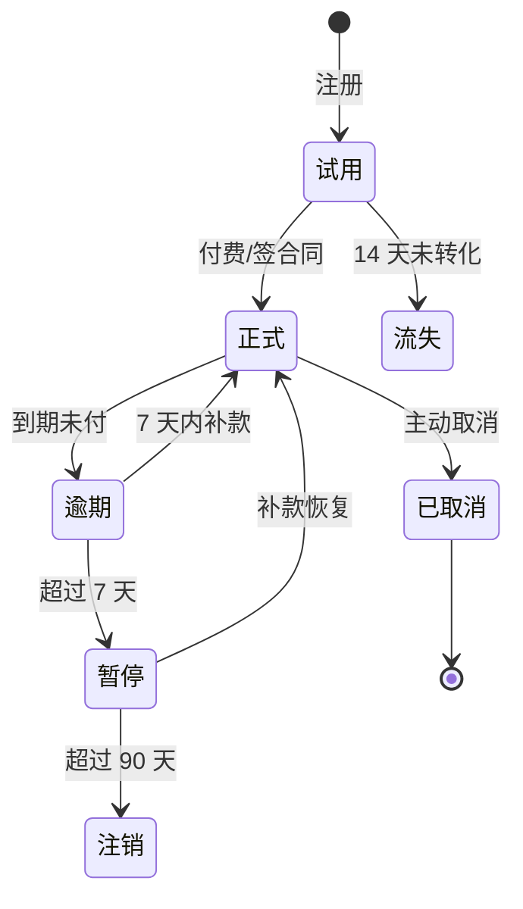

- **试用**：14 天，不绑卡；第 7 天提醒，第 13 天人工跟进。
- **正式**：年付/月付；年付默认 10 个月价。
- **逾期**：D+1 / D+3 / D+7 三次提醒；7 天内功能不变，只显示横幅。
- **暂停**：只读，不能新增单据/调用 agent；数据保留 90 天；**导出永远可用**。
- **注销**：提前 30 天申请；导出全部数据后删除；审计保留 1 年（合规）。
- **改席位**：按天折算，升级即时生效、降级下个账期生效。
- **发票**：默认按国内 SaaS 惯例——**增值税专用发票 6%，价税分离展示**；可在平台端配置为普票/13%/免税，按租户的 `tax_profile` 取。专票需填抬头/税号/开户行；红冲走财务审核；发票状态可见。

**支付方式**：对公转账（主流）、微信/支付宝（小额/月付）、企业网银。转账必须带「公司简称 + 账单号」备注，系统自动核销；对不上的人工匹配。

**开票配置（总后台可改）**：开票不是写死的，平台财务在「开票设置」里维护：

| 配置 | 默认 | 说明 |
| --- | --- | --- |
| 发票类型 | 电子增值税专用发票 | 可切普票/数电票 |
| 税率 | 6%（SaaS 服务） | 可按租户/合同改为 13% 或免税，需财务确认 |
| 价格展示 | 价税分离 | 列表价不含税，账单显示税额与含税总额 |
| 开票主体 | 平台签约主体 | 多主体时按租户合同选择 |
| 开票时机 | 收款后 3 个工作日 | 可配「先票后款」（需审批） |
| 红冲/重开 | 财务审核 | 留原因与审计 |

> 「老规矩」按国内 SaaS 默认处理：**6% 专票、价税分离、收款后开票**。如果公司实际按 13% 软件产品销售开票，平台端改一个税率即可，账单与发票模板会自动跟着变。

### 14.4 权益与配额（entitlements）

不要在每个功能里写 `if (plan === 'pro')`。统一从 `entitlements` 读：

```
plan: pro
seats: 20
quotas: { agent_actions: 5000, storage_gb: 400, print_templates: 50 }
features: { customer_portal: true, sso: false, custom_domain: true, print_agent: true }
```

- 服务端网关统一校验；前端只读展示，不信任前端。
- 配额用「软限 + 硬限」：80% 提醒、100% 停新任务、110% 才真正拒绝（给人处理时间）。
- 降级不删数据，只把超出部分变只读。
- 功能开关按租户/批次灰度，不靠发版。

### 14.5 平台总管理端（control plane）

这是一个**独立产品**，`admin.weaveorder.cn`，与租户端物理/逻辑隔离。里面不出现任何客户的报价明细、样品图、客户手机号，只看聚合与账号级信息。

```
平台总管理端
├── 总览       MRR / ARR · 活跃租户 · 试用漏斗 · 流失 · 毛利 · 事故
├── 租户       列表/搜索/筛选；详情：套餐、席位、用量、健康度、隔离模式（共享/schema/独立）、LLM 覆盖（默认/自定义端点）、区域、备注、功能开关
├── 订阅账单   合同、账单、回款、逾期、退款、发票
├── 用量       agent 动作、存储、短信；Top 消耗与异常
├── 套餐与价格 计划、价格表版本、租户覆盖、试算；改价不影响存量合同
├── 开票设置   税率、发票类型、开票主体、开票时机、红冲规则
├── LLM 设置   全局参数、租户覆盖、测试连接、调用统计与预算
├── 身份        Casdoor 组织、企业 SSO、MFA 策略、登录审计
├── 配置中心    商业/计量/AI/功能/内容/数据/安全，版本、影响预览、回滚
├── 功能开关   按租户/批次灰度；一键回滚
├── 支持       工单、备注、break-glass 申请与审批
├── 运营       公告、邮件模板、试用跟进任务
└── 平台审计   平台侧所有动作（与租户审计分开）
```

**角色（最小 5 个）**：

| 角色 | 能做什么 | 不能做什么 |
| --- | --- | --- |
| `platform_owner` | 全部；改价格/套餐；删除租户 | 无 |
| `platform_finance` | 账单、回款、发票、退款 | 改功能、看业务数据 |
| `platform_support` | 看租户状态、开工单、申请 break-glass | 改套餐、删除、导出业务数据 |
| `platform_ops` | 功能开关、灰度、LLM 参数、事故处理 | 改账单、删除租户 |
| `platform_readonly` | 只看 | 任何写操作 |

**六条硬规则**：

1. **默认看不到租户业务数据**。平台侧只存租户、订阅、用量聚合；需要看业务数据必须 break-glass。
2. **代登录（impersonation）要审批**。租户管理员在应用内点同意，或工单里明确授权；单次 ≤ 60 分钟；租户端顶部始终显示「平台支持正在协助」；全程录审计；不能导出。
3. **危险操作双人复核**。删除租户、强制改套餐、清空数据，需要第二个平台 owner 确认。
4. **平台动作独立审计**。`platform_audit` 不可改；租户 audit 里也记一条「平台支持访问」。
5. **租户数据可带走**。注销/降级前提供全量导出（Excel/CSV + 附件清单），导出任务可审计。
6. **改价与改税双人复核**。价格表、租户合同价、税率变更需要 owner + finance 两人确认，并记录改前/改后与影响租户数。

### 14.6 Break-glass：客服要看客户数据时

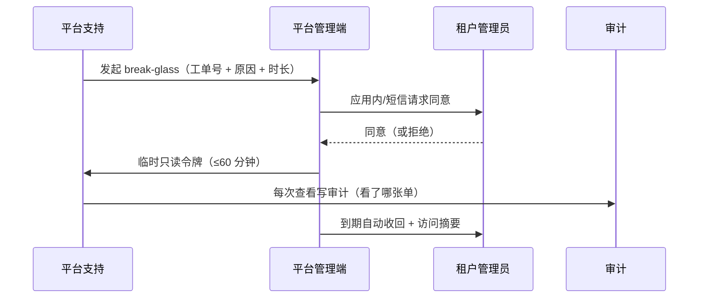

没有租户同意时，只能看账号/账单/用量，不能看业务单据。这是 SaaS 信任的底线，也是卖给纺织老板时最能打动人的一条。

### 14.7 租户端「订阅与用量」页面

放在「组织 → 订阅与用量」，老板/财务可见：

- 当前套餐、席位数、下次扣费日、年付到期日。
- 用量条：agent 动作、存储、短信；显示「本月已用 3,240 / 5,000」。
- 账单与发票列表（PDF 下载）、付款方式、开票信息。
- 升级/降级/增购席位（自助，按天折算）；取消订阅（自助，不藏入口）。
- 「为什么被限制」的解释：点开看到具体哪个额度、什么时候恢复、需要多少钱。

**升级触发点**（在场景里，不在设置里）：额度 80% 时在审批页顶部提示；用完时在 agent 任务卡上给「买 1,000 次动作包」；不弹窗、不阻断当前工作。

### 14.8 单位经济与运营指标

| 指标 | 目标 | 说明 |
| --- | --- | --- |
| 毛利率 | ≥ 70% | 扣除模型、存储、短信、支付通道 |
| 模型成本占收入 | ≤ 15% | token 只计量不收费，控制成本占比 |
| token 成本可核算 | 100% 租户 | 每租户、每模型、每日 |
| CAC 回收期 | ≤ 12 个月 | 销售+市场 / 新客月毛利 |
| 试用转化 | ≥ 20% | 14 天内完成首单报价 |
| 月度毛流失 | ≤ 2% | 试点期可放宽到 3% |
| NDR | ≥ 110% | 增席位 + 动作包 |
| 席位利用率 | ≥ 80% | 活跃/已购，低于 60% 要客户成功介入 |
| 支持成本 | ≤ 收入的 8% | 工单数 × 单工单成本 |

### 14.9 商业化分期

| 阶段 | 做什么 | 不做什么 |
| --- | --- | --- |
| P0 | 合同 + 对公转账 + 手工开票；平台端只读租户/用量；套餐写死 3 档 | 不做自助支付、不做计量计费 |
| P1 | 账单/发票/回款登记；自助升级席位；试用管理 | 不做按动作实时扣费 |
| P2 | 动作包、超额计费、自动续费、逾期暂停；平台端完整 | 不做渠道商 |
| P3 | 渠道商/代理、私有化报价、API 计费 | 不做免费版 |

### 14.10 需要拍板的商业化问题

1. 三档价格（¥299 / ¥499 / 定制）与年付送 2 个月，是否接受？
2. 内置 agent 额度（1,000 / 5,000 次/月）够不够？超出单价定多少（建议 ¥0.05–0.1/次）？
3. 试用 14 天是否够？要不要「陪跑 7 天」代替纯自助试用？
4. 打印/标签是否完全不计费？（建议不计，只做成本分析）
5. 开票税率按 6%（SaaS 服务）还是 13%（软件产品）？建议 6%，由财务确认。

### 14.11 配置优先：能在总后台配的，都不写死

按你的原则：**凡是「会变」且「不同公司可能不同」的，都放总后台配置**，改配置不发版。这不是「加一个设置页」，而是一条产品纪律。

**三类配置，三种管控**：

| 类型 | 例子 | 谁能改 | 管控 |
| ---- | ---- | ------ | ---- |
| 商业参数 | 套餐价、年付折扣、试用天数、隔离包价格、税率/发票类型、账期 | owner / finance | 版本化 + 生效日 + 双人复核 + 影响试算 |
| 运营参数 | LLM Router、provider/model、temperature、限额、功能开关、通知模板、数据保留 | ops / support（按角色） | 审计 + 回滚 + 灰度 |
| 安全参数 | 隔离模式、MFA 策略、break-glass 时长、KMS、导出限制 | owner + 安全 | 双人复核 + 租户通知 |

**配置项必须有的元数据**：`key`、名称、说明、作用域（全局 / 套餐 / 租户）、类型、默认值、允许范围、风险等级、负责人、生效时间。没有这些不许加。

**作用域只有三层**：全局默认 → 套餐 → 租户覆盖。不再往下做「用户级平台配置」，否则会变成配置迷宫。

**配置中心（平台端）**：

```
配置中心                          [搜索配置项]  [+ 新增]
├── 商业     套餐价格 · 折扣 · 试用 · 隔离包 · 税率
├── 计量     动作额度 · 存储 · 并发 · token 预算 · 限流
├── AI       Router · Provider · Model · Temperature · Fallback · 出网开关
├── 功能     模块开关 · 灰度批次 · Beta
├── 内容     通知模板 · 邮件/短信 · 合同条款 · 发票模板
├── 数据     保留期 · 导出限额 · 备份策略
└── 安全     隔离模式 · MFA · break-glass 时长
```

**变更流程**：草稿 → 影响预览（哪些租户会变、账单差多少）→ 审批（钱/安全双人）→ 生效（可定时）→ 审计 → 一键回滚。配置读取带版本号、缓存 ≤30 秒、热更新不重启。

**不做什么**（这些是代码铁律，不是配置）：

- 金额计算、草稿必须人批、审计不可改、租户隔离、审批阈值兜底。
- 法律法规要求的保留/删除规则（只能更严，不能更松）。
- 让客户自己改内核行为（如「允许 agent 直接确认报价」）。

**防配置爆炸**：默认值必须能开箱即用；只暴露销售/支持每月真的会改的项；每个配置有负责人，季度清理僵尸开关；配置页要能搜索和看 diff，不能变成 200 个开关的坟场。

**数据模型**：`platform_configs`（key, scope, scope_id, value_json, type, default, version, effective_at, owner）、`config_versions`（变更前后、审批人、影响租户数）、`config_audit`。

---

## 15. 多租户隔离与 LLM 配置（数据安全）

客户问「数据放哪、会不会混、能不能用我们自己的模型」，这不是技术细节，是**成交门槛**。结论先给：

1. **数据库不要二选一**。默认「共享库 + 行级隔离（RLS）」，付费企业版可升级「每家公司一个 schema」，最高档「独立数据库/独立实例/私有化」。同一套代码，三种数据平面。
2. **LLM 也不二选一**。默认云端 API（零留存、不训练），企业版可接**客户自己的 API Key / 自定义端点**。按租户配置，不按全局开关。
3. **现在就要留口子**，否则以后改成本很高：所有表带 `tenant_id`、从第一天开 RLS、租户表加 `data_plane_id` / `isolation_mode` / `region`、LLM 走 provider 接口而不是全局单例。

### 15.1 四种隔离模型与推荐

| 模型 | 隔离强度 | 成本 | 运维复杂度 | 适合 |
| ---- | -------- | ---- | ---------- | ---- |
| 共享库 + 共享 schema + `tenant_id` + RLS | 中（逻辑隔离） | 最低 | 最低 | 绝大多数客户、试用、Starter/Pro |
| 每租户一个 schema（同库或同实例） | 中高 | 中 | 中（迁移 × N） | 有合规要求的中大型客户 |
| 每租户一个数据库 | 高 | 较高 | 较高 | 金融级/强合规客户 |
| 每租户独立实例 / 私有化部署 | 最高 | 最高 | 最高 | 大企业、内网、信创 |

**推荐：分层，不是一刀切。**

- **默认（P0）**：共享库 + RLS。`tenant_id` 出现在每张业务表，连接进来先 `SET LOCAL app.tenant_id`，策略强制过滤，应用角色没有 `BYPASSRLS`。
- **企业版（P1）**：schema-per-tenant。同一套代码，通过 `tenant_data_planes` 把租户路由到不同 schema；迁移按租户编排。
- **旗舰/私有化（P2）**：独立 DB 或独立实例，客户可自选区域、自带备份策略。

为什么不全用 schema：500 家公司 = 500 个 schema，一次迁移要跑 500 次，连接池和监控都变复杂，跨租户运营报表也难做。**schema 是卖给企业的「隔离感」，不是默认架构。**

### 15.2 共享库 + RLS 怎么做到「不敢混」

不是「查询时记得加 tenant_id」，而是数据库层强制：

```sql
-- 每个请求的事务内
SET LOCAL app.tenant_id = '<uuid>';

-- 每张业务表
ALTER TABLE quotes ENABLE ROW LEVEL SECURITY;
ALTER TABLE quotes FORCE ROW LEVEL SECURITY;
CREATE POLICY tenant_isolation ON quotes
  USING (tenant_id = current_setting('app.tenant_id')::uuid)
  WITH CHECK (tenant_id = current_setting('app.tenant_id')::uuid);
```

配套：

1. **应用角色无 `BYPASSRLS`**；只有迁移/运维角色例外，且单独审计。
2. **租户上下文由网关注入**，不接受前端传 `tenant_id`；JWT 只带 user，tenant 从会话/域名解析。
3. **跨租户测试常驻**：CI 里用两个租户互相查，任何一张表漏加策略就失败。
4. **对象存储按前缀隔离**：`s3://bucket/tenant/<id>/...`，签名 URL 绑定租户，禁止拼接他人 key。
5. **向量检索按租户分区**：embedding 查询必须带 `tenant_id`，不做跨公司相似度。
6. **缓存 key 带租户**：Redis key 前缀 `t:<id>:`，避免缓存串号。
7. **审计**：所有跨租户的运维访问（break-glass）单独记录，见 §14.6。

### 15.3 schema-per-tenant 的工程细节

| 问题 | 做法 |
| ---- | ---- |
| 请求路由 | 登录时解析租户 → 从 `tenant_data_planes` 取 schema/连接串 → 连接池按 data plane 分组 |
| 迁移 | 迁移任务按 schema 串行/分批执行；失败可单租户回滚；记录每个 schema 的迁移版本 |
| 新建租户 | 复制模板 schema（`CREATE SCHEMA ... TEMPLATE` 或迁移 + seed），原子切换状态 |
| 从共享迁到 schema | 导出该租户数据 → 导入新 schema → 校验行数/金额 → 切换指针 → 保留回滚窗口 |
| 备份/恢复 | 共享库 PITR + 按租户导出；schema 可单 schema dump；独立库各自备份 |
| 监控 | 每个 data plane 的连接数、慢查询、迁移版本；租户详情里可见 |
| 噪声邻居 | 每租户限流、每 data plane 连接上限；重租户可单独迁到独立实例 |

迁移路径必须**单向可升级**：共享 → schema → 独立库 → 独立实例。客户规模变大时只换数据平面，不换产品。

### 15.4 LLM：不自建模型，只在总后台留参数

**按你的决定：不自部署、不做 GPU 运维。** 平台总后台提供「LLM 设置」页，配好参数即可；默认一套全局配置，允许按租户覆盖。想接自己模型的客户，把 `base_url` 指向自己的 vLLM / OpenAI 兼容端点就行，我们不负责那台机器。

**参数表**（全局默认 → 租户覆盖，就两层，不搞复杂继承）：

| 参数 | 说明 |
| ---- | ---- |
| Provider | OpenAI 兼容 / 阿里百炼 / 火山 / Azure / 自定义 |
| Base URL | 兼容 OpenAI 协议的端点；客户自建模型就填自己的内网地址 |
| API Key | 加密存 KMS，不回显；支持 BYOK |
| Model | 主模型，例如 `qwen-plus`、`deepseek-chat` |
| Temperature / Top P | 报价建议偏保守（0.2），文案可稍高 |
| Max tokens / Timeout / Retries | 按任务配，避免长任务卡死 |
| Fallback | 主模型失败时的备用模型；再失败降级到规则 |
| 允许出网 | 租户级开关；关闭后只用本地规则 |
| 记录 prompt | 默认关；开启时脱敏并只保留 30 天 |
| 每日预算 | 按租户/全局，防止跑飞 |

**页面能力**：测试连接、拉模型列表、保存为新版本、一键回滚、查看最近调用与错误率。改配置需要 owner 复核，写审计。

**LLM Router（你计划做的）**：不自己写路由，直接接成熟开源网关——LiteLLM Proxy、OneAPI、Higress AI Gateway、Kong AI Gateway 都行。建议 **LiteLLM**（多模型、虚拟 Key、预算、用量日志最全）。

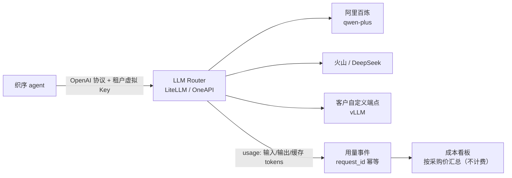

**Router 负责**：多模型适配、每租户虚拟 Key、模型白名单、限额与预算、重试/降级、缓存（可选）、用量日志。**我们负责**：租户配置界面、采购价表、把 usage 变成成本与毛利看板。

**token 记账链路**：

1. 每次调用带 `request_id` + `tenant_id` + `task`。
2. Router 返回 `usage.prompt_tokens / completion_tokens / cached_tokens`，网关写入 `token_usage`（幂等）。
3. 每日汇总到 `usage_monthly`；每月按 `model_prices` 采购价算成本（参考销售价默认不启用）。
4. 平台端出现「模型用量」成本看板；租户端只显示用量，不进入账单金额。
5. 与 Router 自带日志做日对账，差异 >1% 告警；避免漏计/重计。

**按任务路由**（可选）：报价/对账用稳的模型（低 temperature），跟进话术可用便宜模型，OCR 用专用模型。全部在同一个设置页里按「任务」覆盖，不增加新概念。

**仍然保留的底线**：

1. 所有 agent 走统一网关，不直接调厂商；密钥只存在服务端。
2. 敏感字段（手机号、银行账号）出网前脱敏；成本底线、合同价、客户名单默认不发给外部模型。
3. 不跨租户复用缓存；prompt 默认不落原文。
4. 「不允许外部模型」的租户，agent 用规则/本地模型，界面明确提示能力降级。

**数据区域是什么、要不要管**：就是数据存在哪个机房/国家。国内客户默认杭州，**不需要选**；只有海外客户或合同明确要求「数据不出境/存在新加坡」时才出现这个选项。字段保留，但现在不给你增加操作。

**不自部署意味着什么**：我们不做模型训练、GPU 采购、模型升级。客户坚持要内网模型，就由客户自己提供兼容端点，我们只填 URL 和 Key。这样复杂度最低，也仍然留了口子。

### 15.5 现在版本必须留的口子（很便宜，后面补很贵）

| 事项 | 现在做什么 | 以后省什么 |
| ---- | ---------- | ---------- |
| 租户列 | 所有业务表加 `tenant_id`（已有计划） | 不用改表结构 |
| RLS | 第一天就开，CI 跨租户测试 | 不用补历史漏网查询 |
| 数据平面 | `tenants` 加 `isolation_mode` / `data_plane_id` / `region` | 升级 schema/独立库只改路由 |
| 对象存储 | key 前缀带租户，签名 URL 带租户 | 不用迁移文件 |
| LLM | 参数统一走 `llm_settings`（全局 + 租户覆盖），agent 不直连厂商 | 换模型/换供应商只改配置 |
| 密钥 | API Key 存 KMS/密钥管理，不落库明文 | 满足企业安全评审 |
| 审计 | 记录 tenant、data plane、provider、model、prompt hash | 可回答「数据经过谁」 |
| 导出/删除 | 租户级导出/删除任务 | 满足合规与流失交接 |

### 15.6 安全基线（销售材料可直接用）

- 传输 TLS 1.2+，静态加密 AES-256；敏感字段（手机号、银行账号）字段级加密。
- 租户隔离：RLS + 跨租户测试；企业版 schema/独立库；对象存储前缀隔离。
- 权限：最小权限、MFA、平台侧 break-glass 需租户同意、双人复核。
- 审计：登录、导出、打印、审批、平台访问全留痕；审计不可改。
- 备份：每日全量 + PITR；每季度恢复演练；企业版可指定区域。
- 模型：零留存协议、不训练、区域端点；支持客户自定义端点；prompt 默认不留原文。
- 合规：DPA、子处理商清单、数据删除承诺、渗透测试报告（上线前）。

### 15.7 分期建议

| 阶段 | 数据隔离 | LLM |
| ---- | -------- | --- |
| P0 | 共享库 + RLS + 跨租户测试；`isolation_mode` 字段 | provider 接口 + 云端零留存；敏感字段脱敏 |
| P1 | schema-per-tenant 路由与迁移；单租户导出/恢复 | LLM 租户覆盖（含自定义 base_url / 客户自带 Key） |
| P2 | 独立数据库/实例、每租户 KMS、区域（仅按合同启用） | LLM 按任务路由、调用成本看板、故障切换 |

### 15.8 已定与待定

**已定（v1.5）**：

1. 默认共享库 + RLS；schema/独立库只作为应对挑剔客户的升级项，不默认。
2. 不自部署模型，不做 GPU 运维；总后台「LLM 设置」提供参数口子，客户要内网模型就填自己的兼容端点。
3. 数据区域不作为用户必选项：国内默认杭州，只有海外/合同要求时才启用。
4. 「绝不用客户数据训练」写进合同与官网。
5. 登录交给 Casdoor，我们只做授权映射。

**还需确认**：

1. 隔离升级（schema/独立库）定价：Enterprise 加价多少？
2. LLM 默认供应商与模型选哪家（阿里百炼 / 火山 / DeepSeek）？
3. Casdoor 自托管由谁运维、是否接受它作为登录单点？

---

## 16. 风险与待拍板

| 风险 | 影响 | 对策 |
| ---- | ---- | ---- |
| 定价口径不统一（毛利按客户/品类/业务员） | 报价建议不可信，整条链路失效 | 已定为「系统推荐 → 公司 → 团队/客户/品类 → 个人」继承链 + 管控夹取，见 §3.5；老板只需确认公司默认值与底线 |
| 业务员抵触「被 AI 替代」 | 数据不录入，产品空转 | 定位为「替你干活」，采纳率与个人业绩挂钩；不监控个人 |
| 客户数据敏感 | 跨人可见引发冲突 | 默认 `own`，共享显式授权，交接留痕 |
| 移动端图片/弱网 | 现场不可用 | 压缩 + 直传对象存储 + 离线队列 |
| 移动端范围蔓延 | 变成「什么都做一点」 | 用 §5.2 的能力矩阵与 P0/P1 边界卡住；PC 独占清单不动 |
| 报价链接外泄 | 价格被同行看到 | 有效期 + 可撤回 + 手机尾号验证 + 客户名水印 + 不存明文 token |
| 客户点「接受」后失联 | 误当成交 | 接受只是意向，必须业务员确认转订单草稿；页面写明 |
| 箱唛贴错 / 发错货 | 退货、赔款、客户流失 | 扫码复核 + 一箱一码 + 打印快照；数量不符不允许打 |
| 打印代理挂掉 | 仓库打不出箱唛 | 代理独立常驻机 + 心跳告警 + 浏览器 PDF 兜底 + 手机蓝牙 |
| 标签模板改坏 | 一批货打错 | 模板版本化；重打默认原版本；测试页 + 灰度 |
| 每家都要定制模板，变成外包开发 | 实施成本失控、交付变慢 | 参数覆盖 → 字段布局 → 模板工作室 → 模板包四层；AI 识样张降低启动成本；白名单约束 |
| 打印代理安装/被杀毒拦截 | 仓库装不上、用不起来 | 代码签名、静默升级、扫码绑定、5 分钟安装、失败可回退浏览器打印 |
| SaaS 计费错账 | 客户投诉、收入漏损 | 用量事件幂等 + 月度对账 + 争议窗口 + 人工调账审计 |
| 改价影响存量客户 | 客诉、收入波动 | 价格表版本化 + 合同锁价 + 改价试算 + 双人复核 + 审计 |
| 开票税率/类型配错 | 税务风险、客户拒收 | 默认 6% 专票、按租户 `tax_profile`、财务复核、红冲留痕 |
| 平台客服越权看数据 | 信任崩塌 | 控制面与租户库分离 + break-glass 租户同意 + 双人复核 + 全程审计 |
| 定价过低覆盖不了 agent 成本 | 越卖越亏 | 每席位额度 + 动作包 + 月度毛利看板；毛利 < 60% 触发调价 |
| 共享库漏加租户条件导致串号 | 严重安全事故 | RLS 强制 + 应用角色无 BYPASSRLS + CI 两租户互查 + 对象存储/缓存前缀隔离 |
| schema 迁移一半失败 | 部分租户不可用 | 按租户串行迁移 + 单租户回滚 + 每个 schema 记录版本 |
| 客户自填的模型端点不稳定 | 调用失败、体验下降 | 测试连接 + 超时/重试 + 备用模型 + 降级到规则；不承诺运维客户端点 |
| Casdoor 登录单点故障 | 全员无法登录 | 独立部署 + 多副本 + 每日备份 + 会话短期宽限 + 监控告警 |
| Casdoor 与本地成员不同步 | 权限错配 | `(sub, org)` 映射 + 定期对账任务 + 离职禁用双写 |
| 客户敏感数据出网 | 合规与信任风险 | 默认脱敏 + 数据分级路由 + 租户「禁止外部模型」开关 + 出网审计 |
| 模型厂商停服/涨价 | 成本与连续性 | provider 抽象 + 多厂商 + 备用端点 + 规则降级 + 按租户可切 |
| 渠道 API 审批 | 自动发送无法上线 | 先「复制文案 + 记录已发」，不阻塞链路 |
| 多租户数据串号 | 严重安全事故 | 所有业务表 `tenant_id` + 行级隔离；控制面单独 schema；集成测试覆盖跨租户越权 |

**已按你的回复定下（v1.1 / v1.2）**：

1. 毛利率等参数：**系统推荐 + 公司/团队/客户/品类/个人分层设置，按继承链取用**；管控类（底线/阈值）以公司为硬边界，下级只能收紧。见 §3.5。
2. 手机端：在原「审批 + 拍照找样 + 客户」上扩为 **5 入口 + 角色化首页 + 现场能力矩阵**（扫码、拍签收、拍大货、盘点、拜访、回款、离线、委派）。见 §5.2。
3. 客户可见报价链接：**确认做**，进入 P0；客户无登录可看、可问、可接受，接受后由业务员确认转订单。见 §7.6 / §8.5。
4. 打印：做成**统一打印中心 + 打印代理 + 一单一码**，不是每个页面一个按钮；发货单/箱唛走「拣货 → 装箱 → 一键打全套 → 扫码复核」。见 §4.4 / §7.7 / §8.6。
5. SaaS 收费：**只按席位 + agent 动作收费**；**token 全程计量但不收费**，只用于成本、毛利、容量规划与未来定价。平台总管理端独立于租户端，默认看不到业务数据。见 §14.2。
6. 定价：**暂按 ¥299 / ¥499 / 定制、年付送 2 个月**；价格做成**总后台可配的版本化价格表**，支持租户级合同价/锁价，改价不影响存量。见 §14.1。
7. 开票：按「老规矩」默认 **6% 增值税专用发票、价税分离、收款后开票**；发票类型/税率/开票主体/时机在**总后台「开票设置」**可改，按租户生效。见 §14.3。
8. 打印：**做一个真正的打印代理（Print Agent）**，本地常驻、自动发现打印机、离线补打、本地渲染与校准；每家公司通过「参数覆盖 → 字段布局 → 模板工作室 → 模板包」自定义，并可用 **AI 识样张**从旧单据生成模板。见 §4.4。
9. 数据隔离：**默认共享库 + RLS**，企业版可升级 **schema-per-tenant**，旗舰/私有化用独立库/实例；**升级包价格在总后台按合同配置**（不写死）。见 §14.1 / §15。
10. LLM：**不自建模型**；总后台「LLM 设置」提供参数口子，接入 **LiteLLM 等开源 Router**，每家公司可配模型，**token 全程记账**，当前只用于成本与未来定价、不收费。见 §15.4。
11. 登录：**交给 Casdoor**（已部署 `https://sso.wnbgj.com`），一个租户一个 Organization，平台管理员独立应用 + 强制 MFA；我们只保留角色/数据范围映射，不存密码。见 §3.6。
12. 改稿：**表单改值、Chat 改意图、统一落成 Patch**；Chat 不直接写数据，所有修改走内核版本与审计。见 §7.8。
13. 配置优先：**凡是会变、且不同公司可能不同的，都进总后台配置**（价格、税率、模型、限额、开关、模板、保留期等），版本化 + 审计 + 回滚；内核铁律不配置。见 §14.11。

**还需要你拍板的事**：

产品：
1. 公司默认毛利率与最低毛利率各定多少？（建议：默认 18–20%，底线 12–15%）
2. 审批金额阈值（业务员 5 万 / 主管 20 万 / 老板无上限）是否照此执行？
3. 试点客户名单，以及是否允许客户在报价页直接点「接受」（还是先只给「提问」）。

打印：
4. 仓库现有打印机型号（热敏/A4/蓝牙）与标签尺寸（100×100？100×150？）？
5. 打印代理挂在哪台常驻机器上（前台/仓库小主机）？谁负责换纸？
6. 第一版模板个性化做到哪一层？建议 P1 先做「参数覆盖 + 自定义字段」，P2 上模板工作室与 AI 识样张。

商业化：
7. 内置 agent 额度 1,000 / 5,000 次/月够不够？超出单价建议 ¥0.05–0.1/次。
8. 试用 14 天，还是改成「7 天陪跑 + 14 天试用」？
9. 开票按 6% 专票是否就是你说的「老规矩」？如果公司实际按 13% 开，请让财务在总后台改税率即可。

数据安全：
10. schema/独立库升级包的默认标价（可后台改）先定多少？
11. Router 先接哪几家（阿里百炼 / 火山 / DeepSeek）？哪些模型开放给租户选？
12. Casdoor 已由你部署，确认后续运维/备份由你负责，还是要我们接手监控？

---

## 附：与既有文档的关系

- 工程边界、内核/工具/草稿铁律：沿用 `README.md` 与 `mvp-usability-assessment.md`，本文不改架构。
- 阶段排序与验收口径：沿用 `usability-roadmap.md`；本文只在其上补产品设计与双端落点。
- 平台形态（移动端/桌面壳/打印/部署）：`platform-and-engineering-plan.md` 的结论仍然有效；本文的差异是**把移动端从「阶段三之后」提前到 P0 的 PWA**，并在 v1.1 扩为 5 入口 + 角色化现场能力，理由是公司化后「老板在路上批单」是采纳瓶颈，且 PWA 成本远低于 Taro 三端。
- 客户侧：`platform-and-engineering-plan.md` 曾把客户自助端排在 P3；v1.1 按你的决定把**单条报价链接**提前到 P0（只读、无登录、可接受），完整的客户门户（寄样/历史/对账）仍在 P3。
- 数据隔离与模型部署：既有文档按「试点单租户」假设，v1.4 改为**SaaS 多租户分层隔离**（共享库+RLS / schema / 独立库）；v1.5 按你的决定**不做自部署模型**，只在平台端提供 LLM 参数口子，见 §15。登录统一交给 Casdoor，见 §3.6。
