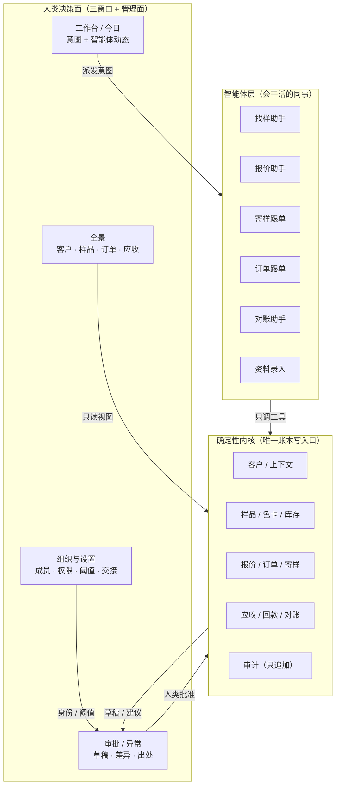
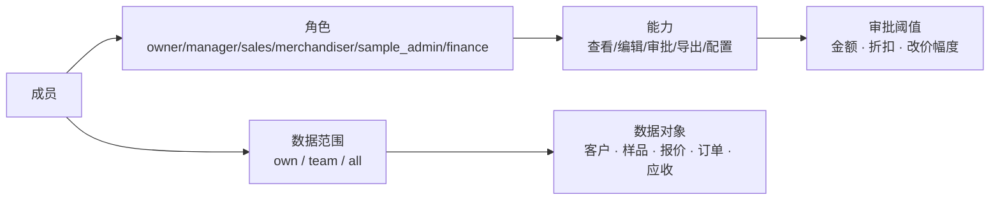
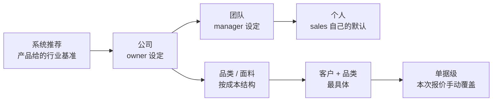
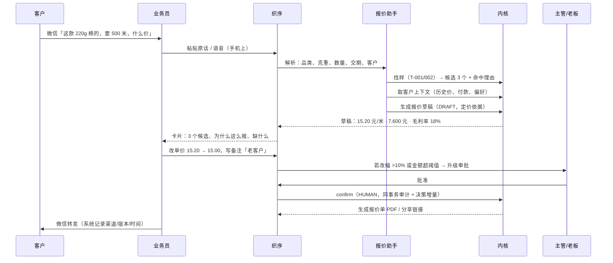
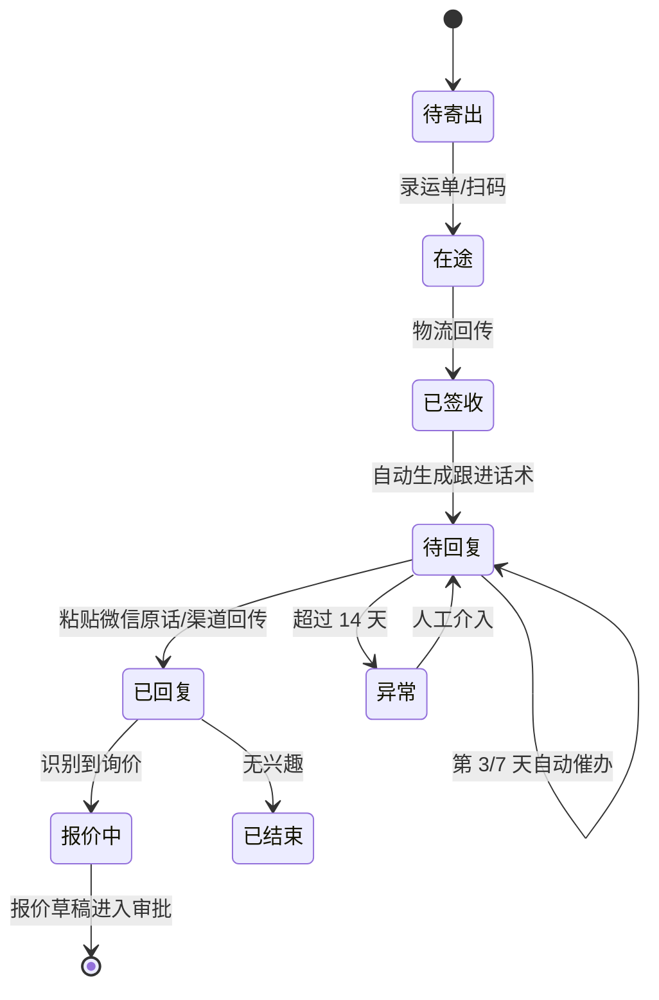
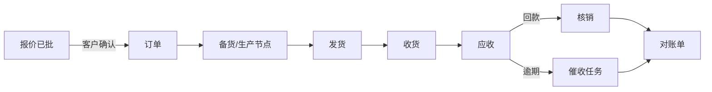
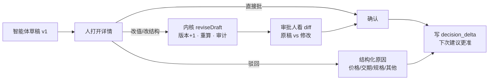
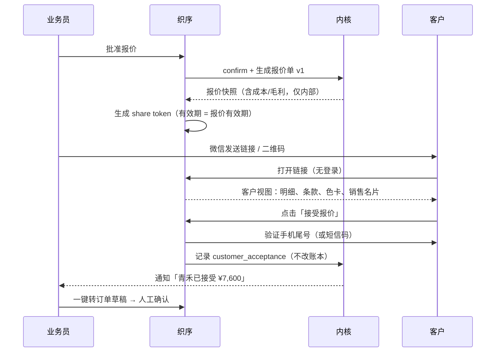

# 后 AI 时代纺织管理软件 · 产品设计

> 版本：v1.1 ｜ 日期：2026-11-12 ｜ 作者：巧匠（产品设计 & 增长）
> v1.1 变更：新增配置继承链（§3.5）、移动端 5 入口与能力矩阵（§5.2）、客户报价链接（§7.6 / §8.5）、分享指标与增长闭环（§11 / §13.6），分期与拍板项同步更新（§12 / §14）。
> 面向：`weave-order`（织序）现有代码与三份既有文档（`mvp-usability-assessment.md`、`usability-roadmap.md`、`platform-and-engineering-plan.md`）
> 本文回答的是**产品该怎么设计**：定位、角色、能力、双端、界面、权限、指标与分期。工程可行性沿用既有文档的结论，不重复论证；如有冲突，以本文的产品决策 + 既有文档的阶段排序为准。

---

## 0. 一句话

**织序不是「带 AI 功能的纺织 ERP」，而是一套「智能体干活、人只做决定」的纺织业务操作系统。**

布管家这类软件的前提是「业务员是操作者」：人选菜单、人录单、人查表。织序的前提是「智能体是默认操作者」：系统听懂一句话、自己找样、自己起草、自己跟进，人只在一张卡片上按「批」。所以它不是把布管家的功能搬上 AI，而是把布管家的**能力**重新组织成**智能体可调用的工具** + **人可审批的草稿**。

产品名沿用 **织序 WeaveOrder**。对外一句话：

> **你说生意，系统做单。**
> 报价、寄样、跟单、对账，智能体做完，你只点头。

---

## 1. 产品判断：后 AI 时代到底变了什么

| 维度       | 前 AI 时代（布管家 / 珍妮类） | 后 AI 时代（织序）                                     | 设计含义                                     |
| ---------- | ----------------------------- | ------------------------------------------------------ | -------------------------------------------- |
| 软件价值   | 存得住、查得到                | **替人做完一段工作**                                   | 首页不是菜单，是「今天替你做了什么、等你决定什么」 |
| 人的角色   | 操作者：录入、查询、点击      | **审批者 / 异常处理者**                                | 交互从「填表单」变成「看草稿、改一处、批」   |
| 数据入口   | 人逐条录入                    | 微信原话、照片、Excel、扫描件、语音 → 智能体结构化     | 输入必须是自然的多模态，不是 20 个字段       |
| 功能组织   | 按模块（样品/客户/订单）      | 按**任务**（这单客户要什么，谁去做，卡在哪）           | 模块仍在，但用户不按模块工作                 |
| 多用户     | 账号 + 权限，防越权           | 人 + **智能体成员**，都要有范围、预算、审计            | 权限模型要把 agent 当一等公民                |
| 护城河     | 数据量                        | **客户上下文 + 决策增量**（越用越懂这家客户）          | 每次改价/驳回都是训练信号，必须沉淀          |
| 交付形态   | PC 为主，移动端是查询器       | **双端同权**：PC 做批量与深度，手机做现场与决定        | 不是「PC 功能搬到手机」，是按场景切          |

**结论**：产品设计的第一性问题不是「功能够不够全」，而是**一条工作流能不能由智能体跑到「只剩一个决定」**。功能表再长，只要中间还要人搬数据，就仍是前 AI 时代的软件。

---

## 2. 产品架构：三层 + 一个自主等级



### 2.1 自主等级（每个 agent 能力都要标级）

| 等级 | 名称       | 行为                                       | 适用                                 |
| ---- | ---------- | ------------------------------------------ | ------------------------------------ |
| L0   | 只建议     | 给选项、给理由，不动任何数据               | 定价口径不明、新客户、首次合作       |
| L1   | 出草稿     | 产出 `DRAFT`，等人批（**当前默认**）       | 报价、寄样单、对账单、消息           |
| L2   | 执行后告知 | 低风险动作直接做，进「已办」并可撤销       | 建跟进任务、更新物流、打标签、提醒   |
| L3   | 自主运行   | 在预算与规则内闭环，只在异常时找人         | 常规催办、库存预警、日报（后期开放） |

设计原则：**默认 L1，升级靠证据**。一个 agent 在某客户/某品类上连续 N 次被原样采纳，才允许把该场景升到 L2；任何金额类动作永远不低于 L1。自主等级是**按场景配置**的，不是按 agent 全局开关，避免「一放就乱」。

---

## 3. 用户与组织

### 3.1 角色（先 6 个，不要再加）

| 角色 | 代号 | 每天在干什么 | 主端 | 关键诉求 |
| ---- | ---- | ------------ | ---- | -------- |
| 老板 / 总经理 | `owner` | 看经营、批大单、处理客户交接 | 手机 + PC | 5 分钟知道公司今天哪里不对 |
| 主管 / 合伙人 | `manager` | 批中额单、带新人、看团队漏斗 | PC + 手机 | 团队的单卡在哪、谁在摸鱼 |
| 业务员 | `sales` | 客户现场、找样、报价、寄样 | **手机优先** | 客户一句话，10 分钟给出报价 |
| 跟单 | `merchandiser` | 寄样物流、大货进度、交期 | 手机 + PC | 不漏一单、不被客户催 |
| 样品间 / 仓管 | `sample_admin` | 色卡、借还、盘点、扫码 | **手机 / 扫码枪** | 找得到、数得清 |
| 财务 | `finance` | 应收、回款、对账、开票 | PC | 月底对得上、逾期看得见 |

只读外部角色（客户/供应商）**本期不做**，见 §12 的 P3。财务不是「只读」：能登记回款、生成对账单，但不能改报价与订单金额。

### 3.2 智能体也是「成员」

| 字段       | 说明                                                       |
| ---------- | ---------------------------------------------------------- |
| 名称/头像  | 「小织 · 报价」「小样 · 找样」，让人能指名道姓地找它       |
| 归属       | 属于公司，不属于个人；可被分配给某个团队/客户              |
| 工具范围   | 只拥有该角色需要的工具（找样 agent 不能确认报价）          |
| 数据范围   | 与创建人一致或更窄；跨客户检索需显式授权                   |
| 每日预算   | 模型调用 / 外部查询次数上限，超限降级为 L0 并通知 owner     |
| 审计       | 每次工具调用、草稿、失败都记 `actorType=AGENT` + `actorId` |

**设计要点**：界面上不要叫「AI 功能」，要叫「小织正在做…」。人会对「同事」有预期，对「功能」只有开关。

### 3.3 权限模型：三层 + 两条阈值



| 能力             | owner | manager | sales | merchandiser | sample_admin | finance |
| ---------------- | :---: | :-----: | :---: | :----------: | :----------: | :-----: |
| 查看全公司客户   |   ✓   |  团队   | 自己  |     自己     |      —       |  金额向 |
| 新建/编辑客户    |   ✓   |    ✓    |  自己 |      —       |      —       |    —    |
| 查看成本底线     |   ✓   |    ✓    |  ✗    |      ✗       |      ✓       |    ✓    |
| 生成报价草稿     |   ✓   |    ✓    |   ✓   |      —       |      —       |    —    |
| 批准报价 ≤ 5 万  |   ✓   |    ✓    |   ✓   |      —       |      —       |    —    |
| 批准报价 ≤ 20 万 |   ✓   |    ✓    |  ✗    |      —       |      —       |    —    |
| 批准 > 20 万     |   ✓   |    ✗    |  ✗    |      —       |      —       |    —    |
| 改价 > 10%       |   ✓   |    ✓    | 需上级 |      —       |      —       |    —    |
| 库存出入库       |   ✓   |    ✓    |  ✗    |      ✓       |      ✓       |    —    |
| 登记回款         |   ✓   |    ✓    |  ✗    |      ✗       |      —       |    ✓    |
| 客户交接         |   ✓   |    ✓    | 发起  |      —       |      —       |    —    |
| 成员/权限/阈值   |   ✓   |  部分   |  ✗    |      ✗       |      ✗       |    ✗    |
| 修改公司级定价策略 |   ✓   |  建议   |  ✗    |      ✗       |      ✗       |    ✗    |
| 修改客户/个人默认值 |   ✓   |    ✓    |  自己 |      ✗       |      ✗       |    ✗    |
| 分享报价链接     |   ✓   |    ✓    |  自己 |      ✓       |      ✗       |    ✗    |
| 查看链接访问数据 |   ✓   |    ✓    |  自己 |      ✓       |      ✗       |    ✗    |

三条硬规则：

1. **数据范围默认 `own`**。纺织贸易里客户是业务员的命，跨人可见会直接引发抵触；共享必须显式（项目协作或交接），并留痕。
2. **金额阈值在阶段一就留字段**。阈值后改要重写审批流；先允许全公司一个默认值。
3. **审计存快照**：`actorRole` / `tenantId` / `dataScope` 在动作发生时落库，员工调岗后仍能还原「当时他有没有这个权限」。

### 3.4 客户交接（离职 / 调岗）

不是「改个 owner 字段」就完了，要做成一次**带清单的移交**：

1. 主管发起交接 → 系统列出：在跟客户、未决报价、在途寄样、未回款订单、待办跟进。
2. 新业务员逐项确认接收；客户上下文（偏好、历史价、付款习惯）只读带过去。
3. 交接期 7 天内双方都能看；到期后原业务员自动失去 `own` 权限。
4. 全程审计 + 通知客户负责人（内部，不通知客户）。

### 3.5 配置优先级：系统推荐 → 公司 → 团队/客户/品类 → 个人

毛利率、报价有效期、付款方式、税率口径、改价阈值、取整规则这些「会因为公司不同而不同」的参数，**不写死在代码里，也不要求每家公司从零填**。统一按一条继承链取值：



**取值顺序（从最具体到最通用）**：

```
单据级 > 客户+品类 > 品类 > 客户 > 团队 > 个人 > 公司 > 系统推荐
```

**但优先级不是简单的「就近覆盖」**，否则业务员可以给自己设 5% 毛利。参数分两类：

| 类型 | 例子 | 规则 |
| ---- | ---- | ---- |
| **管控类**（下限 / 上限 / 审批线） | 成本底线、最低毛利率、审批金额阈值、改价幅度上限、税率 | **公司级是硬边界**。下级只能收紧，不能放宽；越界时取边界值并显式提示「已按公司底线修正」 |
| **建议类**（默认值 / 偏好） | 默认毛利率、报价有效期、付款方式默认值、条款模板、取整规则 | 按上面的顺序就近覆盖；个人可以改自己的默认值 |

所以最终生效值 = **就近取到的值，再被管控层夹一次**。举三个例子：

| 参数 | 系统 | 公司 | 品类（棉氨纶） | 客户（青禾） | 个人（李娜） | 生效值 | 说明 |
| ---- | ---- | ---- | -------------- | ------------ | ------------ | ------ | ---- |
| 默认毛利率 | 18% | 20% | 22% | 21% | 19% | **22%** | 品类比客户更具体，且高于个人 |
| 客户+品类毛利率 | — | 20% | 22% | — | — | **21.5%** | 客户+品类是最具体的一层 |
| 最低毛利率 | 12% | 15% | — | — | 8% | **15%** | 个人想设 8%，被公司底线夹回 15% |

**四条产品规则**：

1. **每个值都显示来源**。设置页、客户 360、报价审批卡上都标注「生效值 + 来自哪一层 + 谁在什么时候设的」。审批人看到的不是孤零零一个 18%，而是「18% · 客户专属，李娜 2026-08 设定」。
2. **继承不是复制**。下级没设就实时继承上级；上级改了，下级立刻跟着变。要「冻结」当前值必须显式点「固定为…」并留痕。
3. **智能体只读生效值**。agent 可以在建议里引用「公司底线 15%、该客户历史 21%」，但不能修改任何配置；它只能提议「这家客户建议下调 1%」，由人批。
4. **系统推荐会学习，但不会偷偷变**。推荐值 = 行业基准 + 该公司被采纳的历史（决策增量）。每月生成一次「建议调整」清单，owner 确认后才生效。

**谁能设哪一层**：

| 层级 | 谁可以设 | 备注 |
| ---- | -------- | ---- |
| 系统推荐 | 产品团队 | 所有公司可见，不可被单公司改写 |
| 公司 | owner | 管控类参数的唯一出口；修改写审计 |
| 团队 | manager | 只能在不突破公司边界的范围内 |
| 品类 / 面料 | manager、sample_admin（仅成本字段） | 按成本结构，通常由主管维护 |
| 客户 / 客户+品类 | 客户的 owner、manager | 销售可提议，超出公司边界需审批 |
| 个人 | 每个成员 | 只影响自己的默认值，不影响他人 |
| 单据级 | 报价的创建人 / 审批人 | 只影响本单，必须在审批卡上显示偏离与理由 |

**交互形态**：设置页不是一堆输入框，而是一张「继承表」：

```
参数            系统推荐   公司     团队    我的     生效值      来源
默认毛利率       18%       20%      —      19%      22%        品类：棉氨纶
最低毛利率       12%       15%      —      8%       15%        公司底线（你的 8% 已被修正）
报价有效期       15 天     30 天    —      —        30 天      公司
付款方式         月结 30   月结 30  —      月结 45  月结 30    公司（个人不可放宽）
```

每一行可展开「为什么是这个值」，显示完整的继承链和最近三次修改。客户 360 里多一个「该客户专属」页签，只显示与默认值不同的项，避免配置迷宫。

---

## 4. 能力地图：布管家能力 → 织序能力

### 4.1 行业基准能力（布管家 / 珍妮类软件的共性）

面料库与色卡、样品管理（借还/样品间/条码）、以图找样与按规格找样、客户档案与跟进、报价与合同、订单与生产进度、库存出入库、寄样物流、应收与对账、报表、移动端查询、账号与权限。

**我们不做「功能对齐清单」。** 对齐的是**任务完成度**：同一件事，布管家要人做 8 步，织序要做到「人只说一句 + 批一次」。

### 4.2 能力对照

| 能力域 | 布管家类做法 | 织序做法（智能体 + 草稿） | AI 增量 | 端 |
| ------ | ------------ | ------------------------- | ------- | -- |
| 面料/色卡库 | 手工建卡、传图、填 20 个字段 | 拍照/Excel/供应商表 → 自动结构化；缺失字段标红待补 | 识别成分/克重/门幅，自动去重合并 | PC 建，手机拍 |
| 找样 | 关键词/类目筛选 | 一句话、一张图、一段客户原话 → 候选 + 命中理由 + 库存 | 多模态检索、相似度解释、替代料建议 | 手机为主 |
| 客户档案 | 人录 + 跟进记录 | 微信原话/通话摘要自动归档；客户 360 自动生成 | 偏好、价格敏感度、付款习惯沉淀为上下文 | 双端 |
| 报价 | 选模板、填单价、算总价、导出 | 客户一句话 → 草稿（含定价依据、历史价、毛利）→ 人改一处 → 批 → PDF/链接 | 定价建议、底线校验、改价写决策增量 | 手机批，PC 改 |
| 定价/毛利 | 固定系数，或每个业务员手填 | 系统推荐 → 公司 → 团队/客户/品类 → 个人继承链；审批卡显示生效值与来源 | 推荐值随采纳率变准、公司底线自动夹取、越权配置拦截 | 双端 |
| 寄样 | 建单、填运单、人工催 | 建单 → 自动追踪 → 到样提醒 → 生成跟进话术 → 识别回复 → 转报价 | 中断可视化、自动催办、回复意图识别 | 手机 |
| 订单/生产 | 手工排期、Excel 跟 | 报价成交自动转订单；按交期倒排节点；异常自动升级 | 延期预测、缺料预警、客户同步话术 | PC 看板，手机收异常 |
| 库存 | 扫码出入库、盘点 | 扫码/拍照出入库；安全库存自动补货建议 | 呆滞料识别、按订单预留 | 手机/扫码枪 |
| 对账 | 月底拉 Excel 对 | 自动生成对账单；差异定位到单/行；回款自动核销 | 差异解释、逾期分级催收 | PC 为主 |
| 报表 | 固定报表 | 问一句「这个月谁毛利最高」→ 图表 + 口径说明 | 自然语言取数、异常归因 | 双端 |
| 权限 | 账号 + 角色 | 角色 + 数据范围 + 金额阈值 + 交接 + agent 权限 | 越权拦截、审批路由 | PC 配置 |
| 移动 | 查询/审批 | 与 PC 同权的「现场工作台」 | 拍照、语音、扫码、离线队列 | 手机 |

### 4.3 只有后 AI 时代才成立的新能力

1. **客户上下文（护城河）**：每个客户的价格带、常用品类、付款节奏、沟通偏好、历史争议。每次改价/驳回都写 `decision_deltas`，下一次建议显式引用「上次给该客户 15.0，本次 15.2，因为棉价涨了 4%」。
2. **决策出处（Provenance）**：任何数字都能点开看来源：哪张样品、哪次报价、哪条消息、哪个规则。没有出处的数字不许出现在审批卡上。
3. **差异审批（Diff Approval）**：人改过的草稿，审批人看到的是「智能体原稿 vs 人的修改」逐行 diff，而不是一坨新数字。
4. **异常优先（Exception-first）**：默认视图不是全量列表，而是「今天有 3 件事不对」。正常的事智能体做完就沉下去。
5. **自然语言取数**：老板问「上周寄样转化率」，系统给图 + 口径 + 可下钻，不再等报表。
6. **交接即知识转移**：客户上下文跟着客户走，人走单不断。

---

## 5. 信息架构

### 5.1 一个明确的产品决策：3 + 1

既有铁律 #4 是「人类界面只有三个窗口」。多用户公司化之后，必须有成员、角色、阈值、交接、连接器这些配置。**建议扩展为「3 个业务决策面 + 1 个管理面」**：

- **3 个业务面**（所有人）：工作台 / 审批 / 全景。仍然是铁律说的三个窗口，业务操作只在这里发生。
- **1 个管理面**（owner/manager）：组织与设置。它不是业务窗口，不产生业务单据，等价于「操作系统的设置」，不违背铁律的初衷（防止界面按模块碎片化）。

```
织序（桌面）
├── 工作台 Today            ⌘1
│   ├── 意图栏（说一句话 / 粘贴微信 / 拖文件 / 拍照）
│   ├── 智能体动态（正在做 / 做完了 / 卡住了）
│   ├── 我的待办（今天必须决定的）
│   └── 异常提醒（交期、逾期、库存、客户流失）
├── 审批 Approvals          ⌘2
│   ├── 待我批（按金额×紧急度排序）
│   ├── 我发起的（含被驳回）
│   ├── 已办（可撤销窗口 10 分钟）
│   └── 审批详情（草稿 / 出处 / diff / 修改 / 批准）
├── 全景 Panorama           ⌘3
│   ├── 客户 360（含上下文、历史、在途）
│   ├── 样品/色卡（图墙 + 规格 + 库存）
│   ├── 报价与订单（漏斗 + 交期）
│   ├── 应收与对账
│   └── 审计流水（可按人/单/时间）
└── 组织 Settings           ⌘,
    ├── 成员与角色
    ├── 数据范围与交接
    ├── 审批阈值与自主等级
    ├── 连接器（微信/物流/邮件/Excel）
    └── 模板（报价单/对账单/箱唛）
```

### 5.2 移动端（不是桌面缩小版）

底部 5 个入口：**今日 / 审批 / 相机 / 客户 / 更多**。「相机」不是相册，是**现场能力入口**：拍照找样、扫运单、扫色卡、拍签收、拍大货进度、拍名片。

```
手机
├── 今日      按角色变的首页：智能体动态 + 待我决定 + 异常 + 快捷动作
├── 审批      大卡片、拇指区、左滑驳回、语音批注、委派、大额二次验证
├── 相机      6 个模式：找样 / 扫运单 / 拍签收 / 拍大货 / 建样品 / 名片·截图
├── 客户      我的客户、360、快速报价、寄样/订单、拜访记录、报价链接访问
└── 更多      样品 · 订单 · 库存 · 对账 · 报表 · 设置 · 切换身份 · 离线队列
```

**「今日」按角色变**（同一套组件，不同的块排序）：

| 角色 | 首页第一屏 | 第二屏 | 快捷动作 |
| ---- | ---------- | ------ | -------- |
| 业务员 | 待决定（报价/跟进） | 我的客户待办、今天要拜访 | 拍照找样、粘贴微信、语音报价 |
| 老板 | 经营一句话（今天哪里不对） | 待我批、异常、团队漏斗 | 看周报、批单、客户交接 |
| 跟单 | 异常（交期/物流/签收） | 在途寄样、生产中订单 | 扫码录运单、拍签收、更新进度 |
| 样品间 | 待办（借还/盘点/补样） | 货架与库存预警 | 扫码借还、盘点、拍照建样品 |
| 财务 | 逾期与待核销 | 本月应收、差异对账 | 拍回款凭证、生成对账单 |

**手机端能力清单（这是「够不够」的答案）**：

| 能力 | 业务员 | 跟单 | 样品间 | 老板 | 财务 |
| ---- | :----: | :--: | :----: | :--: | :--: |
| 拍照/以图找样、看色卡 | ✓ | 只读 | ✓ | 只读 | — |
| 语音/粘贴微信 → 报价草稿 | ✓ | — | — | — | — |
| 改价、批单、分享报价链接 | ✓ | — | — | ✓ | — |
| 扫码录运单、拍签收 | ✓ | ✓ | — | — | — |
| 拍大货进度、更新交期 | 只读 | ✓ | — | 只读 | — |
| 扫码借还、盘点、出入库 | — | — | ✓ | — | — |
| 拍回款凭证、核销 | — | — | — | 只读 | ✓ |
| 客户拜访签到 + 语音记录 | ✓ | — | — | — | — |
| 名片/微信截图建客户、建样品 | ✓ | — | ✓ | — | — |
| 审批委派、大额二次验证 | — | — | — | ✓ | — |
| 经营看板、团队漏斗 | — | — | — | ✓ | 只读 |
| 离线队列（弱网/仓库/展会） | ✓ | ✓ | ✓ | ✓ | ✓ |

**七条移动端设计规则**：

1. **单手可达**。主操作固定在底部拇指区；审批卡不要求滚动才能批。
2. **相机优先于表单**。能拍就不填：拍布 → 建样品；拍运单 → 录单号；拍名片 → 建客户；拍签收单 → 推进状态。
3. **语音优先于打字**。现场手上有布、有笔、有客户，长按说话；转写结果可改，原始录音留档。
4. **离线优先**。今日待办、客户列表、待批单据缓存到本地；扫码/拍照先入队，恢复后按时间序提交，冲突弹「保留哪一版」。
5. **颜色不当真**。手机屏幕看色卡必须显示「屏幕色仅供参考，以实物色卡为准」，并支持拍标准光源对比图。
6. **隐私最小化**。拜访定位只在点击「签到」时取一次，不后台持续定位；客户手机号默认脱敏；报价链接水印到客户名。
7. **大额审批升门槛**。超过个人阈值的单，手机端要求 Face ID / 指纹二次验证；验证记录进审计。

**手机不做**：批量导入、模板编辑、宽表全景、权限配置、审计检索、多行复杂改价。这些在 PC 上 10 秒能做完，在手机上做是自虐。

**移动端首发范围（P0 → P1）**：

| 阶段 | 范围 | 验收 |
| ---- | ---- | ---- |
| P0 | 今日、审批、相机（找样/扫码/拍签收）、客户（列表/360/分享报价链接） | 业务员手机粘贴原话 → 改价 → 分享链接；老板手机批单 |
| P1 | 更多（样品/订单/库存/对账入口）、拜访签到、拍大货、回款凭证、离线队列、审批委派 | 跟单在仓库扫码；样品间盘点；财务拍凭证核销 |

### 5.3 全局入口

- **⌘K 命令栏**：任何页面可呼出，输入自然语言直接派发意图；也支持跳转（「青禾的报价」）。
- **长按/右键**：任何单据可「问小织」（为什么这个价、这单卡在哪）。
- **通知**：只推「需要你决定」和「出事了」，不推「已完成」。已完成的进工作台动态流。

---

## 6. 双端分工

| 场景 | 桌面（Web / PWA，后期 Tauri 壳） | 手机（PWA → 小程序/App） |
| ---- | -------------------------------- | ------------------------ |
| 报价 | 多行编辑、批量改价、模板、导出 PDF、对比历史 | 看摘要、改单价、一键批、语音备注 |
| 找样 | 图墙、多条件筛选、批量建寄样 | 拍照/相册、以图搜样、现场给客户看 |
| 寄样 | 列表、批量打印面单 | 扫码录运单、拍签收、推进状态 |
| 客户 | 360 全量、批量分配、交接 | 最近沟通、快速报价、导航到客户 |
| 订单 | 交期看板、批量排期、对账 | 收异常、拍大货进度、确认收货 |
| 库存 | 盘点表、批量调整 | 扫码出入库、拍照建样品 |
| 定价 | 继承表、批量调整、品类/客户专属、审计 | 看生效值来源、改本单、提议调整 |
| 报价分享 | 批量生成链接、访问分析、撤回、模板 | 生成/转发链接、看访问提醒、客户提问 |
| 对账 | 对账单、差异定位、批量核销 | 拍回款凭证、看逾期、核销一笔 |
| 拜访 | 团队拜访地图与记录 | 签到、语音记录、拍现场 |
| 管理 | 全部 | 只做「批个假/加个人」的轻操作 |

**形态策略**：

1. **一套代码，两套布局**。同构 React，移动端走独立路由与组件密度，不做「响应式压缩」。
2. **先 PWA**。可安装、可离线缓存、免审核，覆盖 90% 的「手机上批一下」需求；小程序等有客户自助诉求时再做（见 P3）。
3. **桌面壳只为外设**。Tauri 只暴露 `print / scan / readFile / 电子秤`，业务 UI 仍从 Web 加载，避免两套界面。
4. **离线队列**：仓库/展会弱网下，扫码与拍照先落 IndexedDB，恢复后按时间序提交，冲突以「服务端版本 + 人工确认」解决。
5. **移动端前置条件**：图片先压缩再上传（长边 1600px、≤ 1MB），或直传对象存储，不能走 base64 JSON。

**PC 独占（手机永远不做）**：Excel/CSV 批量导入与字段映射、报价模板/条款编辑、多行报价批量改价、宽表全景与自定义报表、角色与数据范围配置、审计全文检索、对账单批量调整。

**手机独占（PC 做不了）**：拍照找样/拍签收/拍大货、扫码录运单与盘点、名片扫描、现场签到、语音批注、离线队列、Face ID 大额审批。

---

## 7. 关键旅程

### 7.1 客户一句话 → 报价发出（核心链路）



**设计要点**：
- 输入不是表单，是「原话」。系统要能展示它**听懂了什么**（解析出的 4 个槽位），错了可点开改。
- 候选样品必须给**命中理由**（「克重一致、成分一致、有现货」），否则人不敢选。
- 报价卡上必须有**定价依据**与**缺失项**（「未确认交期」），而不是只给一个数。
- 改价不是重新生成，是**原地改 + 版本 + diff**。

### 7.2 寄样 → 跟进 → 回复 → 报价



界面必须回答三个问题：**卡在等什么、等了几天、下一步谁做**。现在只有「等待客户回复」一个状态是不够的。

### 7.3 成交 → 订单 → 对账



智能体的职责：从交期倒排节点、每天比对进度、异常升级给人、自动生成对账单并解释差异（「这 320 米是补损，未在订单内」）。

### 7.4 新公司冷启动（第一次打开）

1. 建组织：公司名、抬头、银行账号、默认币种。
2. 导入：拖 Excel / 微信通讯录截图 / 供应商面料表 → 预览 → 逐行可判别的错误 → 整批原子导入（沿用现有 ImportService 语义）。
3. 邀请成员：手机号/链接，预设角色与数据范围。
4. 设阈值：默认 5 万 / 20 万 / 无上限，可改。
5. 第一个任务：系统给一个「用你刚导入的客户试报一次价」的引导，5 分钟内产出第一张草稿。
6. 验收：老板在手机上批掉第一单。

### 7.5 人机协作改稿（决定产品好不好用）



**三条体验规则**：
1. 改完能直接批（同一个人负责一单），换人改必须重新审批。
2. 驳回必须选原因 + 可补一句话；原因进上下文，不允许自由文本黑洞。
3. 界面上显示「你改了它 2 处」，但不做说教式提示；改动本身就是训练信号。

### 7.6 报价链接：客户不登录也能看、能问、能接受

报价批准之后，系统生成一条**带签名的只读链接**。客户在微信里点开就能看，不需要账号、不需要装 App；业务员能看到「谁看了、看了几次、看到哪一行、有没有接受」。



**链接的 12 条规则**：

1. **只有已批准的报价能分享**。`DRAFT` 状态的报价不生成链接，避免把内部草稿发出去。
2. **链接指向版本快照**。报价改了就是 v2 新链接；旧链接打开显示「此报价已更新」并可跳转最新版（是否允许跳转由业务员控制）。
3. **默认有效期 = 报价有效期**，到期自动失效；可提前撤回（`revoked_at`），撤回后立即 410。
4. **不暴露内部字段**：成本、毛利率、成本底线、内部备注、其他客户、提成，一律不在客户视图出现。
5. **水印到客户名 + 报价编号**，PDF 下载带同一水印；截图外流也能追溯。
6. **可选身份门槛**：默认「手机尾号后 4 位」；高金额可开短信验证码；不强制注册。
7. **接受 ≠ 合同**。客户点「接受」只产生「成交意向」，需要业务员确认后转订单草稿，再由人批准；页面必须写清这一点。
8. **能提问**。客户可在任意行留言（「这个克重有没有更厚的」），进入小织的消息队列，小织起草回复，人批后回。
9. **访问提醒有度**。只推「首次查看 / 接受 / 提问 / 过期前 3 天」，不推每一次刷新；访问数据聚合展示。
10. **隐私最小化**：不写 Cookie 做跨站追踪，IP 只存哈希；客户无需填任何资料即可看。
11. **多语言**：中/英一键切换，价格与条款跟随报价版本；导出 PDF 同步语言。
12. **分享渠道可记录**：微信复制、二维码、邮件、短信；记录「发给了谁、哪个渠道、哪一版」。

**状态机**：`不可分享（DRAFT）→ 可分享 → 已查看 → 已接受 / 已提问 / 已过期 / 已撤回`。状态变化全部进审计，业务员在客户 360 里能看到时间线。

---

## 8. 界面与交互规范

### 8.1 工作台：从「功能入口」变成「同事汇报」

```
┌──────────────────────────────────────────────────────────────┐
│  织序        ⌘K 说点什么…                         小织 ▾   │
├──────────────────────────────────────────────────────────────┤
│  今天，小织替你做了 7 件事，3 件等你决定                     │
│                                                              │
│  ┌─ 等你决定 ──────────────────────────────────────────┐    │
│  │ 青禾服饰 · 报价 ¥7,600      改幅 0%   [看详情] [批] │    │
│  │ 例外：单价低于该客户历史均价 3%                       │    │
│  └──────────────────────────────────────────────────────┘    │
│  ┌─ 正在进行 ──────────────────────────────────────────┐    │
│  │ 小样 · 找样   3 个候选，等你选                       │    │
│  │ 小跟 · 寄样   SF1234 已签收，第 2 天待回复           │    │
│  │ 小账 · 对账   8 月对账单已生成，差异 1 处            │    │
│  └──────────────────────────────────────────────────────┘    │
│  ┌─ 出事了 ────────────────────────────────────────────┐    │
│  │ 华瑞订单交期只剩 6 天，染厂进度 40%                  │    │
│  └──────────────────────────────────────────────────────┘    │
└──────────────────────────────────────────────────────────────┘
```

- 每一行都必须可**一键展开为决定**，不允许「点了跳到另一个模块再找一遍」。
- 智能体动态要有「为什么」：一行说明它依据了什么。
- 空状态不是插图，是「你现在可以说什么」的三个示例。

### 8.2 审批卡解剖

```
┌────────────────────────────────────────────────────────────┐
│ 报价 · 青禾服饰                              金额 ¥7,600   │
│ 500 米 × 15.20 元/米 · 毛利率 18% · 有效期 15 天          │
│ ────────────────────────────────────────────────────────── │
│ 智能体依据                                                  │
│  • 历史：该客户 3 次成交价 15.0 / 15.4 / 15.2              │
│  • 成本：坯布 11.8 + 染费 1.4 = 13.2（底线 14.2）          │
│  • 库存：32S 精梳棉 220g 现货 1,200 米                     │
│  • 缺失：交期未确认                                         │
│ ────────────────────────────────────────────────────────── │
│ 你改过 2 处  [查看 diff]        [驳回]  [改价]  [批准]     │
└────────────────────────────────────────────────────────────┘
```

规则：
- **金额永远在右上角**，等宽数字，千分位。
- **出处必须可点**：历史价点开是那 3 张报价；成本点开是成本构成。
- **缺失项用黄色徽标**，不用红色错误（不是错误，是待补）。
- 主操作只有一个（批准），「改价」是次操作，驳回在左。
- 移动端：卡片占满，批准按钮在拇指区；左滑驳回、右滑通过（可撤销 5 秒）。

### 8.3 AI 交互的 7 条规范

1. **草稿，不是结果**。所有 AI 产出用「草稿」视觉（浅底 + 虚线边 + 版本号），批准后才变实底。
2. **不显示置信度百分比**。显示「依据」和「缺什么」，百分比是伪精确。
3. **说人话的失败**。「缺运单号，补一下就能继续」，不给 Zod 原文/堆栈。
4. **可撤销**。任何 L2 动作 10 分钟内可撤销；撤销也是一次审计。
5. **可指名**。用户可以说「让小样再找一次」「换小织报价」，agent 是同事不是功能。
6. **人改即学习**。改价、驳回原因、补的字段都写上下文，并在下次建议里可见（「因为你上次改了…」）。
7. **不抢戏**。AI 不弹窗、不自动聚焦输入框、不在人打字时插话；结果进动态流。

### 8.4 异常与空状态

| 状态 | 文案 | 动作 |
| ---- | ---- | ---- |
| 没有待办 | 「今天没有要你决定的事。小织在跟 12 个客户。」 | 看动态 / 派个新任务 |
| 智能体失败 | 「小样没找到匹配的面料：这张图太暗。重拍 / 改用规格找。」 | 重试 / 换方式 / 转人工 |
| 权限不足 | 「成本底线仅主管可见。需要的话让小织发起申请。」 | 申请 / 关闭 |
| 网络断开（移动） | 「已存本地，联网后自动提交（3 条）。」 | 查看队列 |
| 数据为空 | 「先导入客户和样品，或者让小织从一张 Excel 开始。」 | 导入 / 手动建一个 |

### 8.5 客户看到的报价页（无登录）

这是产品**唯一一个外部界面**，也是每个销售每天都会发出去的东西。它必须像一个正经公司发的报价，而不是一个后台页面。

```
┌──────────────────────────────────────────┐
│  青禾纺织 · 报价单            [中/EN]    │
│  Q-20261112-018           剩余 14 天     │
│  ──────────────────────────────────────  │
│  致：杭州青禾服饰  周敏                   │
│  ──────────────────────────────────────  │
│  32S 精梳棉汗布 220g  本白               │
│  500 米 × ¥15.20            ¥7,600.00    │
│  [色卡图] 克重 220g · 门幅 180cm         │
│  ──────────────────────────────────────  │
│  合计（含税）                ¥7,600.00    │
│  付款：月结 30 天 · 交期：7 天            │
│  有效期至：2026-11-26                    │
│  ──────────────────────────────────────  │
│  [ 接受此报价 ]   [ 有疑问，留言 ]        │
│  [ 下载 PDF ]                            │
│  ──────────────────────────────────────  │
│  李娜 · 138****6621 · 微信二维码          │
│  本报价为要约邀请，接受后由业务员确认订单  │
└──────────────────────────────────────────┘
```

**设计规则**：

- **先给结论，再给细节**：首屏是面料、数量、单价、总额、有效期；规格、条款、色卡在下面。
- **一个主操作**：「接受此报价」。提问与下载是次操作，不抢主按钮。
- **有效期可视化**：剩余天数用文字 + 细进度条，过期后整页变成「已过期，联系李娜」。
- **信任元素**：公司抬头、报价编号、销售实名与可拨电话、营业执照/地址（可配）、水印、条款。
- **移动优先**：375px 宽下不横向滚动；表格在窄屏改成「一行一卡片」。
- **无障碍**：金额用 `tabular-nums`；对比度 ≥ 4.5:1；接受按钮 ≥ 48px 高。
- **空/错状态**：链接失效、已撤回、已更新、需要验证，四种状态各有明确文案与下一步动作。
- **不做**：轮播图、在线支付、客服浮窗、推荐其他产品。客户是来看这一单的。

---

## 9. 设计系统

### 9.1 品牌与色彩

纺织的质感来自「布」与「靛蓝」，不是科技蓝紫渐变。

| Token | 值 | 用途 |
| ----- | -- | ---- |
| `--ink-900` | `#14202B` | 主文字、深色底 |
| `--ink-700` | `#2B3B4A` | 次级文字 |
| `--ink-400` | `#7A8896` | 辅助、占位 |
| `--paper` | `#F7F4EE` | 页面底色（米白，像样布卡） |
| `--surface` | `#FFFFFF` | 卡片 |
| `--indigo-600` | `#1F4E79` | 品牌主色、主按钮 |
| `--indigo-100` | `#E6EEF5` | 选中、信息底 |
| `--vermilion-600` | `#C0492F` | 警示、驳回、金额异常 |
| `--moss-600` | `#3F6B4F` | 成功、已批准 |
| `--amber-600` | `#B7791F` | 待补、风险提示 |
| `--line` | `#E3DED4` | 分隔线、草稿虚线 |

深色模式不是反色：用 `--ink-900` 作底、`--paper` 作文字，保持低饱和。

### 9.2 字体与排版

- 中文：思源黑体 / PingFang SC；西文与数字：Inter。
- 数字一律 `font-variant-numeric: tabular-nums`，金额右对齐。
- 字号阶：12 / 13 / 14 / 16 / 20 / 24 / 32；行高 1.5（正文）、1.25（标题）。
- 审批卡标题 20/600，金额 24/700，依据 13/400。

### 9.3 组件清单（首批 16 个）

`DraftCard` `ApprovalSheet` `DiffRow` `ProvenanceChip` `AgentRunStrip` `CommandBar` `IntentComposer` `RiskBadge` `MissingFieldBadge` `MoneyText` `CustomerHeader` `SampleTile` `StatusRail` `MobileActionBar` `OfflineBanner` `AuditTrail`

每个组件的关键状态：默认 / 草稿 / 已批准 / 已驳回 / 失败 / 加载 / 空 / 无权限。**草稿态是本产品最重要的组件状态**，必须有统一视觉。

### 9.4 动效与可达性

- 动效只用于「状态变化」：草稿→批准（200ms 实底填充）、卡片进队列（120ms 上移）、撤销倒计时。
- 触控目标 ≥ 44×44；对比度 ≥ 4.5:1；审批主按钮在手机底部安全区内。
- 键盘优先：`J/K` 上下、`Enter` 详情、`A` 批准、`R` 驳回、`E` 改价、`Esc` 返回。
- 屏幕阅读器：金额读「七千六百元」，diff 读「原 15.20，改为 15.00」。

---

## 10. 数据模型增量

现有表：`customers` `customer_contexts` `samples` `sample_shipments` `quotes` `sample_embeddings` `audit_log`。

新增（按阶段）：

| 表 | 关键字段 | 阶段 |
| -- | -------- | ---- |
| `tenants` | id, name, brand, bank, currency, settings | P0 |
| `users` | id, tenant_id, name, phone, email, status | P0 |
| `memberships` | user_id, role, team_id, data_scope, approval_limit | P0 |
| `teams` | id, tenant_id, name, manager_id | P0 |
| `customer_owners` | customer_id, user_id, scope, granted_by, granted_at | P0 |
| `quote_versions` / `draft_revisions` | entity, entity_id, version, patch, actor, reason | P0 |
| `pricing_policies` | tenant_id, scope_type, scope_id, key, value_json, priority, locked, effective_from, created_by | P0 |
| `policy_change_log` | policy_id, old_value, new_value, actor, reason, created_at | P0 |
| `quote_shares` | quote_id, version, token_hash, expires_at, require_phone_tail, allow_pdf, revoked_at, created_by | P0 |
| `quote_share_events` | share_id, event, meta, ip_hash, ua_hash, created_at | P0 |
| `quote_acceptances` | share_id, customer_name, phone_tail, accepted_at, ip_hash | P1 |
| `customer_messages` | customer_id, share_id, body, status, reply_draft_id | P1 |
| `orders` / `order_items` | quote_id, status, due_date, progress | P1 |
| `order_milestones` | order_id, node, planned_at, actual_at, status | P1 |
| `inventory` / `stock_moves` | sample_id, warehouse, qty, direction, ref | P1 |
| `receivables` / `payments` | order_id, amount, due_date, paid_at | P2 |
| `statement_runs` | customer_id, period, totals, diff | P2 |
| `agents` | id, tenant_id, name, scope, autonomy, daily_budget | P1 |
| `agent_runs` | agent_id, intent, tools, status, tokens, cost | P0（审计已有雏形） |
| `attachments` | entity, entity_id, storage_key, mime, size | P0（PDF/图片/签收单） |
| `visit_logs` | customer_id, user_id, checked_in_at, location_hash, note, voice_asset | P1 |
| `offline_queue`（客户端） | op_id, entity, payload, base_version, status | P1 |

关键索引：`customers(tenant_id, owner_id)`、`quotes(tenant_id, status, created_at)`、`pricing_policies(tenant_id, scope_type, scope_id, key)` 唯一、`quote_shares(token_hash)` 唯一、`quote_share_events(share_id, created_at)`、`orders(tenant_id, due_date, status)`、`audit_log(tenant_id, entity, entity_id, created_at)`。

> 迁移策略：`tenantId` 现在加、单租户填默认值；`ownerId` 先允许空，空=全公司可见（兼容演示数据），新数据强制填。
> `pricing_policies` 的 `value_json` 存 `{ "marginPct": 20, "unit": "percent" }` 这类结构化值，不用字符串；`locked=true` 表示管控层，下级不可覆盖。
> `quote_shares` 只存 token 的哈希，明文 token 只在生成那一刻返回；链接不能从数据库反推。

---

## 11. 指标

**北极星**：**每周「智能体完成且人一次通过」的业务动作数**（埋点名：`auto_completed_actions`）。
它同时约束三件事：AI 真在干活、产出质量够、人愿意用。

| 层级 | 指标 | 目标（试点 8 周） |
| ---- | ---- | ----------------- |
| 北极星 | 周自动完成动作数 / 活跃公司 | ≥ 30 |
| 质量 | 草稿一次通过率 | ≥ 65% |
| 质量 | 平均改价幅度 | ≤ 3% |
| 质量 | 驳回原因 Top3 可归因 | 100% 有结构化原因 |
| 效率 | 从客户原话到报价发出（P50） | ≤ 10 分钟 |
| 效率 | 寄样跟进逾期率 | ≤ 5% |
| 采纳 | 建议采纳率（不修改直接批） | 逐月 +5pp |
| 使用 | 双端分布（sales 手机占比） | ≥ 60% 手机 |
| 使用 | 移动端完成的审批占比 | ≥ 50% |
| 使用 | 7 日留存（业务员） | ≥ 60% |
| 分享 | 批准报价的链接生成率 | ≥ 90% |
| 分享 | 链接打开率（发出 → 打开） | ≥ 70% |
| 分享 | 查看 → 接受转化率 | ≥ 25% |
| 分享 | 客户提问响应时长（P50） | ≤ 2 小时 |
| 移动 | 离线队列同步成功率 | ≥ 99% |
| 商业 | 每席位月处理单量 | 基线 ×2 |

埋点事件（最小集）：`intent_submitted` `draft_created` `draft_revised`（字段/幅度）`draft_approved` `draft_rejected`（原因）`agent_failed`（工具/错误码）`policy_resolved`（层级/是否被夹）`quote_share_created` `quote_share_viewed` `quote_accepted` `quote_question` `mobile_capture_used` `mobile_scan_used` `visit_checked_in` `offline_synced` `offline_conflict` `handover_completed`。

---

## 12. 交付分期

与 `usability-roadmap.md` 的四阶段对齐，不新增阶段；只补「双端 + 多用户 + 设计系统」的落点。

| 阶段 | 已有路线 | 本次设计新增 | 端 |
| ---- | -------- | ------------ | -- |
| **P0 阶段一**（4–6 周） | 真实数据入口、真智能体报价、可改价审批、PDF 出口、最小身份 | 设计系统 v1、审批卡/diff/出处、3+1 IA、定价继承表（系统/公司/个人 + 管控夹取）、报价链接（客户视图/接受/撤回）、手机 PWA 审批 + 拍照找样 + 客户分享、`tenants/users/memberships/pricing_policies/quote_shares` | PC + 手机 PWA + 客户 |
| **P1 阶段二**（4–6 周） | 寄样跟进产品化、中断可视化、建议落库、人工兜底 | 订单实体与交期看板、寄样状态机 6 态、客户留言与回复、移动扫码/拍签收/盘点/离线队列、拜访签到、回款凭证、agent 成员与自主等级配置 | PC + 手机 PWA + 客户 |
| **P2 阶段三**（4–6 周） | 决策增量闭环、建议质量可度量 | 客户 360 与上下文可视化、链接访问时间线与分享分析、对账/回款、库存出入库、自然语言取数、团队数据范围与客户交接 | PC 为主 |
| **P3 阶段四**（6–8 周） | 订单履约、对账 | 客户自助门户（寄样进度/历史报价/对账单）、供应商协同、Tauri 外设壳、小程序（仅当客户侧验证成立） | PC + 手机 + 客户侧 |

**每阶段的验收都是「一个人做一次具体动作」**（沿用既有原则）：

- P0：业务员在手机上粘贴客户原话 → 改一个价 → 主管在手机上批 → 微信发出链接，客户打开就能看/接受，全程 ≤ 10 分钟；设置页能看到每个毛利参数的生效值与来源。
- P1：5 单真实寄样从录运单到「回复询价 → 报价草稿进审批」，不碰命令行；跟单在仓库用手机扫码；客户在报价页留言能进小织队列。
- P2：同一客户第 3 次报价出现历史价与偏离解释；链接访问时间线可查；月底对账单差异能定位到行。
- P3：客户不登录即可看寄样进度、历史报价与对账单；老板在手机上看完经营日报。

**明确不做（避免范围爆炸）**：生产排产、财务总账、多租户计费、跨公司知识迁移、自动发微信（渠道审批周期长，先人工复制 + 留痕）。

---

## 13. 增长与发布

### 13.1 定位与 ICP

- **一句话**：给纺织贸易公司的「AI 业务员团队」：找样、报价、跟单、对账，人只审批。
- **ICP**：5–50 人的面料/服装贸易公司，业务员 3–20 人，年营业额 2,000 万–5 亿，已有微信接单习惯、被 Excel 和「人一走客户就丢」折磨。
- **反 ICP**：纯生产型工厂（要排产/MES）、纯零售（要 POS）、超大型集团（要私有化+SSO）。

### 13.2 落地页结构（首屏即价值）

1. **H1**：你说生意，系统做单。
2. **副标题**：纺织贸易的 AI 业务操作系统。报价、寄样、跟单、对账，智能体做完，你只点头。
3. **演示视频 40 秒**：微信原话 → 报价草稿 → 手机批准 → 客户收到 PDF。
4. **三个证据**：10 分钟出报价 / 寄样不漏跟 / 人走客户不走。
5. **对比表**：布管家类「记录型」vs 织序「完成型」。
6. **CTA**：预约 20 分钟演示（主）/ 下载报价单模板（次，换邮箱）。
7. **信任**：客户 logo（试点后）、数据私有化承诺、审计可追溯。

### 13.3 发布节奏

| 渠道 | 内容 | 目的 |
| ---- | ---- | ---- |
| 行业社群 / 微信群 | 「一张微信截图，10 分钟出报价」实操录屏 | 线索 |
| 视频号 / 抖音 | 纺织老板的一天：从 8 小时到 40 分钟 | 认知 |
| 知乎 / 公众号 | 「纺织 ERP 为什么业务员不用」系列 | SEO + 信任 |
| Product Hunt / HN | Show HN: Agent-native OS for textile trading | 海外/品牌 |
| 展会（intertextile） | 现场拍照找样 + 5 分钟报价挑战 | 高意向 |

SEO 关键词簇：纺织管理软件、面料管理软件、布管家替代、找样软件、面料报价单模板、纺织 ERP、寄样管理、对账单模板。

### 13.4 定价（建议，待拍板）

- **按席位**：¥299/人/月（年付 ¥2,990），含基础 agent 额度。
- **按动作**：超出额度后按「完成的业务动作」计费（报价/寄样/对账各计 1），比按 token 计费更好懂。
- **老板席位免费**（只审批），降低决策门槛。
- **私有化**：一次性 + 年维护，P3 再谈。

### 13.5 冷启动的 3 个动作

1. **陪跑 3 家试点**：不卖软件，卖「帮你把这周 20 张报价做完」，现场录屏做素材。
2. **模板换线索**：报价单/对账单/寄样单模板免费下载，留资进私域。
3. **老板视角周报**：每周给试点老板发一张「本周智能体干了什么、省了多少时间」的图，制造内部传播。

### 13.6 报价链接是天然的增长资产

每一条报价链接都是一张**带品牌、带销售名片、能直接成交**的落地页。它天然带来三个增长杠杆：

1. **客户侧传播**：客户把链接转给老板/采购/设计师，链接底部是「青禾纺织 · 李娜」，等于免费曝光。
2. **同行线索**：客户问「你们这个报价单怎么做的」→ 链接底部留「同样想要这样的报价单？免费试用织序」，用 `?ref=<share_id>` 归因。
3. **产品背书**：报价页的加载速度、专业度、接受/提问体验，本身就是产品演示。把「客户接受率」做成对外可讲的案例数字。

**但克制**：客户视图不放广告、不做弹窗、不收集手机号做营销。增长钩子只在页脚一行小字 + 销售主动分享的试用链接里，不能污染客户体验。

**分享分析（给业务员看的）**：不是热力图监控，而是三句话——「青禾已看 3 次，停在第 2 行」「华瑞还没打开，建议换个时间再发」「锦程接受了 7,600，可转订单」。

---

## 14. 风险与待拍板

| 风险 | 影响 | 对策 |
| ---- | ---- | ---- |
| 定价口径不统一（毛利按客户/品类/业务员） | 报价建议不可信，整条链路失效 | 已定为「系统推荐 → 公司 → 团队/客户/品类 → 个人」继承链 + 管控夹取，见 §3.5；老板只需确认公司默认值与底线 |
| 业务员抵触「被 AI 替代」 | 数据不录入，产品空转 | 定位为「替你干活」，采纳率与个人业绩挂钩；不监控个人 |
| 客户数据敏感 | 跨人可见引发冲突 | 默认 `own`，共享显式授权，交接留痕 |
| 移动端图片/弱网 | 现场不可用 | 压缩 + 直传对象存储 + 离线队列 |
| 移动端范围蔓延 | 变成「什么都做一点」 | 用 §5.2 的能力矩阵与 P0/P1 边界卡住；PC 独占清单不动 |
| 报价链接外泄 | 价格被同行看到 | 有效期 + 可撤回 + 手机尾号验证 + 客户名水印 + 不存明文 token |
| 客户点「接受」后失联 | 误当成交 | 接受只是意向，必须业务员确认转订单草稿；页面写明 |
| 渠道 API 审批 | 自动发送无法上线 | 先「复制文案 + 记录已发」，不阻塞链路 |
| 多租户过早 | 工程复杂度爆炸 | 本期单租户，字段预留 |

**已按你的回复定下（v1.1）**：

1. 毛利率等参数：**系统推荐 + 公司/团队/客户/品类/个人分层设置，按继承链取用**；管控类（底线/阈值）以公司为硬边界，下级只能收紧。见 §3.5。
2. 手机端：在原「审批 + 拍照找样 + 客户」上扩为 **5 入口 + 角色化首页 + 现场能力矩阵**（扫码、拍签收、拍大货、盘点、拜访、回款、离线、委派）。见 §5.2。
3. 客户可见报价链接：**确认做**，进入 P0；客户无登录可看、可问、可接受，接受后由业务员确认转订单。见 §7.6 / §8.5。

**还需要你拍板的 3 件事**：

1. 公司默认毛利率与最低毛利率各定多少？（建议：默认 18–20%，底线 12–15%）
2. 审批金额阈值（业务员 5 万 / 主管 20 万 / 老板无上限）是否照此执行？
3. 试点客户名单，以及是否允许客户在报价页直接点「接受」（还是先只给「提问」）。

---

## 附：与既有文档的关系

- 工程边界、内核/工具/草稿铁律：沿用 `README.md` 与 `mvp-usability-assessment.md`，本文不改架构。
- 阶段排序与验收口径：沿用 `usability-roadmap.md`；本文只在其上补产品设计与双端落点。
- 平台形态（移动端/桌面壳/打印/部署）：`platform-and-engineering-plan.md` 的结论仍然有效；本文的差异是**把移动端从「阶段三之后」提前到 P0 的 PWA**，并在 v1.1 扩为 5 入口 + 角色化现场能力，理由是公司化后「老板在路上批单」是采纳瓶颈，且 PWA 成本远低于 Taro 三端。
- 客户侧：`platform-and-engineering-plan.md` 曾把客户自助端排在 P3；v1.1 按你的决定把**单条报价链接**提前到 P0（只读、无登录、可接受），完整的客户门户（寄样/历史/对账）仍在 P3。
