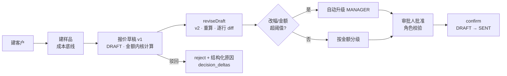

# Track A · 内核与审批（报价全链路 + 定价继承）

> 版本：v1.0 ｜ 日期：2026-11-12 ｜ 对应 issue：WAN-83
> 依赖：T0 契约（`packages/schema` / `packages/db` / 内核与网关骨架）

本文说明 Track A 落地的内核业务逻辑、审批链路、定价继承与新增合同。契约代码仍是唯一事实来源：

- Zod：`packages/schema/src/{pricing,quote-revision,approval,revisions,kernel}.ts`
- 物理表：`packages/db/src/schema/{pricing,decision-deltas,quotes,revisions}.ts`
- 内核：`apps/api/src/kernel/*`
- 审批：`apps/api/src/approval/*`

## 1. 已交付范围

| 能力        | 内核方法                               | 说明                                                   |
| ----------- | -------------------------------------- | ------------------------------------------------------ |
| 客户 / 样品 | `customers.create` / `samples.create`  | T0 已有；样品新增 `category`，用于定价 CATEGORY 作用域 |
| 报价草稿    | `quotes.generateDraft`                 | DRAFT、版本 v1、金额整数分、逐行出处                   |
| 报价改稿    | `quotes.reviseDraft`                   | 乐观锁版本 +1、重算、同事务审计 / 改稿 / 决策增量      |
| 报价确认    | `quotes.confirmDraft`                  | HUMAN + 角色阈值校验，DRAFT → SENT                     |
| 报价驳回    | `quotes.rejectDraft`                   | HUMAN，结构化原因写决策增量                            |
| 审批视图    | `quotes.getApprovalView`               | 原稿 vs 当前版本逐行 diff + 每个数字的出处             |
| 寄样        | `shipments.createDraft/confirm/reject` | T0 已有                                                |
| 订单        | `orders.create/confirm`                | DRAFT → CONFIRMED；复用同一价格底线规则                |
| 应收        | `receivables.create/recordPayment`     | 部分收款累加，超额拒绝                                 |
| 定价继承    | `pricing.create/update/list/resolve`   | 系统 → 公司 → 团队/客户/品类 → 个人 + 管控夹取         |
| 改稿原因    | `revisions.list/create/ensureDefaults` | 价格 / 交期 / 规格 / 客户要求 / 其他                   |

## 2. 报价全链路



### 2.1 改稿（`reviseDraft`）

- 仅 HUMAN 可执行；AGENT 调用返回 `PERMISSION_DENIED`（G10：AI 只产出 Patch）。
- 入参必须带 `baseVersion`；与账本不一致返回 `KERNEL_REJECTED / VERSION_CONFLICT`。
- 版本 +1，行金额 / 总额由内核重算；单价仍受「样品成本底线 + 公司成本底线 + 最低毛利」约束。
- 同一事务写入：
  - `audit_log`：`REVISION_REQUESTED`、`QUOTE_DRAFT_REVISED`、必要时 `QUOTE_APPROVAL_ESCALATED`
  - `revision_requests`（status=APPROVED，记录来源 / 指令 / patch / 原因 / 操作人）
  - `draft_revisions`（version、before/after/patch/provenance，可回放）
  - `decision_deltas`（每个改价行一条，含原值 / 新值 / actor / reason）
  - `customer_contexts.decision_deltas` 最近 50 条同步更新

### 2.2 确认（`confirmDraft`）

- 仅 HUMAN；`ctx.actor.role` 必须不低于单据要求。生产环境缺角色直接拒绝（fail-closed），
  仅非生产环境为兼容 demo / 旧测试回退 OWNER。
- 可选 `baseVersion`：审批人看到哪一版就确认哪一版，防止覆盖并发修改。
- 同事务写 `QUOTE_CONFIRMED` 审计，记录 version / 总额 / 所需角色 / 改幅。

### 2.3 驳回（`rejectDraft`）

- 仅 HUMAN；可选 `reasonId`（`revision_reasons`），原因写入决策增量。
- 同事务写 `QUOTE_REJECTED` 审计 + `decision_deltas(field=quote_status)`。

## 3. 审批阈值与自动升级

阈值来自 `pricing_policies`，默认值对齐 product-design §7.4：

| 键                                  | 默认                   | 语义                     |
| ----------------------------------- | ---------------------- | ------------------------ |
| `approval.sales.limit`              | 5,000,000 分（5 万）   | 业务员审批上限           |
| `approval.manager.limit`            | 20,000,000 分（20 万） | 主管审批上限；超出升老板 |
| `approval.owner.limit`              | null                   | 老板上限；null = 无上限  |
| `pricing.reprice_escalation_pct`    | 5%                     | 改幅超过即升级主管       |
| `pricing.reprice_escalation_amount` | 1,000,000 分           | 改幅金额超过即升级主管   |

- 金额与改幅分别判定，**取较高审批层级**。
- 升级原因封闭集合：`AMOUNT_OVER_LIMIT` / `REPRICE_PCT_EXCEEDED` / `REPRICE_AMOUNT_EXCEEDED` / `COST_FLOOR_POLICY` / `MANUAL_ESCALATION`。
- 审批卡（`ApprovalItem`）直接携带 `requiredRole` / `escalated` / `changePctBps` / `diff` / `requirement.policySources`。

## 4. 定价继承与管控夹取

继承顺序：`SYSTEM(0) → COMPANY(1) → TEAM/CATEGORY/CUSTOMER(2) → PERSON(3)`。

- 同层冲突按 `priority` 升序、创建时间、ID 决定最终值（越具体越优先）。
- `locked = true` 的管控键形成硬边界：
  - `pricing.min_margin_pct` / `pricing.cost_floor_amount`：只允许**抬高**（MIN）
  - `approval.*`：只允许**压低**（MAX）
- 下级策略试图放宽时被夹回，`ResolvedPricingValue.clamped = true`，`source` 指向真正生效的管控策略。
- 夹取保留原始值形态：对象值（如 `{ marginPct: 20, unit: "percent" }`）只改数值字段，
  不会降级成裸数字而丢失单位。
- 任何解析结果都同时返回生效值、来源、完整继承链，审批卡上的数字可以点开看来源。

```ts
const resolved = await kernel.pricing.resolve("pricing.min_margin_pct", {
  customerId,
  categoryId: "cotton",
  personId: salesId,
});
// { value, source: { policyId, scopeType, locked }, clamped, chain }
```

### 4.1 价格下限

一行单价的下限 = `max(样品成本底线, 公司成本底线)`，再应用最低毛利：

```
floor = ceil(base × (1 + minMarginPct / 100))
```

低于底线返回 `KERNEL_REJECTED / PRICE_BELOW_COST_FLOOR`，LLM 无法绕过。

## 5. HTTP 面（Track C/D/E 联调）

| 方法     | 路径                                                | 说明                                           |
| -------- | --------------------------------------------------- | ---------------------------------------------- |
| POST     | `/api/quotes/revise`                                | 人类改稿，返回 `ReviseQuoteDraftResult`        |
| GET      | `/api/quotes/:id`                                   | 草稿视图（含版本 / 审批要求）                  |
| GET      | `/api/quotes/:id/approval-view`                     | 审批卡详情：逐行 diff + 出处 + 版本历史        |
| GET      | `/api/pricing/policies?limit=&cursor=`              | 策略列表（有界游标分页，按 scope 过滤）        |
| POST     | `/api/pricing/policies`                             | 新建策略（审计 + 变更日志）                    |
| PATCH    | `/api/pricing/policies/:id`                         | 更新策略                                       |
| GET      | `/api/pricing/resolve?key=...`                      | 生效值 + 来源                                  |
| GET      | `/api/approvals?limit=&cursor=`                     | 审批队列（有界游标分页，只含 DRAFT）           |
| POST     | `/api/approvals/decide`                             | 批准 / 驳回（支持 `baseVersion` / `reasonId`） |
| GET      | `/api/customers/:id/decision-deltas`                | 决策增量历史（训练信号）                       |
| GET/POST | `/api/revision-reasons`                             | 改稿原因字典                                   |
| POST     | `/api/revision-reasons/defaults`                    | 幂等补齐默认原因                               |
| GET/POST | `/api/orders`、`/api/orders/:id/confirm`            | 订单草稿 / 确认                                |
| GET/POST | `/api/receivables`、`/api/receivables/:id/payments` | 应收 / 收款                                    |

> 人类写接口（改稿 / 审批 / 定价 / 订单 / 应收 / 改稿原因）统一走
> `HumanActorService`：`Authorization: Bearer <token>` → Casdoor/Casdoor-dev 校验 →
> 本地 membership → `KernelContext.actor.role`，并用该 membership 的租户会话执行
> （RLS 生效）。生产环境缺 Bearer 令牌直接 401；仅非 production 且无令牌时回退
> `DEV_HUMAN_CONTEXT`（OWNER，默认租户，供 demo/旧测试）。

## 6. 新增数据表 / 列

| 表                                                                                                                                                        | 用途                                       |
| --------------------------------------------------------------------------------------------------------------------------------------------------------- | ------------------------------------------ |
| `pricing_policies`                                                                                                                                        | 定价继承链 + 审批阈值；`locked` 表管控     |
| `policy_change_log`                                                                                                                                       | 策略变更历史（只追加）                     |
| `decision_deltas`                                                                                                                                         | 完整训练信号（改价 / 驳回 / 原因 / actor） |
| `quotes.version / baseline_snapshot / pending_diff / required_approval_role / approval_escalated / escalation_reasons / change_pct_bps / last_revised_at` | 版本、原稿快照、审批升级状态               |
| `quote_items.provenance`                                                                                                                                  | 每个数字的出处                             |
| `samples.category`                                                                                                                                        | 定价 CATEGORY 作用域                       |

新表全部纳入 `packages/db/sql/rls.sql` 的 `tenant_id` RLS 策略与 `weave_app` 授权。

## 7. 验收与测试

```bash
pnpm db:migrate
pnpm typecheck
pnpm lint
pnpm test
```

常驻用例：

- `apps/api/test/track-a.integration.test.ts`：定价夹取、草稿 → 改价 → 升级 → 低层级拒绝 → 主管批准 → confirm、驳回决策增量、订单/应收、新表跨租户 RLS。
- `apps/api/test/track-a.e2e.test.ts`：真实 HTTP 走完改稿 / 审批卡 / 定价解析 / 带版本批准。
- `apps/api/test/approval-policy.test.ts`：金额分级与改幅升级纯函数。
- `packages/schema/test/track-a-contracts.test.ts`：新契约的 strict 校验与向后兼容。

## 8. 列表分页与审计角色快照（WAN-103）

### 8.1 审批队列 / 策略列表

- `GET /api/approvals`：游标分页，默认 50 条/页、上限 100。响应增加
  `nextCursor`（null 表示最后一页）与 `hasMore`。DRAFT 过滤下推到 SQL，
  因此不会出现「取前 100 条再过滤」导致的审批饥饿；前端队列页用
  「加载更多」逐页加载，第 101 条起同样可达。
- 审批卡详情按 `id` 精确读取，不再从队列第一页里找。
- `GET /api/pricing/policies`：游标分页，默认 50 条/页、上限 200。
  人员可见范围（PERSON / TEAM）与分页在同一条 SQL 中完成——先过滤再分页，
  翻页条数稳定。
- 游标是不透明的 base64url JSON，只承载排序键（`createdAt+id` 或
  `rank+priority+id`）；格式非法返回 `INVALID_INPUT`，不会静默跳回第一页。

### 8.2 审计角色快照

- `audit_log.actor_role` 由迁移 `0007_young_sprite` 引入，`appendAudit`
  在写入时记录 `ctx.actor.role`（角色快照，非外键）。
- **历史行**：该迁移之前写入的审计行 `actor_role IS NULL`，表示
  「升级前未采集角色」。系统不做猜测性回填（当时的角色已不可考），
  读取模型保持 `null`，前端按「未知」展示即可。
