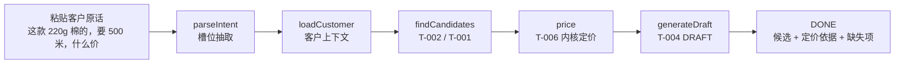

# Track B · 找样 / 报价智能体 + OpenAI 兼容企业网关

> 版本：v1.1 ｜ 日期：2026-11-18 ｜ 对应 issue：WAN-84
> 依赖：T0 冻结契约（`packages/schema`、`packages/db`、`apps/api/{kernel,tools}`）

## 1. 验收路径



| 环节   | 产出                                                            | 铁律                                   |
| ------ | --------------------------------------------------------------- | -------------------------------------- |
| 槽位   | 成分 / 克重 / 数量 / 询价意图 / 交付日期                        | LLM 只抽槽位，数字单位由确定性代码归一 |
| 找样   | 最多 10 个候选，按相关度排序；每个候选带 `matchedOn` + 可读理由 | 理由来自确定性命中的字段，不让 LLM 编  |
| 定价   | 策略链解析的成本底线 + 默认毛利 + 整元取整，逐项带来源          | 金额由内核计算（`computedBy: KERNEL`） |
| 草稿   | `QuoteDraft.status = DRAFT`                                     | 智能体永不确认；确认只在审批窗口       |
| 缺失项 | `CUSTOMER / QUANTITY / SAMPLE / PRICE` 为阻断项                 | 缺什么列什么，不猜客户、不猜数量       |

## 2. 合同与代码位置

| 层    | 文件                                                   | 说明                                                                                      |
| ----- | ------------------------------------------------------ | ----------------------------------------------------------------------------------------- |
| 契约  | `packages/schema/src/quoting.ts`                       | `QuoteRequestInput` / `QuoteAgentResult` / `QuoteSampleCandidate` / `QuotingStage`        |
| 契约  | `packages/schema/src/llm.ts`                           | `LlmSettings` / `ResolvedLlmSettings` / `TokenUsage` / `UsageMonthly` / `LlmBudgetStatus` |
| 契约  | `packages/schema/src/tools/t006-suggest-line-price.ts` | T-006 定价依据                                                                            |
| 数据  | `packages/db/src/schema/llm.ts`                        | `llm_settings` / `token_usage` / `usage_monthly`                                          |
| 内核  | `apps/api/src/kernel/pricing.service.ts`               | Track A 的定价继承 / 管控夹取（默认毛利、成本底线）                                       |
| 内核  | `apps/api/src/kernel/quote-pricing.service.ts`         | T-006 报价场景换算：策略值 → 成本底线 + 默认毛利 + 整元取整                               |
| 内核  | `apps/api/src/kernel/llm-settings.service.ts`          | 全局 + 租户覆盖解析、租户配置写入 + 审计                                                  |
| 内核  | `apps/api/src/kernel/usage.service.ts`                 | `request_id` 幂等记账 + 月度汇总 + 预算状态                                               |
| 工具  | `apps/api/src/tools/suggest-line-price.tool.ts`        | T-006，只调 `kernel.quotePricing`                                                         |
| 平台  | `apps/api/src/platform/llm.ts`                         | `LlmProvider` 接口 + 本地规则实现 + `OpenAiCompatibleProvider`                             |
| 平台  | `apps/api/src/platform/privacy.ts`                     | 手机号 / 邮箱 / 银行账号出网前脱敏                                                        |
| agent | `apps/api/src/agent/quoting-graph.ts`                  | LangGraph 状态机 + 只调 tools                                                             |
| 入口  | `POST /api/agents/quote`、`pnpm demo:quote`            | 粘贴原话的 HTTP / 脚本入口                                                                |

## 3. 架构约束

1. **agent 只调 tools**：`apps/api/src/agent` 由 ESLint 禁止 import `kernel` / `drizzle` / `@weave-order/db`。定价、找样、草稿全部经 `Tools`。
2. **不直连上游厂商**：所有模型请求只发往 `${LLM_BASE_URL}/chat/completions`，使用 OpenAI 兼容协议；网关地址与令牌都来自部署配置。
3. **Key 引用白名单**：`llm_settings.key_ref` 只接受 `LLM_API_KEY` / `LLM_TENANT_KEY_<名称>`；运行时解析后放进 `Authorization: Bearer` 头，数据库与日志不落明文。
4. **模型白名单 + 预算**：调用前检查 `model_allowlist` 与 `daily_token_budget` / `monthly_token_budget`；超限直接拒绝，不发外网请求。
5. **模型路由**：日常任务用 `LLM_DEFAULT_MODEL`；`QUOTE_DRAFT` 以及超过 1200 字符的 `QUOTE_INTENT` 用 `LLM_REASONING_MODEL`；截图识别用 `LLM_VISION_MODEL`。三者都必须在白名单内。
6. **脱敏**：手机号 / 邮箱 / 银行账号在出网前替换为保形掩码；成本底线、客户名单、合同价不进入 prompt。
7. **prompt 不落原文**：`token_usage.prompt_hash` 只存 SHA-256；`log_prompts` 默认 false。
8. **草稿即默认**：agent 的最终产物只能是 `DRAFT` / `NEEDS_INPUT` / `FAILED`。
9. **生产 fail closed**：`LLM_PROVIDER=openai-compatible` 时缺 `LLM_BASE_URL`、缺有效 `LLM_API_KEY`、占位 key 或 keyRef 未命中都拒绝启动（与 T0 的 `APP_DATABASE_URL` 同一口径）；`local-rule` 不因缺网关凭据阻断开发。

## 4. token 计量

```
OpenAI 兼容网关 response.usage
  └─ token_usage(request_id UNIQUE, tenant_id, task, model, prompt/completion/cached, prompt_hash)
       └─ usage_monthly(tenant_id, period=YYYY-MM-01, model, task)  # 每次调用即时累加
```

- `request_id` 在调用前生成并随 `x-request-id` 下发；写入用 `ON CONFLICT DO NOTHING`，重试/重放不重复计量。
- `usage_monthly` 是月度聚合，**每日调用即时累加**，用于成本看板与预算判断；不向客户收费。
- 预算判断用 `token_usage` 的当日/当月求和，超限时 provider 抛错，agent 落 `FAILED`（不伪造答案）。

## 5. 如何切到真实模型

```bash
# 1. 在部署配置（或本地 .env）填写通用网关配置
LLM_PROVIDER=openai-compatible
LLM_BASE_URL=https://<企业网关>/v1
LLM_API_KEY=<网关令牌>
LLM_DEFAULT_MODEL=<网关上的日常模型 ID>
LLM_REASONING_MODEL=<网关上的复杂任务模型 ID>
LLM_VISION_MODEL=<网关上的视觉模型 ID>
LLM_MODEL_ALLOWLIST=<上述三个模型 ID 的逗号分隔列表>

# 2. 切换 provider（本地默认 local-rule，零 key）
LLM_PROVIDER=openai-compatible pnpm demo:quote

# 3. 多租户：在 llm_settings 写租户覆盖（owner/人类操作，写审计）
#    key_ref = LLM_TENANT_KEY_T_0001 之类的受控环境变量名
```

网关侧的令牌创建与预算由平台运维完成；本仓库只保存引用并做调用前的白名单/预算兜底。换网关或换模型只改上述环境变量，不改 Provider 代码。

## 6. 本地验收

```bash
pnpm db:migrate
pnpm demo:quote    # 原话 → 槽位 → 3 候选 + 理由 → 定价依据 → DRAFT + 缺失项 + 计量
pnpm test          # 含 quote-agent / llm-openai-compatible / quote.integration
```

无数据库时集成测试自动跳过；`llm-openai-compatible.test.ts` 用注入的 `fetchImpl` 验证：
只请求配置的企业网关地址、Bearer Key、`x-request-id`、脱敏、usage 幂等写入、白名单与预算拦截。
