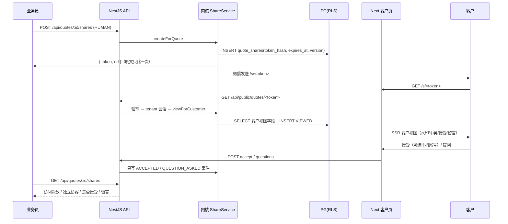

# Track E · 客户报价链接页（E3）落地说明

> 目标：客户无登录打开 `/s/[token]` 可看、可问、可接受；业务员看到访问数据；
> 接受 ≠ 合同；绝不泄露成本/毛利/内部备注/其他客户。

## 1. 交付物

| 层        | 位置                                          | 说明                                                                                                        |
| --------- | --------------------------------------------- | ----------------------------------------------------------------------------------------------------------- |
| 契约      | `packages/schema/src/shares.ts`               | 在 T0 冻结的 `QuoteShare` / `CustomerQuoteView` 之上补页面读取模型、接受/提问输入输出、访问统计、链接错误码 |
| 表        | `packages/db/src/schema/shares.ts`（T0 已有） | `quote_shares` 只存 `token_hash`；`quote_share_events` 存访问/接受/提问/撤回事件，IP/UA 只存哈希            |
| 内核      | `apps/api/src/kernel/shares.service.ts`       | 生成/撤回/客户视图/接受/提问/PDF 事件/访问统计；唯一写分享表的地方                                          |
| Token     | `apps/api/src/kernel/share-token.ts`          | HMAC-SHA256 签名 + 随机 nonce；`sha256(token)` 落库                                                         |
| 公开入口  | `apps/api/src/shares/public-share.service.ts` | 验签 → 取 tenantId → `withTenantSession` 打开 RLS 会话 → 内核                                               |
| HTTP      | `apps/api/src/http/shares.controllers.ts`     | 公开路由 + 业务员分享路由                                                                                   |
| 客户页    | `apps/quote`（Next.js 15）                    | `/s/[token]` SSR、中/英、水印、接受/提问/打印 PDF                                                           |
| 业务员 UI | `apps/web/src/windows/SharePanel.tsx`         | 生成链接、复制/预览、访问次数/独立访客/接受/留言/撤回                                                       |

## 2. 数据流

## 3. 安全约束对照

| 约束                | 落点                                                                                    |
| ------------------- | --------------------------------------------------------------------------------------- |
| 不存明文 token      | 只存 `sha256(token)`；明文只出现在 `CreatedQuoteShare.token/url`                        |
| 有效期 = 报价有效期 | `expiresAt = quote.expiresAt`；`expiresInDays` 仅旧客户端兼容保留，不参与计算；过期 410 |
| 可撤回              | `revoked_at` + `REVOKED` 事件 + 审计 `QUOTE_SHARE_REVOKED`；撤回后 410                  |
| 只有已批准可分享    | `quote.status === "SENT"`，否则 `KERNEL_REJECTED / QUOTE_NOT_APPROVED`                  |
| 手机尾号验证        | 可选；比对 `customers.contact_phone` 后 4 位；不匹配 400                                |
| 客户名水印          | 页面 + 打印版铺满「客户名 · 报价编号」                                                  |
| 不泄露内部字段      | 客户视图只 SELECT `CustomerQuoteView` 需要的列；测试断言无 cost/margin/remarks          |
| 接受 ≠ 合同         | 只写 `ACCEPTED` 事件；不更新 `quotes`；测试断言状态仍为 `SENT`                          |
| IP 只存哈希         | `hashAnonymous(ip, QUOTE_SHARE_SECRET)`，不存明文                                       |
| 生产密钥 fail-fast  | 生产/OIDC 下 `QUOTE_SHARE_SECRET` 仍是开发默认值即拒绝启动（同 `APP_DATABASE_URL`）     |
| 不写追踪 Cookie     | Next 路由无鉴权 Cookie；返回 `Cache-Control: no-store` + `noindex`                      |
| 跨租户隔离          | token 自带 tenantId；公开路由仍走 `withTenantSession`，不存在 owner 跨租户查询          |
| 不回显 token        | `CustomerQuoteView` 不含原始 token；客户端从 URL 取，避免日志/监控误记明文              |
| 销售名片            | 读 `tenants.settings.salesContact`；只输出脱敏电话与可选微信二维码                      |

## 4. 接口

| 方法 | 路径                                  | 身份                 | 返回                                       |
| ---- | ------------------------------------- | -------------------- | ------------------------------------------ |
| POST | `/api/quotes/:id/shares`              | HUMAN，且报价 `SENT` | `CreatedQuoteShare`（token/url 只此一次）  |
| GET  | `/api/quotes/:id/shares`              | 只读                 | `QuoteShareStatsList`                      |
| POST | `/api/shares/:id/revoke`              | HUMAN                | `QuoteShareStats`                          |
| GET  | `/api/public/quotes/:token`           | 公开                 | `CustomerQuotePage`；`?track=0` 只读不计数 |
| POST | `/api/public/quotes/:token/accept`    | 公开                 | `CustomerAcceptQuoteResult`                |
| POST | `/api/public/quotes/:token/questions` | 公开                 | `CustomerAskQuestionResult`                |
| POST | `/api/public/quotes/:token/pdf`       | 公开，`allow_pdf`    | 204                                        |

错误统一为 `{ ok:false, error:{ code, message } }`：`INVALID_LINK` 404、
`EXPIRED`/`REVOKED` 410、`PHONE_TAIL_REQUIRED`/`PHONE_TAIL_MISMATCH`/`INVALID_INPUT` 400、
`PDF_DISABLED` 403。

## 5. 测试

- `apps/api/test/share-token.test.ts`：签名/篡改/换密钥/随机性/匿名哈希。
- `apps/api/test/share.integration.test.ts`：草稿不可分享、只存哈希、无登录查看、
  手机尾号错误/缺失/正确、重复接受幂等、提问、PDF、独立访客、撤回、过期、篡改 token、
  接受后账本仍 `SENT`。
- `apps/api/test/share.http.e2e.test.ts`：真起 Nest 的 HTTP 状态语义与闭环。
- `apps/quote/src/lib.test.ts`：金额/数量/日期/中英文案/有效期比例。

## 6. 与 Track A 的衔接

- 当前实现：业务员在批准后**显式**点「生成报价链接」。这样明文 token 能在生成响应里
  当场展示给业务员；若在 `confirm` 里静默生成，按「只存哈希」原则，token 将无人可见。
- Track A 合入 `quotes.version` 后，分享的 `version` 自动取该字段；本分支已做兼容回退。
- 若后续要求「confirm 即生成」，建议在 `confirm` 返回值里扩展一次性 `shareToken` 字段，
  或前端在批准成功后自动调用一次 `POST /api/quotes/:id/shares`（当前 UI 即按此路径设计）。

## 7. 已知边界 / 后续

1. PDF 是浏览器打印（另存为 PDF），服务端记录下载事件；后续可接 Playwright/puppeteer 渲染同款页面成 PDF。
2. 销售名片当前是租户级配置（`tenants.settings.salesContact`）；后续可升级为 per-membership 资料并从 Casdoor 同步。
3. 条款文本读 `tenants.settings.quoteTerms`，尚未做租户设置页（可先用种子/后台写入）。
4. ISR 未启用：浏览计数与接受状态必须实时，使用 `force-dynamic`；静态资源仍可走 CDN。
5. 分享渠道记录（微信/二维码/邮件）与「旧链接显示已更新」尚未实现。
