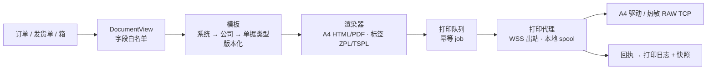

# Track G · 打印中心 + 打印代理（E5）

> 目标：把「一单发货 → 扫码拣货 → 一键打箱唛×N + 发货单 → 扫码复核」做成仓库每天可重复的流水线。

## 1. 分层

铁律：

- 模板只能写 `{{path}}` 与 `{{#lines}}`/`{{#boxes}}` 循环，变量必须命中后端白名单；未知变量在**发布时**和**渲染时**都失败。
- 金额、数量、批次只来自 `DocumentView`（内核只读视图），模板不能查库、不能写表达式。
- `idempotency_key = sha256(单据 + 模板版本 + 份数 + 操作人 [+ 箱唛标签序号])`，唯一索引去重；重复点击不重复出纸。
- 每次打印写 `document_snapshots`（不可变视图）+ `print_job_events`（回执流水）+ `audit_log`。
- 一箱一码 `tenant/order/box/seq`，不含价格；重打 seq+1，旧标签 `voided_at`，旧码立即失效。
- 扫码复核累计数量 ≠ 箱内应有量 → 箱标记差异，打印/发货入口变「先核对差异」。

## 2. 数据表

| 表                                            | 作用                                           |
| --------------------------------------------- | ---------------------------------------------- |
| `print_templates` / `print_template_versions` | 三层模板 + 追加式版本                          |
| `print_agents` / `printers`                   | 代理 token 哈希、打印机 profile、校准参数      |
| `print_jobs` / `print_job_events`             | 队列、幂等键、载荷、每次回执                   |
| `document_snapshots`                          | 打印时的只读视图，事后可还原                   |
| `order_boxes` / `order_box_items`             | 箱号、箱内明细                                 |
| `box_labels`                                  | 标签版本（ACTIVE/VOIDED + voided_at + reason） |
| `scan_events`                                 | 拣货 / 复核流水，不一致也留痕                  |

## 3. 接口

人工（Bearer + 租户会话）：

| 方法     | 路径                                       | 说明                                       |
| -------- | ------------------------------------------ | ------------------------------------------ |
| GET      | `/api/print/center`                        | 抽屉首屏聚合（队列/模板/设备/记录/待发货） |
| POST     | `/api/print/jobs`                          | 单张打印（幂等）                           |
| POST     | `/api/print/jobs/bundle`                   | 一单发货：拣货单 + 箱唛×N + 发货单         |
| POST     | `/api/print/jobs/:id/cancel` `/retry`      | 取消 / 重试                                |
| GET/POST | `/api/print/templates`                     | 列表 / 发布公司模板                        |
| POST     | `/api/print/templates/:id/versions`        | 发布新版本                                 |
| GET/POST | `/api/print/devices` · `/agents`           | 设备 / 注册代理（明文 token 只返回一次）   |
| POST     | `/api/orders/:id/shipments`                | 建发货单                                   |
| POST     | `/api/shipments/:id/boxes`                 | 建箱（默认均分实发明细）                   |
| POST     | `/api/shipments/:id/pick-scan`             | 拣货扫描                                   |
| POST     | `/api/shipments/:id/verify-scan`           | 装箱复核（不一致即锁打印）                 |
| POST     | `/api/print/boxes/:id/reprint`             | 补打（必须选原因）                         |
| POST     | `/api/print/boxes/:id/void`                | 作废箱与标签                               |
| POST     | `/api/print/boxes/:id/resolve-discrepancy` | 人工核对后恢复                             |
| POST     | `/api/shipments/:id/ship`                  | 确认发货                                   |

代理（token scope=print，中间件拒绝任何业务路由）：

| 方法 | 路径                         | 说明                                      |
| ---- | ---------------------------- | ----------------------------------------- |
| WSS  | `/api/print/agent/ws`        | hello / wake / claim / result / heartbeat |
| POST | `/api/print/agent/claim`     | 领任务（`FOR UPDATE SKIP LOCKED`）        |
| POST | `/api/print/agent/result`    | 回执 DONE/FAILED                          |
| POST | `/api/print/agent/heartbeat` | 在线 + 打印机上报                         |
| GET  | `/api/print/agent/me`        | 自身状态（不含业务数据）                  |

## 4. 渲染策略

- A4：内置 HTML 模板（预览/浏览器打印）；PDF 默认由 `pdf-lib` 内置 A4 版式生成，**不需要安装浏览器**（中文字体内置，分页表格）。
- **自定义 HTML 模板的精确 PDF 需要 Chromium**：只有为「公司覆盖 / 单据类型覆盖」的 HTML 模板做像素级还原时，才在打印服务所在机器安装 Chromium/Chrome，并显式设置 `PRINT_CHROME_PATH`。未设置时自定义 HTML 只用于预览/浏览器打印，服务端 PDF 仍走内置版式（内容正确，但不是模板的像素级还原）。
- 字体：内置 `DroidSansFallbackFull.ttf`（Apache-2.0，约 4MB）保证离线中文 PDF；可用 `PRINT_CJK_FONT_PATH` 指向外部 TTF/OTF 覆盖，生产可通过挂载字体目录把大字体移出镜像层。
- 标签：ZPL / TSPL 纯文本模板；二维码、箱号均由指令生成，不依赖打印机内置条码能力。中文标签需要打印机装载 CJK 字体（ZPL 用 `^CI28` + 字体包；TSPL 用 `TSS24.BF2`）。

## 5. 验收映射

| 验收点                      | 实现                                                      | 测试                                   |
| --------------------------- | --------------------------------------------------------- | -------------------------------------- |
| 一单发货全套打印            | `enqueueBundle`                                           | `print.integration.test.ts`            |
| 扫码拣货 / 复核拦截         | `pickScan` / `verifyScan` + `hasDiscrepancy`              | 同上 + `print.e2e.test.ts`             |
| 箱唛数量不一致 → 先核对差异 | `printBlockedReason` → 400 `PRINT_DISCREPANCY_UNRESOLVED` | 同上                                   |
| 补打选原因 / 旧标签作废     | `reprintBox` + `box_labels.voided_at`                     | 集成测试                               |
| 幂等不重复出纸              | 唯一索引 + 去重返回                                       | 集成 + e2e                             |
| 代理 token 只打印           | scope 中间件 + 无业务路由                                 | e2e                                    |
| 离线补打 / 状态回传         | 本地 SQLite spool + 回执重传                              | 代理代码（需 Rust 环境 `cargo check`） |
